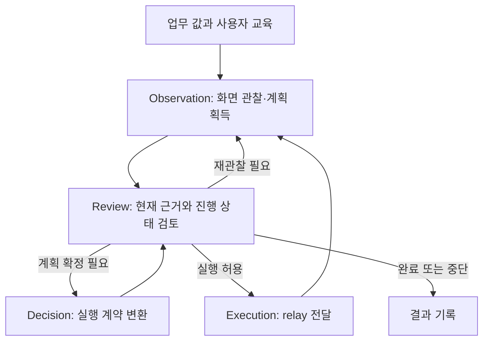
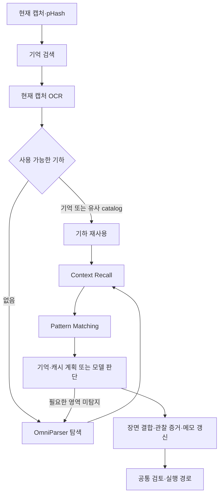

# Agent Sawon

사용자가 알려 준 업무 절차와 문서의 값을 바탕으로 Windows ERP 화면을 조작하는 Python 에이전트입니다.
현재 실행 프로필은 **화면 캡처·OCR·시각 탐지 기반 `visual_only`**입니다. 모델이 화면의 의미와
다음 행동을 판단하고, 코드는 문맥·증거·기억을 관리하며 계획을 실제 입력으로 변환합니다.

이 저장소는 core입니다. 옆의 `agent-sawon-bench`는 relay, Mock ERP, 공개 계약,
실행 하네스와 독립 채점을 제공합니다. 화면 작업자는 ERP DB나 채점 정답을 읽지 않습니다.

> 구현·테스트 대조 기준: 2026-10-23, core `38020db`, bench `1bdeba4`.
> 무료 테스트 통과와 오프라인 기록 재생은 실제 프로그램 전체의 호환성·성공률을 보장하지 않습니다.

## 입력과 결과

| 입력 | 역할 | 정의 |
|---|---|---|
| 업무 값 | 입력할 실제 값. `ShipmentRecord` 또는 수동 `TaskInputRecord.inputs` | 공개 `sawon_interfaces`, [task_instruction.py](brain/task_instruction.py) |
| 사용자 교육 `--task` | 목표, 식별 입력 키, 완료 조건, 단계별 버튼·입력 설명 | `TaskInstruction`, [교육 예제](examples/shipment-user-taught-task.json) |
| 현재 화면 | 텍스트, 컨트롤 영역, 입력값과 메시지의 관찰 근거 | [scanning.py](brain/visual/scanning.py) |
| 이번 실행의 메모 | 확인한 값, 남은 입력, 직전 행동, 저장·재조회 진행 상태 | [state.py](brain/graph/state.py), [context_recall.py](brain/graph/context_recall.py) |
| 재사용 기억 | 성공 기록에서 정제한 행동·기하·입력 키 대응 | [memory_compilation.py](brain/demo_learning/memory_compilation.py) |

교육의 의미 이름과 입력 키는 화면 탐지 번호와 구분합니다. 모델 경계의 `ScreenMapping`은
`fields`에 의미 이름·bbox·현재 값을, `assignments`에 의미 이름 → 업무 입력 키를,
`steps`에 행동·대상 이름·모델이 선택한 point를 담습니다. 실행용 숫자 ID는 현재 장면에
연결할 때 만들어지며 지속 업무 키로 사용하지 않습니다.

현재 문서 추출과 주된 ERP 실험은 선적 업무입니다. 수동 임의 키 입력 계약도 지원하지만,
이것이 모든 업무·ERP의 검증 완료를 뜻하지는 않습니다. 다른 회사 화면에는 그 회사의 교육을
연결해야 하며 기본 예제 파일을 그대로 적용한 결과와 구분해야 합니다.

결과는 case의 `result.json`과 `run_log.jsonl`에 남습니다. 작업자의 성공 시 case 상태는
`AWAITING_APPROVAL`이 됩니다. **행동 전달 성공, 작업자 정상 종료, bench의 ERP 저장 채점,
기억 재현 판정은 서로 다른 결과**입니다. 저장 버튼 클릭만으로 업무 완료를 선언하지 않습니다.

## 실제 실행 순서

### 책임 그래프

LangGraph는 네 노드를 사용합니다. 다음 노드는 `WorkerState.lifecycle.route`로 정합니다.
아래는 대표 경로이며, 모든 실행이 고정된 선형 순서를 밟는 것은 아닙니다.



- **Observation**: 새 화면을 관찰합니다. 직전 전달 행동이 있으면 `_verify_node`가 그 효과도
  확인합니다. 현재 `screen_matching=true`에서는 모델의 화면 판단이 이 노드 안에서 이미 일어납니다.
- **Decision**: 현재 관찰에서 얻은 계획을 재사용하고 실행 계약으로 변환합니다. 계획이 없거나
  재판단이 필요하면 공통 화면 판단 경로로 들어갑니다. 매번 새 모델 호출을 하는 노드는 아닙니다.
- **Review**: 완료 근거와 실행 상태에 따라 실행·추가 판단·종료를 결정합니다. 그래프의 Review
  노드와 `completion_review` 같은 모델 호출 purpose는 동일한 개념이 아닙니다.
- **Execution**: `ExecutionRequest`를 실행하고 `ExecutionResult`를 기록합니다. 실제 화면의
  결과는 다음 관찰에서 확인합니다.

구현: [workflow.py](brain/graph/workflow.py), [engine.py](brain/graph/engine.py),
[실행 계약](brain/graph/execution.py).

### 한 화면을 처리하는 내부 흐름



| 개념 | 현재 책임 | 주요 함수 |
|---|---|---|
| 화면 유사도 | pHash와 viewport 등으로 기하 재사용 후보 탐색 | `ScreenScanner.scan` |
| Memory Retrieval | 같은 교육·목표의 기억에서 필드 기하와 절차 인출 | `retrieve_screen_memory` |
| Scanning | 현재 캡처에서 OCR과 조작 후보 bbox 확보 | `_build_catalog`, `_resolve` |
| Context Recall | 이번 실행의 메모·남은 입력·교육·이력을 요청 문맥으로 구성. 모델 호출이나 상태 변경 없음 | `recall_context` |
| Pattern Matching | 인출된 방법을 현재 진행 상태에 결합 | `match_screen_pattern` |
| 화면 판단 | 메서드 → 화면 캐시 → 기존 해석에 대한 계획 → 일반 화면 모델 순으로 선택·보완 | `select_screen_response`, `decide_screen` |

새 `scan()`은 같은 화면이어도 **OCR을 다시 수행**합니다. 재사용하는 것은 주로 기하와 해석이며,
과거 문자열을 현재 값의 증거로 복사하지 않습니다. 같은 관찰 안에서 재판단하는 `rematch()`나
보완 탐색은 이미 확보한 캡처·OCR을 사용할 수 있습니다.

기억이 불충분하면 `needs_refinement`로 같은 캡처의 탐지를 보완하고 공통 판단 경로로 돌아갑니다.
교육 상세 조회, 빈 행동 보완, 잘못된 계획의 재계획도 이 경로가 담당합니다. 따라서 기억 인출에
성공해도 모델 호출이 반드시 0회가 되는 것은 아닙니다.

기본 기억 매칭의 pHash 최대 거리는 설정상 6입니다. 실행 직전 대상 재결합에는 별도 조건이
있으므로 모든 화면 검사에 같은 임계값이 쓰인다고 해석하면 안 됩니다. pHash 일치는 값 일치나
업무 완료의 증거가 아닙니다.

## 상태와 결합 규칙

`WorkerState`가 실행 상태를 소유합니다. `Brain`의 상태 접근자는 이 저장소를 읽고 쓰며
독립 복사본을 동기화하는 구조가 아닙니다.

| 상태 | 의미 |
|---|---|
| `verified` | 현재 실행에서 확인한 입력과 그 대상 descriptor |
| `post_save_verified` | 저장 후 상세 검토에서 확인한 입력 키 |
| `evidence_ledger` | 의미상 입력 영역의 소유권·대체·무효화 이력 |
| `pending` | 전달한 행동과 다음 관찰에서 확인할 효과 |

확인된 값은 후속 화면에서 보이지 않는다는 이유만으로 전부 지우지 않습니다. 현재 보이는 값이
달라졌거나 기존 증거를 대체해야 할 때 갱신합니다. 메모를 쌓았다는 사실과 ERP에 저장됐다는
사실은 구분합니다. 기억을 인출한 것만으로 `verified`를 채우지도 않습니다.

최근 정리로 확정한 경계는 다음과 같습니다.

- `ScreenMatch.from_plan`: 새 계획의 필드가 기존 해석보다 우선합니다. 전체 `ScreenMatch`가
  반환되면 새 controls·화면 종류도 우선하며, 직렬화에서 제외되는 `mapping`은 명시적으로 연결합니다.
- 직전 이동이 무진행이어도 현재 관찰에서 얻은 유효한 대안 계획은 Review에 전달합니다.
  실패 이력과 중단 한도는 유지합니다.
- 저장 결과가 `ready_for_query`인 단일 `click + confirm_save`는 실행용 `navigate`로 변환합니다.
  모델 원문·대상·좌표는 보존하고 변환을 기록합니다. `confirmation_required`는 그대로입니다.
- 대상·증거 보완 전후의 sanitize는 입력이 달라질 수 있어 유지합니다. 현재 `observe_only`는
  모든 파싱·실행 계약 검증을 없애는 설정이 아닙니다.

소유 파일과 변경 시 확인할 생산자·소비자는 [계약 지도](docs/contracts.md)에 정리되어 있습니다.

## 기억 편찬과 재사용

`read_memory_candidates`는 성공 실행의 기록에서 실제 전달 행동과 관찰을 연결합니다.
`assemble_memory`가 모델로 후보를 정제하고, `compile_memory`가 그룹·순서·좌표·입력 슬롯·
화면 anchor 등을 기억으로 구성합니다. 현재 설정은 `compiled_only=true`이므로 원본 모델 trace를
그대로 실행 가능한 기억으로 취급하지 않습니다.

탐색과 재사용은 매 화면의 경로입니다. 콜드·웜은 bench가 초기 캐시·기억 조건을 달리한 실험
구분이며, 한 실행 안에서도 기억 재사용과 모델 탐색이 섞일 수 있습니다. 모델 없는 완전 재현과
ERP 저장 성공은 별도로 측정합니다. bench의 현재 재현 판정은 `harness/reproduction_v2.py`에 있습니다.

## 설치와 실행 진입점

Python **3.13 이상**, 개발 명령은 PowerShell 기준입니다. 두 저장소를 나란히 둡니다.

```text
workspace/
  agent-sawon/
  agent-sawon-bench/
```

```powershell
.\scripts\setup.ps1
```

이 스크립트는 양쪽 프로젝트와 공개 인터페이스를 editable 설치합니다. Windows GUI 의존성은
`-Gui` 옵션으로 추가합니다. GPU OCR·탐지 환경과 모델 가중치는 별도 준비해야 합니다.
[시각 환경 안내](brain/visual/README.md)를 확인하고 아래 로컬 경로를 자신의 환경에 맞춥니다.

| 설정 | 체크인된 현재 값 |
|---|---|
| `config/models.toml` | Anthropic `claude-haiku-5-5`, low, 출력 8192, 요청 제한 120초 |
| `config/brain.visual.toml` | 화면 매칭·모델 의미 판단/검토, observe_only, 최대 80단계, 건별 $3 |
| 같은 파일의 탐지기 설정 | OmniParser v2, CUDA, 입력 크기 640, 별도 Python·가중치 경로 |
| `config/pipeline.toml` | 한국어 PaddleOCR PP-OCRv5, GPU 워커 경로, 문서 추출·교차 검증 설정 |

설정 파일의 값과 `BrainSettings` 기본값은 구분해야 합니다. 프로젝트 전체 누적 상한은 없으며,
파일럿 protocol은 더 낮은 별도 한도를 정할 수 있습니다. 문서→화면 workflow에서는 준비 비용을
포함해 한도를 적용하고, 기억 편찬 CLI는 별도의 명시적 예산을 받습니다.

```powershell
.\.venv\Scripts\python.exe -m brain.run --help
.\.venv\Scripts\python.exe -m pipeline.run --help
.\.venv\Scripts\python.exe -m pipeline.workflow --help
.\.venv\Scripts\python.exe -m brain.demo_learning.memory_compilation --help
```

- `brain.run`: `--record`, `--task`, 새 `--case-dir`, `--relay-url`, `--goal`, 실행·모델 설정으로 화면 작업.
- `pipeline.run`: 문서 추출과 검증. 준비된 추출 결과를 화면에 넘길 때는 `--prepared-case` 인계 검사를 사용.
- `pipeline.workflow`: 문서 manifest → 추출·검증 → 화면 작업을 연결하는 하네스 진입점.
- 기억 편찬: 성공 case와 화면 캐시를 입력으로 사용. 비교 실험에서는 bench의 `harness.compilation`으로 시도·비용을 기록.

실제 ERP 파일럿은 bench에서 실행합니다. 인증된 relay와 올바른 회사 교육, GPU 환경을 먼저
준비해야 합니다. 키는 명시한 `.env`에서 읽으며 현재 Anthropic 키 이름은 `CLAUDE_API_KEY`입니다.
키·업무 문서·원본 화면·비공개 로그·캐시는 커밋하지 않습니다. 기존 case를 덮어쓰지 않습니다.

## 테스트로 확인한 범위

```powershell
.\.venv\Scripts\python.exe -m ruff check .
.\.venv\Scripts\python.exe -m ruff format --check .
.\.venv\Scripts\python.exe -m pytest
.\scripts\check.ps1  # core와 bench를 함께 검사
```

기본 pytest는 GUI 테스트를 제외합니다. 일반 테스트는 fake/replay를 사용하며 실제 API나 ERP를
실행하지 않습니다. 아래 수치는 2026-10-23의 측정 결과이며 고정된 목표 개수가 아닙니다.

| 검증 | 결과와 의미 | 근거 |
|---|---|---|
| core 전체 | 702 passed, Statement 87.8616%, Branch 76.7661% | [최종 정리 보고](docs/test-cleanup/cleanup-final-20261023.md) |
| bench 전체 | 621 passed, 6 GUI deselected | 같은 보고서 |
| 현재 OCR·기하 재사용 | 유사 화면에서도 fresh OCR, 기억 부족 시 재탐색 | [test_visual_markers.py](tests/test_visual_markers.py), [test_memory_retrieval.py](tests/test_memory_retrieval.py) |
| 문맥·메모 전달 | 실제 공통 함수 연결 및 메모 갱신 무력화 탐지 | [test_observation_path_equivalence.py](tests/test_observation_path_equivalence.py) |
| 해석·계획 결합 | 2경로 × 2응답 형태. mapping 유실·우선순위 반전 변이 탐지 | [test_plan_composition.py](tests/test_plan_composition.py) |
| 저장 완료창·대안 계획 | 정상화 범위와 계획 인계 회귀 | [test_screen_decision.py](tests/test_screen_decision.py), [test_click_refinement.py](tests/test_click_refinement.py) |
| 089 전체 오프라인 그래프 | 모델 요청 19회·행동 29건 일치, 88노드 실행 후 정상 종료 | [재생 보고](docs/test-cleanup/graph-replay-20261023.md) |

README 작성 시 아래 관련 테스트를 다시 실행해 **91 passed, 16.94초**를 확인했습니다.
위 전체 테스트·coverage 수치는 기존 측정 기록이며 이번 문서 수정에서 재측정하지 않았습니다.

```powershell
.\.venv\Scripts\python.exe -m pytest tests/test_plan_composition.py tests/test_observation_path_equivalence.py tests/test_memory_retrieval.py tests/test_visual_markers.py -q
```

089 재생은 기록 응답으로 실제 그래프·상태 갱신을 실행한 결과입니다. 새 모델 응답이나 실제
화면 입력을 검증한 것이 아니며, 실행 직전 관찰 21건은 기록 정보를 조합한 envelope입니다.
088은 과거 결함을 합성 재주입했을 때 원래 실패까지 재현됩니다. 현재 코드가 그 실패 지점을
넘은 이후의 화면 결과는 과거 기록만으로 검증할 수 없습니다. 086은 OCR 기록이 빠져 전체 재생이
미완료이며 그 구간에 의존하는 광범위 상태 통합은 보류되어 있습니다.

## 코드와 문서 안내

| 위치 | 책임 |
|---|---|
| `brain/graph/` | 책임 그래프, 상태, 화면 판단·실행·증거 검토 |
| `brain/visual/`, `brain/observe/` | OCR·기하·장면 결합과 관찰 값 처리 |
| `brain/cache/`, `brain/demo_learning/` | 화면 캐시, 기억 저장·편찬 |
| `models/` | 공급자 어댑터와 공용 호출·비용·지연 계측 |
| `pipeline/` | 문서 처리와 검증된 입력 인계 |
| `sawon_runtime/` | 로그·상태 저장, 공용 시각 자료형, 지속 워커 |
| `tests/` | 합성 회귀, 계약 검증, 오프라인 재생 도구 |

현재 기준은 [런타임 설정](docs/current-runtime.md), [상태·인터페이스 계약](docs/contracts.md),
[실행 흐름](docs/code-flow.md), [화면 처리 용어](docs/runtime-terminology.md)입니다.
[문서 인덱스](docs/README.md)의 과거 보고서는 당시 관찰 기록으로 읽습니다.
UIA 캐시, Florence-2 의미 설명, detector 번호를 지속 업무 키로 쓰는 방식,
입력 직전 픽셀 완전일치 거절은 현재 경로의 설명이 아닙니다.
