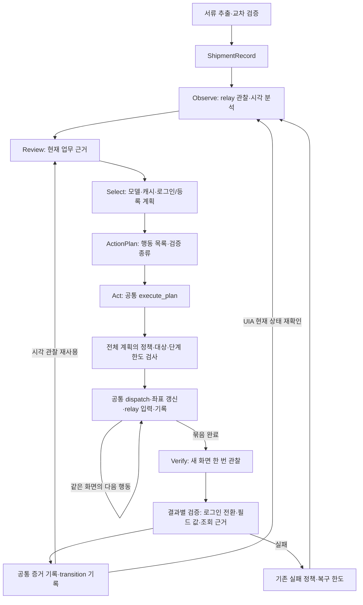
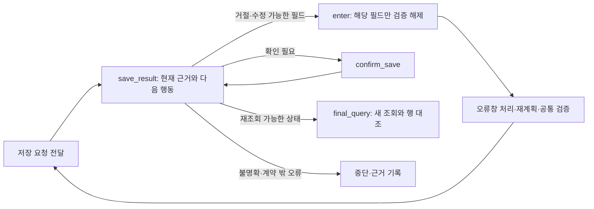
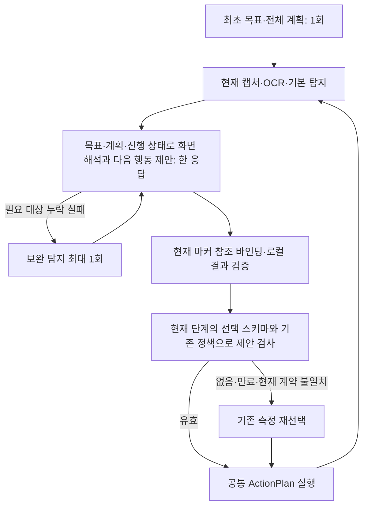

# 실행 전 아키텍처 점검 · 2026-09-30

사용자 요청: 전체 구조를 점검하고 각 부분의 핵심 로직을 재사용하도록 정리한다.
이번 작업은 코드 구조와 재생 검증이며 유료 호출·실제 화면 실행을 재개하지 않는다.

## 점검 결과와 이번 수정

| 부분 | 확인한 문제/상태 | 반영 |
|---|---|---|
| 행동 선택/실행 | 등록 묶음은 select 안에서 실행·재관찰까지 수행하고 로그인은 별도 실행 루프를 사용 | 선택은 ActionPlan만 준비하고 모든 경로가 act → verify를 사용 |
| 실행 제어 | 로그인/등록에 단계 수 계산, 사전 검사, 반복 dispatch, 실패 시 중단이 중복 | execution.execute_plan 한 곳에서 전체 계획 검사·순서·한도·중단 관리 |
| 검증 기록 | 묶음의 중간 pending을 지워 전달된 행동의 transition 근거가 사라짐 | PlanExecution에 전달된 행동 보존, 부분 실패도 unchecked로 기록, 실제 대조한 값만 사실 기록 |
| 입력 증거 | 단일 입력·모델 제출 근거·묶음 입력이 각각 verified와 progress를 변경 | _record_verified_field로 값 대조·증거 기록을 공통화 |
| 대상 재탐색 | 조회/자격 증명/단일·묶음 검증에 의미 설명자 비교가 반복 | observe.evidence.matching_elements 공통 사용 |
| 값 비교 | 범용 비교가 graph.engine에 들어 있어 다른 모듈이 엔진을 역참조 | observe.values로 분리. 기존 engine import는 호환 재수출 |
| 비용 | 두뇌가 이미지 비용 계산을 위해 서류 추출 모듈을 import, 비용 합산도 별도 구현 | models.budget.ImageCallBudget와 models.accounting으로 이동해 두뇌/시각 기록/서류에서 공유 |
| 공개 계약 의존성 | 실제 인터페이스0.4.0을 사용하지만 코어/벤치 설치 제약과 editable 메타데이터는0.3대에 남음 | 양쪽 pyproject의 sawon-interfaces 범위를 >=0.4,<0.5로 정합화 |
| 모델/저장소 | ModelClient, append-only RunLog, atomic StateStore가 이미 공통 경계 | 재사용 유지 |
| 캐시/시연 | 현재 관찰의 Decision을 제안하고 동일 정책·실행·검증 사용 | 단일 ActionPlan으로 같은 executor 사용. 묶음 자체의 캐시 학습은 아직 지원하지 않음 |
| OCR/탐지 | 공통 worker 실행기를 사용하지만 각 작업마다 모델을 로드 | 지속 worker 개선은 별도 성능 작업으로 남김 |

## 현재 공통 실행 구조

`screen_batch`는 모델 응답을 공통 계획으로 변환하고, 필드 묶음의 결과를 해석한다.
직접 relay 입력을 보내거나 전체 인식을 시작하지 않는다. `execution`은 계획의 입력 순서와
전달 기록을 관리한다. `engine`은 그래프·업무 단계·관찰과 검증의 연결을 담당한다.
로그인/등록/조회는 결과의 의미가 다르므로 하나의 성공 조건으로 합치지 않는다.

시각 단일 행동도 검증 장면을 다음 판단에 재사용한다. UIA는 다음 선택 전의 저비용 관찰을
유지한다. 기존 관찰 후 조회값 변경을 검출하는 동작까지 무조건 생략하면 안 되므로,
관찰 방식에 필요한 최신성 차이는 유지한다. 두 경로의 행동 실행기는 동일하다.

텍스트/이미지 비용 예약과 비용 합산은 모델 계층의 공통 기능이다. 모델 계층은 두뇌나
서류 처리 구현을 import하지 않으며 공개 이벤트와 이미지 크기 프로토콜만 받는다.
서류의 단위 변환·증빙 대조와 UI 값 비교는 의미가 달라 별도로 유지한다.

## 후속 수정 · 입력 영역과 저장 결과

- `observe.evidence.is_record_input`을 공통 기준으로 사용한다. 현재의 평면 ShipmentRecord
  필드는 form의 edit/combobox이며, table/list/row 내부의 반복 품목 칸은 대응 대상이 아니다.
  단일/묶음 실행, 검증 사실 기록, 캐시/시연 후보가 같은 기준을 사용한다. 이름·좌표로 판정하지 않는다.
  일반 레코드를 표 형태로 편집하는 다른 앱까지 지원한다는 의미는 아니다. 그런 앱에는
  레코드/반복행 소속을 구분하는 별도 계약 확장이 필요하다.
- 저장 클릭 전달은 `save_result` 단계로만 전환한다. 다음 선택 응답 SaveReviewResponse에서
  현재 화면 근거 ref와 결과, 다음 행동을 함께 받는다. 별도 결과 분류 API 호출을 추가하지 않는다.
  거절이면 enter로 돌아가 지적된 필드의 검증만 해제하고 오류창 처리 후 다시 계획한다.
  확인창이면 confirm_save를 실행하고 save_result에서 결과를 다시 판단한다.
  ready_for_query만 final_query로 전환하며 이것은 저장 성공 확정이 아니다.
  최종 성공은 기존의 새 조회·같은 행 전체 값 증거로만 판정한다.
- 현재 계약으로 고칠 수 없는 반복 품목 오류는 임의 품목 값을 만들지 않고 중단한다.
  알 수 없는 저장 결과/오래된 근거도 성공 또는 재조회 단계로 넘어가지 않는다.
  결과와 지적 필드의 의미 해석은 모델의 판단이므로 실제 모델에서의 정확성 검증은 남는다.
- 저장된 실제013 관찰 재생: 잘못 선택한 표 셀2개는 거절, 정상 등록 입력6개는 허용했다.
  새 모델 호출·화면 행동 없이 확인한 구조 검증이며 실제 전체 업무 성공률은 아니다.
- OCR/탐지 worker 재로딩은 별도 성능 작업으로 남는다. 다음 단계는 변경된 결과 응답을 포함한
  제한된 실제 파일럿이다. 이 수정 작업에서 화면 실행을 재개하지는 않았다.

## 검증 범위

기존 단일/캐시/시연/서류 연결 테스트에 로그인·등록 묶음의 공통 그래프 경계를 적용했다.
선택 단계의 무입력, 전체 계획 한도 선검사, 중간 창/위치 변경 중단, 부분 전달 감사,
필드별 실제 검증 사실, 로그인 성공/실패와 비밀번호 비노출을 확인한다.
최종 검사 결과는 벤치 `docs/progress.md`에 기록한다. 실제 화면/유료 모델 측정은 이번에 하지 않는다.

이전 공통화 검증: 코어654개 통과, 벤치561개 통과/GUI6개 제외. 양쪽 ruff check/format,
pip check 통과. 실행 중인 화면 파일럿은 없으며 신규 모델 비용0이다.

후속 입력 영역·저장 결과 수정 검증: 코어661개 통과(523.08초), 벤치561개 통과/GUI6개 제외(34.29초).
양쪽 ruff check/format 통과. 새 화면 실행과 유료 모델 호출은 없으며 실측 성공은 미확인이다.

## 화면 판단과 계획 연결 · 2026-09-30

실제014의 화면당 27–36초 병목 분석 후 기본 흐름을 다음과 같이 변경했다.

- `VisualTurn`은 화면 의미와 로그인/등록 묶음/저장 결과/단일 행동의 제안을 함께 반환한다.
  기존 단일/묶음 실행기와 완료 검증을 그대로 사용하며 제안 자체가 업무 완료 증거는 아니다.
  새 관찰만 대상으로 `m<marker-id>`를 로컬 ref에 바인딩한다. OCR 정적 텍스트는
  `ocr_evidence_refs`로 증거만 참조하며 입력칸으로 승격하지 않는다.
- 최초 계획을 다시 생성하지 않는다. 목표·계획·phase·검증 필드·남은 필드·진행 중 입력·실패 피드백을
  화면 모델에 전달한다. 반환한 제안은 입력 결과 검증 뒤 현재 정책으로 다시 검사한다.
  정상 제안을 재사용하면 기존 화면 해석+선택 2호출이 1호출이다. 재선택이 필요한 경우는 기록한다.
- 보완 탐지는 미대응 정적 OCR만으로 실행하지 않는다. 기본 화면 판단이 현재 업무에 필요한
  제어 영역 누락을 보고했을 때만 최대1회 실행한다. 실패한 화면 제안은 실행하지 않는다.
  후보 비교에 pixel_rectangle도 포함하며 보완 후에도 누락이면 중단한다.
- 단일 행동/묶음 첫 행동에서 내용·창 정체성·이미지 크기·DPI/스케일이 같고 origin만 바뀌면
  새 캡처의 원점과 ID에 기존 이미지 상대 좌표를 연결한다. OCR/모델을 다시 부르지 않는다.
  내용/크기/DPI 변경과 묶음 중간의 위치 변경에는 기존 재관찰/중단 조건을 유지한다.
- 실제014 로그인 재시도는5.16+8.46+9.51+3.85≈27초의 전체 루프 반복이었다.
  원점 변경은(1609,806)→(1166,668)이었으며 이동 주체는 미확정이다.
  이 변경은 이동만으로 발생한 반복을 없앤다. 진짜 화면 변경 시 OCR/YOLO 프로세스의
  재시작·가중치 재로딩 비용은 남는다. 상주 worker와 성능 개선 폭은 별도 구현/측정 대상이다.
- 검증은 fake/replay만 사용한다. 사용자 중단 이후 신규 유료 호출·ERP 조작은 없다.

검사 결과: 코어669개 통과, 벤치561개 통과/GUI6개 제외, 양쪽 Ruff 통과.
보완 탐지와 모델 호출 계측은 분리했으며 기본/보완 마커 이미지를 각각 보존한다.
마지막 계측·이미지 보존 변경 후 관련27개 테스트를 재검사했다. 실제 성능 측정은 남아 있다.

## 로컬 OCR·탐지 모델 수명 관리 · 2026-09-30

`PersistentWorker`와 stdlib 전용 `worker_server`를 OCR/탐지가 공유한다.
요청은 입력 파일 경로를 전달하고 결과는 요청별 파일을 원자적으로 교체해 받는다.
모델 라이브러리의 stdout/stderr는 프로토콜과 분리한다. 화면 캐시가 아니라 모델 인스턴스를
유지하는 구조이며 이미지가 바뀔 때마다 새 추론 결과를 얻는다.

- OCR worker의 OcrSession은 설정이 같으면 PaddleOCR 인스턴스를 재사용한다.
  YOLO worker의 DetectorSession은 같은 weights에서 기본/보완 탐지를 함께 처리한다.
- 실패 요청은 같은 요청을 몰래 재시도하지 않는다. 해당 프로세스/소유 자식을 종료하고
  다음 요청 때 새 프로세스/모델로 시작한다. timeout도 같은 공통 정리를 사용한다.
- Brain.run의 finally, 시각 기록 CLI의 finally, 서류 준비의 자체 소유 OCR 정리에서 close한다.
  외부 주입 OCR은 서류 호출자가 소유한다. 정상 인터프리터 종료에도 atexit으로 정리한다.
  강제 종료는 부모 harness의 소유 프로세스 트리 종료가 담당한다.
- 첫 요청/재사용별 PID·model_initialized·model_init_ms·inference_ms·round_trip_ms를 기록한다.
  공개 wire 계약, 모델 측정 래퍼, 유료 예산, 화면 좌표 바인딩은 변경하지 않았다.
- 저장된 로그인/메뉴 이미지만 사용한 로컬 진단001: OCR7.01→6.53초, 기본 탐지4.74→0.91초.
  이미지가 다르므로 동일 작업 속도 향상률로 계산하지 않는다. 각 worker의 PID는 동일하며
  두 번째 요청의 초기화 시간은0이다.
- 진단002는 로그인→메뉴→로그인→메뉴 순서로 같은 worker를 유지했다. 동일 로그인의
  OCR6.59→4.14초, 탐지5.00→1.19초를 관찰했다. 메뉴 OCR은8.13/8.59초로 여전히 느리다.
  002 측정에는 회귀 테스트가 일부 동시에 실행됐고 전용 성능 환경/반복 평균이 아니므로
  보장된 가속률로 보고하지 않는다. 핵심 검증은 전환 뒤 동일 PID/초기화0/이미지별 새 결과다.
- 비공개 근거: cases/worker-reuse-20260930-001 및002의 measurement.json/run_log.jsonl.
  모델 API0회·ERP 행동0회이며 확인 비용/미확정 호출 이력은 변동 없다.
