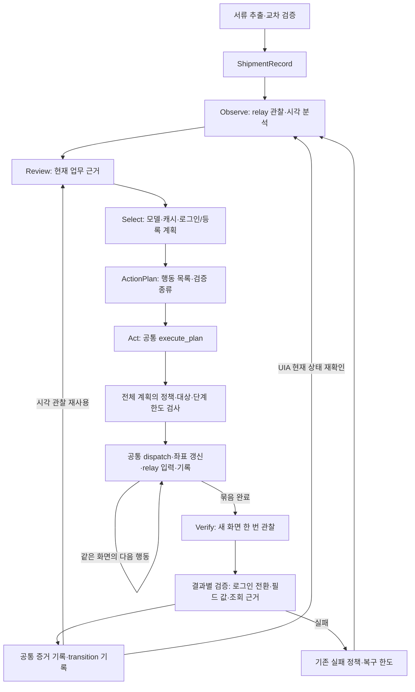

# 실행 전 아키텍처 점검 · 2026-09-30

사용자 요청: 전체 구조를 점검하고 각 부분의 핵심 로직을 재사용하도록 정리한다.
이번 작업은 코드 구조와 재생 검증이며 유료 호출·실제 화면 실행을 재개하지 않는다.

## 점검 결과와 이번 수정

| 부분 | 확인한 문제/상태 | 반영 |
|---|---|---|
| 행동 선택/실행 | 등록 묶음은 select 안에서 실행·재관찰까지 수행하고 로그인은 별도 실행 루프를 사용 | 선택은 ActionPlan만 준비하고 모든 경로가 act → verify를 사용 |
| 실행 제어 | 로그인/등록에 단계 수 계산, 사전 검사, 반복 dispatch, 실패 시 중단이 중복 | execution.execute_plan 한 곳에서 전체 계획 검사·순서·한도·중단 관리 |
| 검증 기록 | 묶음의 중간 pending을 지워 전달된 행동의 transition 근거가 사라짐 | PlanExecution에 전달된 행동 보존, 부분 실패도 unchecked로 기록, 실제 대조한 값만 사실 기록 |
| 입력 증거 | 단일 입력·모델 제출 근거·묶음 입력이 각각 verified와 progress를 변경 | _record_verified_field로 값 대조·증거 기록을 공통화 |
| 대상 재탐색 | 조회/자격 증명/단일·묶음 검증에 의미 설명자 비교가 반복 | observe.evidence.matching_elements 공통 사용 |
| 값 비교 | 범용 비교가 graph.engine에 들어 있어 다른 모듈이 엔진을 역참조 | observe.values로 분리. 기존 engine import는 호환 재수출 |
| 비용 | 두뇌가 이미지 비용 계산을 위해 서류 추출 모듈을 import, 비용 합산도 별도 구현 | models.budget.ImageCallBudget와 models.accounting으로 이동해 두뇌/시각 기록/서류에서 공유 |
| 공개 계약 의존성 | 실제 인터페이스0.4.0을 사용하지만 코어/벤치 설치 제약과 editable 메타데이터는0.3대에 남음 | 양쪽 pyproject의 sawon-interfaces 범위를 >=0.4,<0.5로 정합화 |
| 모델/저장소 | ModelClient, append-only RunLog, atomic StateStore가 이미 공통 경계 | 재사용 유지 |
| 캐시/시연 | 현재 관찰의 Decision을 제안하고 동일 정책·실행·검증 사용 | 단일 ActionPlan으로 같은 executor 사용. 묶음 자체의 캐시 학습은 아직 지원하지 않음 |
| OCR/탐지 | 공통 worker 실행기를 사용하지만 각 작업마다 모델을 로드 | 지속 worker 개선은 별도 성능 작업으로 남김 |

## 현재 공통 실행 구조

`screen_batch`는 모델 응답을 공통 계획으로 변환하고, 필드 묶음의 결과를 해석한다.
직접 relay 입력을 보내거나 전체 인식을 시작하지 않는다. `execution`은 계획의 입력 순서와
전달 기록을 관리한다. `engine`은 그래프·업무 단계·관찰과 검증의 연결을 담당한다.
로그인/등록/조회는 결과의 의미가 다르므로 하나의 성공 조건으로 합치지 않는다.

시각 단일 행동도 검증 장면을 다음 판단에 재사용한다. UIA는 다음 선택 전의 저비용 관찰을
유지한다. 기존 관찰 후 조회값 변경을 검출하는 동작까지 무조건 생략하면 안 되므로,
관찰 방식에 필요한 최신성 차이는 유지한다. 두 경로의 행동 실행기는 동일하다.

텍스트/이미지 비용 예약과 비용 합산은 모델 계층의 공통 기능이다. 모델 계층은 두뇌나
서류 처리 구현을 import하지 않으며 공개 이벤트와 이미지 크기 프로토콜만 받는다.
서류의 단위 변환·증빙 대조와 UI 값 비교는 의미가 달라 별도로 유지한다.

## 다음 실행 전에 남은 기능 문제

1. **입력 영역 구분:** 실제013의 description/gross_weight_kg가 선택 품목 표에 대응됐다.
   공통 실행기로 옮긴 것만으로 의미 매핑이 정확해지지는 않는다. 관찰의 영역/행 맥락과
   레코드 필드의 소속을 대응시키는 계획 단계에서 수정해야 한다. ERP 라벨/좌표를 하드코딩하지 않는다.
2. **저장 요청과 결과:** 현재 save 전달 시 final_query로 전환한다. 실제013의 저장 거절 뒤
   모델이 저장됐다고 해석했다. 저장 결과를 공통 효과 검증에서 분류하고, 명시적 거절은 수정 단계로
   되돌리는 별도 상태 계약이 필요하다. 이번 구조 정리는 이 문제를 해결했다고 주장하지 않는다.
3. **인식 지연:** OCR/탐지 worker 재로딩은 남는다. 실행 루프 재사용과 worker 수명은 다른 문제다.

위 문제의 재생 검증을 먼저 추가·통과시킨 뒤 제한된 실제 파일럿을 진행한다.
종전013을 성공으로 바꾸거나 마일스톤 종료로 간주하지 않는다.

## 검증 범위

기존 단일/캐시/시연/서류 연결 테스트에 로그인·등록 묶음의 공통 그래프 경계를 적용했다.
선택 단계의 무입력, 전체 계획 한도 선검사, 중간 창/위치 변경 중단, 부분 전달 감사,
필드별 실제 검증 사실, 로그인 성공/실패와 비밀번호 비노출을 확인한다.
최종 검사 결과는 벤치 `docs/progress.md`에 기록한다. 실제 화면/유료 모델 측정은 이번에 하지 않는다.

최종 검증: 코어654개 통과, 벤치561개 통과/GUI6개 제외. 양쪽 ruff check/format,
pip check 통과. 실행 중인 화면 파일럿은 없으며 신규 모델 비용0이다.
