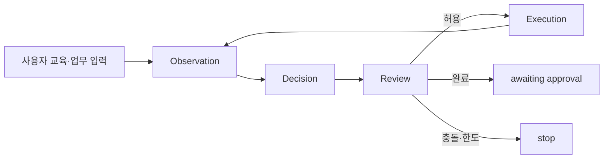

# 일반 ERP 업무 런타임 계약

최초 작성 2026-10-03, 현재 계약 반영 2026-10-08.

기본 화면 작업자는 선적 전용 클릭 순서를 코드에 넣지 않는다. 사용자의 업무 설명과 입력,
현재 화면 근거, 실행 상태를 같은 작업자 그래프가 해석한다. 사용자가 실제 프로그램 절차를
가르친 경우에는 그 순서와 UI 명칭을 `TaskInstruction.procedure`에 업무 지식으로 보존한다.
모델은 교육과 현재 화면을 함께 해석하고, 코드는 현재 근거에 연결된 공통 행동만 실행한다.

## 런타임 입력

- `TaskInstruction`: 업무 이름, 목표, 요구사항, 완료 조건, 제약과 선택적인 사용자 교육 절차.
- `TaskInputRecord`: 이번 건에서 사용할 이름 있는 입력 값.
- 현재 관찰: 허용된 창에서 얻은 OCR, 시각 컨트롤, 의미 역할, 값과 현재 이미지 좌표.
- `WorkerState`: 관찰, 제안, 실행 대기, 검토, 검증된 입력, 탐색·증거·방법 이력과 한도.

화면 작업은 `--task` 또는 `task_path`로만 시작한다. 구형 `--procedure`,
`procedure_path`, 별도 Procedure 로더는 삭제됐다. 예제는 절차가 없는
`examples/shipment-task.json`과 사용자 교육을 포함한
`examples/shipment-user-taught-task.json`이다. 예제 내용은 공통 실행기 분기를 정의하지 않는다.

## 표준 용어

- `inputs`: 사용자가 제공한 업무 데이터의 키-값 맵.
- `input key`: `inputs`에 실제로 존재하는 정확한 키.
- `source`: 입력 행동이 참조하는 input key. 로그인만 `credential.*`를 사용한다.
- `field`: 현재 화면에서 읽은 값 증거를 input key에 연결할 때 사용하는 키.
- `fill`: 조회칸, 필터와 일반 입력칸을 포함한 텍스트 입력 행동.
- `capability`: 현재 업무의 입력 범위, 허용 행동, 목표와 완료 조건을 담은 단일
  `ActionCapability`. 프롬프트에 복수 후보 목록을 보내지 않는다.
- `available_inputs`, `remaining_inputs`, `verified_inputs`: 전체 입력과 현재까지의
  미확인·확인 상태.

모델은 `source`와 `evidence.field`에 정확한 input key를 반환한다. 과거 응답의
`record.<key>`, `inputs.<key>`, 값 자체 표기는 화면 매칭 입구의
`resolve_input_key`에서만 호환 변환한다. 이후 정책, 실행, 검토와 캐시는 정확한 키만 받는다.
클릭 행동의 설명성 source는 데이터 바인딩으로 취급하지 않는다.

`TaskInstruction.procedure`는 현재 사용자 교육이다. 응답과 캐시의
`procedure_step="task-action"`은 직렬화 호환 필드다. 과거 선적 상태 기계의
`record`, `remaining_fields`, `query_input` phase와 같은 개념을 일반 task 모델 상태에
다시 넣지 않는다. non-screen-matching 정책에 남은 같은 이름의 상태는 별도 호환 경로다.

## 공통 실행 흐름

모델은 로그인, 입력, 조회·선택, 화면 이동, 저장, 취소, 대기, 완료 확인 같은 공통 행동 중
현재 목표를 진전시키는 행동을 고른다. 코드는 특정 업무 순서를 새로 만들지 않고 다음을 검사한다.

- 행동과 evidence가 현재 관찰의 마커에 연결되는가.
- 입력 source가 현재 업무 데이터 또는 허용된 credential인가.
- 현재 좌표, 허용 창, 비용과 반복 한도를 만족하는가.
- 실행 뒤 새 관찰이 전달 효과와 완료 조건의 근거를 제공하는가.

현재 시각 프로필의 `visual_model_led_semantics`와 `visual_model_only_review`에서는 모델이
업무 의미를 판단한다. 코드는 과거 UIA 행 규칙으로 다시 판정하지 않지만, 안전·출처·현재 대상
검사는 유지한다. relay 전달 성공만으로 입력 정확성, 저장 또는 전체 완료를 인정하지 않는다.

## 재사용

화면 캐시는 현재 화면과 업무 상태에 묶인 `ScreenMatch`를 저장한다. 업무 방법은 성공한 실제
입력 묶음에서 목적, 입력 슬롯, 화면 상대 의미와 선행 관계를 학습한다. 둘 다 과거 절대 좌표,
marker ref, 업무 값이나 자격증명을 다음 실행의 대상으로 저장하지 않는다.

재사용할 때는 같은 사용자 교육 SHA-256인지 확인하고 새 입력과 현재 OCR·컨트롤에 다시 결합한다.
후보가 하나일 때만 로컬 계획을 만들며, 없거나 여러 개이면 Luna 판단으로 돌아간다. 전달된
행동은 성공 증거가 아니며 전체 실행이 성공한 뒤에만 후보를 승격한다. 모델이 보완한 변형도
같은 검토와 성공 조건을 거친다.

## 현재 검증 범위

2026-10-03 seed17의 제한 콜드·웜 파일럿은 저장 후 재조회 10/10 대조를 완료했고 입력 계획
시간이 13.294초에서 0.487초로 줄었다. 이는 한 ERP와 한 교육의 과거 측정이며 범용 호환
증거가 아니다. 당시 상세는
[사용자 교육 절차의 모델 선례·재사용 레시피](taught-procedure-runtime-20261003.md)와
[방법 복구 계획](experience-runtime-repair-plan-20261003.md)에 보존한다.

이후 task 전용 경로, 상태 소유권, 공통 실행 계약과 단일 capability를 정리했다. 현재 회귀
기준은 677개 테스트 통과이며 실제 화면 성공을 대신하지 않는다. 가장 최근 OmniParser v2/640
실행은 값 10/10 저장·재조회 상세 화면까지 도달했지만 열린 탭 반복 선택으로 stopped였다.
서로 다른 회사·ERP·업무에서 콜드 실행과 교육 해시별 웜 재사용을 연속 측정하는 작업은 남아 있다.
