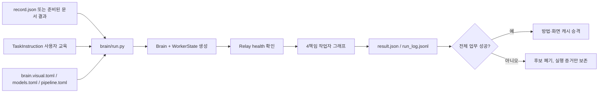
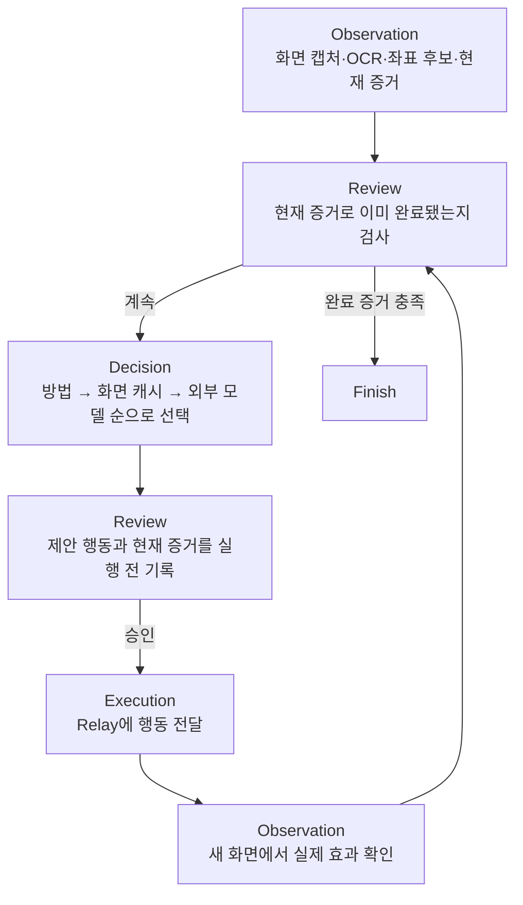

# 작업자 런타임 전체 로직 점검 (2026-10-11)

## 결론

현재 작업자는 **현재 화면을 로컬 시각 인식으로 구조화하고, 검증된 과거 행동을 현재 좌표에
다시 결합하며, 캐시로 해결할 수 없을 때만 외부 의미 모델을 호출하는 구조**다. 콜드 실행은
화면마다 의미를 판단하면서 성공 경로를 학습하고, 웜 실행은 그 경로를 현재 OCR·OmniParser
결과에 재바인딩한다.

이 구조는 동일한 사용자 교육 계약과 동일한 파일럿 업무에서는 실제로 작동했다. 최종 웜 실행
030은 ERP 10/10, 저장 행 1, 중복 0, 비인가 전송 0으로 끝났고 외부 Haiku 호출은 0회였다.
다만 다른 입력값, 다른 회사 화면, 다른 업무 종류까지 일반화되었다는 증거는 아직 없다.

## 한 문장으로 설명하면

사람이 작성한 업무 설명은 **무엇을 달성할지** 알려주고, OCR·OmniParser는 **현재 화면에서
무엇을 어디서 조작할 수 있는지** 알려주며, 콜드 모델은 둘을 연결한다. 성공한 연결은 좌표가
아닌 의미·상대 위치·입력 슬롯으로 저장되어 다음 실행에 재사용된다.

## 전체 진입 흐름

`brain/run.py`가 레코드, 설정, 사용자 교육 파일, Relay, OCR 엔진, 모델 클라이언트를 조립한다.
화면 매칭 모드의 계획 단계는 별도 모델을 호출하지 않고 사용자 교육의 목표·요건·완료 조건을
그대로 작업 계획으로 등록한다.

## 실제 반복 순서

공식 책임은 Observation, Decision, Review, Execution 네 가지다. 실제 라우팅은 Review가 두
개의 문턱을 맡기 때문에 다음처럼 돈다.

### 1. Observation

1. Relay에서 활성 창과 화면 캡처 정보를 받는다.
2. visual-only 모드에서는 전체 데스크톱이 아니라 허용된 현재 창 캡처를 저장한다.
3. PaddleOCR이 텍스트와 텍스트 좌표를 읽는다.
4. OmniParser v2가 버튼·입력면 등 조작 후보의 사각형을 찾는다.
5. 두 결과를 번호가 있는 marker 목록으로 합친다.
6. 동일 이미지 SHA가 이미 관찰되었다면 OCR과 탐지를 생략한다.
7. 현재 marker와 사용자 교육을 방법 캐시 또는 화면 판단 캐시에 결합한다. 둘 다 실패하면
   외부 모델이 marker의 의미와 다음 행동을 JSON으로 반환한다.
8. 결과는 `SceneObservation`으로 저장되고 후속 노드는 이 불변 관찰을 사용한다.

OmniParser는 업무 의미를 결정하는 주체가 아니다. 좌표 후보를 만들고, OCR은 텍스트와 값을
제공한다. “이 입력칸이 hbl_no인가”와 “이 버튼을 눌러야 하는가”의 연결은 학습된 방법 또는
외부 의미 모델이 담당한다.

### 2. Decision

현재 선택 우선순위는 다음과 같다.

1. 현재 실행에서 이미 만들어 둔 화면 제안
2. 학습된 방법(`MethodRuntime.apply`)
3. 성공 승격된 화면 판단 캐시(`VisualMatchCache.lookup`)
4. 이미 해석된 화면 의미를 이용한 외부 모델 계획
5. 화면 이미지와 전체 작업 문맥을 이용한 외부 모델 판단

로그인 화면과 여러 입력칸은 하나씩 판단하지 않고 같은 화면의 입력을 `ActionPlan`으로 묶는다.
행동 계획은 `Decision`, `LoginScreenPlan`, `ScreenFillPlan`, `SaveReviewResponse` 중 현재 상태에
맞는 계약으로 컴파일된다.

### 3. Review

Review는 모델의 행동을 대신 선택하지 않는다. 다음 두 책임을 가진다.

- 실행 전에 현재 관찰, 제안 행동, 검증 대상을 상태에 기록하고 실행 권한을 연다.
- 실행 후 새 화면에서 값 일치, 화면 변화, 저장 결과, 최종 재조회 증거를 검사한다.

입력 직후 OCR이 값을 놓친 경우에는 그 입력 방법을 즉시 삭제하지 않고 `provisional`로 둔다.
최종 업무 성공으로 모든 값이 다시 확인될 때만 방법을 승격한다. 반대로 클릭 후 화면이 변하지
않으면 그 방법 간선은 현재 실행에서 소비하여 같은 무반응 클릭을 반복하지 않는다.

### 4. Execution

Execution은 판단하지 않는다. 컴파일된 계획을 현재 관찰의 ref와 좌표로 바꾸어 Relay에
전달하고, Relay가 확인한 행동 prefix만 결과로 반환한다.

- 여러 텍스트 입력은 가능한 경우 한 화면 캡처를 기준으로 batch 전송한다.
- 순차 클릭은 앞 행동 뒤에 캡처를 갱신하여 오래된 좌표를 그대로 쓰지 않는다.
- 행동 ID와 반환 ID가 다르거나 Relay가 실패하면 성공으로 기록하지 않는다.
- 다음 Observation이 실제 화면 효과를 판정한다.

## 상태의 소유권

`WorkerState`는 네 책임 사이의 공식 계약이다.

| 상태 | 소유 내용 |
|---|---|
| ObservationState | 현재 관찰, 관찰 순번, 이전 관찰과의 조정 결과 |
| DecisionState | 현재 결정, 다중 행동 계획, 사용자 작업 계획 |
| ExecutionState | 전달 후 검증 대기 중인 행동, 실행 승인 여부 |
| ReviewState | 현재 증거 검토, 결정 검토 대기, 실행 검토 대기 |
| LifecycleState | 현재 route, 업무 phase, step 수 |
| ProgressState | 검증 필드, 저장 여부, 실패·탐색 기록, 최종 증거 등 run-local 사실 |
| MethodState | 이번 실행에서 사용·학습·보류된 방법 간선 |

서비스 객체, API 키, 파일 핸들, 모델 클라이언트는 WorkerState에 넣지 않는다. `Brain`의 속성은
대부분 이 상태를 가리키는 호환 접근자이며 두 번째 상태 복사본을 만들지 않는다.

## 두 캐시가 다른 이유

### 화면 판단 캐시

한 화면의 안정적인 의미 상태와 실행 계약을 해시한다. observation ID, 임시 element ref,
confidence, method runtime 상태처럼 실행마다 변하는 값은 키에서 제외한다. 같은 의미 상태가
다시 나타났을 때 과거의 완성된 `ScreenMatch` 응답을 재사용한다.

### 학습 방법 캐시

화면 해시가 아니라 다음을 저장한다.

- 사용자 교육 파일 해시
- 업무 입력 슬롯과 실제 값 키의 매핑
- 주변 OCR anchor와 대상의 상대 기하
- 행동 종류와 성공한 행동 간선 순서
- 최종 완료 증거를 찾는 대상

따라서 화면 좌표가 조금 달라도 현재 marker에 다시 결합할 수 있다. 다른 회사의 교육 파일은
해시가 다르므로 같은 화면처럼 보여도 방법을 공유하지 않는다.

두 캐시 모두 실행 중에는 후보만 stage한다. **전체 업무가 성공했을 때만** 영구 저장소로
승격한다. 실패 실행의 잘못된 분기가 다음 실행을 오염시키는 것을 막는 핵심 규칙이다.

## 저장 후 완료 판정

현재 파일럿의 성공은 저장 버튼 전달만으로 선언하지 않는다.

1. 저장 행동이 실제 전달되면 `save_issued`를 기록한다.
2. 저장 결과 화면은 일반 행동 계획보다 `SaveReviewResponse`로 먼저 해석한다.
3. 저장 후 식별번호로 다시 조회한 행을 현재 화면에서 확인한다.
4. 같은 레코드의 상세 화면을 열고 기본 정보와 추가 정보의 현재 OCR 값을 누적한다.
5. 식별번호가 연결되고 모든 입력 키가 현재 화면 증거와 일치할 때 즉시 종료한다.

이 조건이 029에서 기본 정보 5개 누락을 잡았고, 030에서는 학습된 입력 타깃을 현재 OCR에
재결합하여 기본 5개와 추가 6개를 모두 확인한 뒤 종료했다.

## 콜드와 웜 실행의 차이

| 항목 | 콜드 실행 018 | 웜 실행 030 |
|---|---:|---:|
| ERP 결과 | 10/10 | 10/10 |
| 작업자 결과 | 성공 | 성공 |
| 실행 시간 | 176.896초 | 26.002초 |
| 외부 Haiku 호출 | 21 | 0 |
| 로컬 OmniParser 호출 | 17 | 15 |
| 알려진 외부 비용 | $0.055006 | $0 |

웜 실행의 15회 `model_call` 로그는 외부 판단 호출이 아니라 로컬 OmniParser v2 탐지다. 따라서
“유료 의미 모델 무호출”은 맞지만 “모델이 전혀 없음”은 아니다.

## 점검 결과

### 의도대로 된 부분

- 코드에 ERP 라벨·좌표·탭 순서를 고정하지 않고 사용자 교육과 현재 화면을 연결한다.
- 관찰, 판단, 실행, 검토의 상태 계약이 분리되어 실행기가 모델이나 `Brain`을 받지 않는다.
- 같은 화면의 입력을 batch로 보내고 화면 경계에서만 다시 관찰한다.
- 방법 캐시는 현재 화면에 다시 바인딩되므로 과거 픽셀 좌표를 그대로 재생하지 않는다.
- 실패 간선은 현재 실행에서 반복하지 않고, 성공한 전체 경로만 영구 승격한다.
- 최종 완료는 현재 화면의 저장 후 증거로 판정한다.

### 아직 남은 문제

| 우선순위 | 문제 | 영향 |
|---|---|---|
| 높음 | `guard_mode = "observe_only"`에서는 설정된 `$3` 비용 상한을 초과해도 로그만 남기고 호출을 계속한다. | 현재 설정의 `max_cost_usd = 3.0`은 실제 hard cap이 아니다. 최신 비용 제한 의도와 불일치한다. |
| 높음 | 일반화 실측이 동일 회사 교육·동일 seed·동일 입력에 머물러 있다. | 다른 값에서 슬롯 재바인딩되는지, 다른 회사/ERP에서 콜드 학습 후 웜 재사용되는지 아직 증명되지 않았다. |
| 중간 | 책임 노드는 분리됐지만 `engine.py` 3,131줄, `matching.py` 2,099줄이다. | 상태 소유권은 좋아졌지만 변경 영향 범위와 검토 비용이 아직 크다. `_selection_call`, `_select_node`, `validate_or_replan`, `build_match_prompt`가 다음 분리 후보다. |
| 중간 | 캐시·방법 판단도 `_select_node` 로그에 `source: "model"`로 기록된다. `model_saved_detail_review` 같은 이름도 실제 증거 출처보다 좁다. | 030처럼 외부 모델 0회인 실행을 로그만 보면 모델 판단으로 오해할 수 있다. |
| 중간 | 기본 `shipment-task.json`은 추상 목표만 포함하고 `procedure`가 없다. | 현재 웜 성공은 별도 회사 교육과 학습 방법에 의존한다. 새 업무의 첫 실행 품질은 교육 파일의 구체성과 외부 모델 판단에 달려 있다. |
| 중간 | 시각 캐시는 안정화했지만 화면 구조가 달라지면 exact cache보다 방법 재바인딩에 의존한다. | 반응형 배치, 숨은 필드, OCR 누락이 큰 경우 외부 모델 fallback이 다시 필요하다. |
| 낮음 | 캐시 승격 실패는 로그만 남기고 업무 성공 결과는 유지한다. | 업무는 성공했지만 다음 웜 실행이 다시 콜드가 될 수 있다. 운영 지표에서 별도 경보가 필요하다. |

## 현재 수준 판단

현재 코드는 **한 ERP 절차를 하드코딩한 매크로 단계는 벗어났다.** 사용자 교육, 현재 화면,
성공한 행동 그래프를 분리하고 현재 좌표에 재결합하는 핵심 구조가 실제 웜 실행에서 확인됐다.

그러나 **범용 GUI 업무 작업자로 완성됐다고 판단할 단계는 아니다.** 지금 증명된 범위는 한 회사
교육 계약의 한 합성 업무다. 다음 검증은 코드를 더 늘리는 작업보다 다음 세 가지가 우선이다.

1. `$3` 상한을 의미 검증 완화와 분리해 항상 강제한다.
2. 같은 회사의 다른 입력값 두 개로 콜드 1회, 웜 1회를 실행해 슬롯·증거 재바인딩을 확인한다.
3. 다른 회사 교육 파일과 화면으로 같은 실험을 반복해 교육 해시 격리와 새 방법 학습을 확인한다.

## 검증

- Ruff lint: 통과
- Ruff format check: 176 files 통과
- pytest: 615 passed in 44.40s
- 파일럿 증거: `agent-sawon-bench/docs/branch-method-cache-pilot-20261011.md`
- 최종 core case: `cases/completion-latch-pilot-20261010/08deb75d13369d0907f8/case-de7e0a095a5d4d04bf0a2f05eee1faa6/case`
