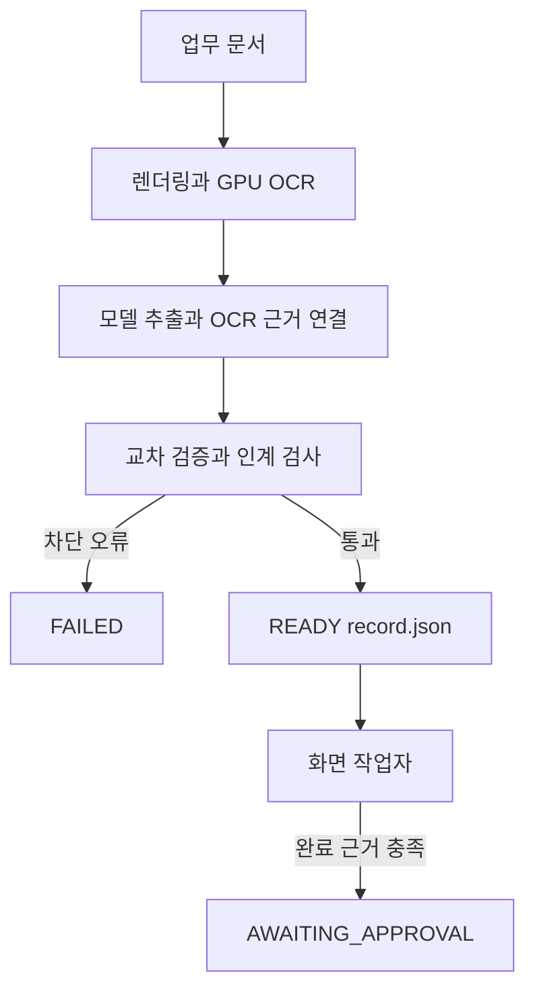
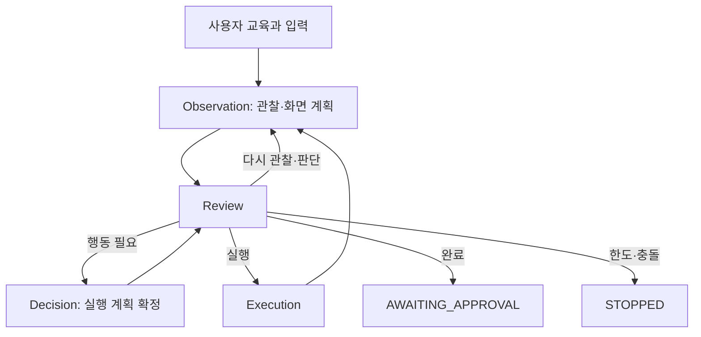
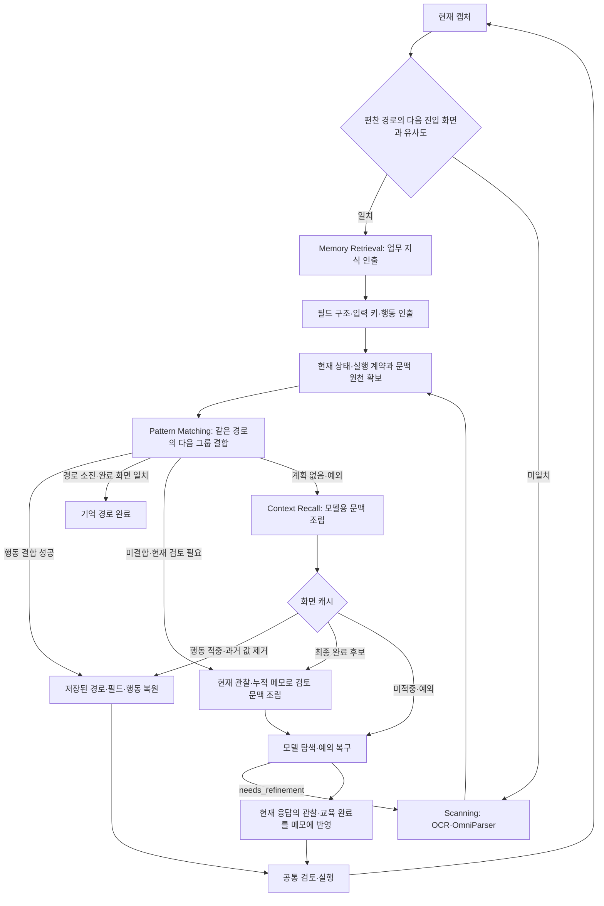

# 현재 코드 실행 흐름

기준일: 2026-11-02. 모델·비용·제거된 동작은 [현행 런타임 기준](current-runtime.md),
상태와 저장소 경계는 [계약 지도](contracts.md)를 함께 따릅니다.

## 서류에서 화면 작업까지



`pipeline.run`은 문서를 처리합니다. `brain.run --prepared-case`는 READY 상태, 같은 건의 record,
차단 없는 checks와 실행 정체성을 확인한 뒤 화면 작업을 시작합니다. 정답 파일은 평가기만 읽고
작업자나 추출 모델에 전달하지 않습니다.

## 작업자 그래프



실제 LangGraph 노드는 `observation`, `decision`, `review`, `execution` 네 책임으로 구성됩니다.
각 노드는 같은 실행의 `WorkerState`를 받아 자기 영역과 `lifecycle.route`를 갱신하고 같은 상태를
반환합니다. 라우팅은 선형 단계 번호가 아니라 현재 책임의 결과에 따라 네 노드 또는 `finish`로
이동합니다.

- **Observation**: relay 캡처 직후 화면 유사도를 확인합니다. 일치한 기억에서 필드 기하를
  인출하거나 OmniParser로 탐색합니다. GPU OCR은 현재 문자열을 관찰 자료로 제공하며,
  기억 인출은 필드 구조·입력 키·행동만 재사용하고 과거 확인값을 현재 값으로 발행하지 않습니다. 직전 행동이 있으면
  새 관찰에서 전달 효과를 확인합니다. 구조·위치 변화는 `compare_navigation` →
  `compare_frames`의 ORB 비교로, 값과 업무 결과는 기존 증거 검토로 확인합니다.
  이 비교는 캡처 저장 직후 수행해 모델 판단 전에 결과를 전달하고, 이후 검토에서 재사용합니다.
  이 비교는 추가 모델 호출을 만들지 않습니다. 무변화는 관찰 사실로 전달하며, 그 결과를 본
  모델의 다른 행동 제안을 이전 행동의 반복 실패만으로 폐기하지 않습니다.
- **Decision**: Observation에서 생성한 화면 계획을 공통 실행 계약으로 확정합니다. 계획이
  없거나 다시 판단해야 하면 같은 `screen_decision` 경로로 들어갑니다. 현재 `screen_matching`
  설정은 화면 해석과 다음 행동을 한 응답으로 얻으므로 최초 모델 판단은 Observation 안에서 일어납니다.
  모델은 현재 관찰로 확인한 결과를 전제로 다음 행동을 함께 선택합니다. Observation은 상세
  검토 범위와 응답의 현재 증거를 메모에 반영하고, Decision은 같은 응답의 계획을 사용합니다.
  메모 반영을 이유로 계획을 폐기하거나 재호출하지 않습니다. 상세 재진입은 누적 검토 메모를
  초기화하지 않습니다. 행동 검증 오류는 유지하며 확인된 증거와 구분합니다.
- **Review**: 모델 제안과 현재 관찰 근거를 연결하고 다음 route를 정합니다. 현재 설정의
  `guard_mode = "observe_only"`를 존중하며 과거의 엄격한 휴리스틱을 지침만 보고 복원하지 않습니다.
- **Execution**: 준비된 `ExecutionRequest`를 공통 실행기에 전달하고 `ExecutionResult`를
  받습니다. relay 전달 성공은 업무 완료가 아니며 다음 Observation/Review가 효과를 판정합니다.

## 화면 의미 경로

화면 유사도를 먼저 확인하고 관찰 원천을 분기합니다. 함수와 데이터 계약은
[용어와 코드 대응](runtime-terminology.md)을 참고합니다.



메모리의 필드가 부족해 모델이 `ScreenMapping.needs_refinement=true`를 반환하면 탐색으로
돌아갑니다. 캡처와 OCR을 다시 수행하지 않습니다. 동일 캡처도 공통 문맥·판단 경로를 거칩니다.
모델이 새 계획을 내는 경우와 기억 계획을 쓰는 경우는 같은 검증·실행 경로를 거칩니다.
정상 메서드 경로는 조회 입력·상세 진입에서도 모델용 전체 문맥을 조립하지 않습니다. 화면 투영과 메서드 문맥은 결합
이전 시점에 확보하고, 캐시 조회·모델·복구가 필요하면 notebook·화면 트리·교육 문맥을 조립합니다.
한 요청의 저장 증거 snapshot과 변경되지 않은 계획의 검증·대상 정리 결과를 재사용합니다.
관찰 카탈로그의 캡처 해시, 판단 문맥의 캐시 키, 선택한 메서드도 소비자에게 그대로 전달합니다.
현재 OCR은 매번 수행하며, 모델은 원본 캡처를 받습니다. 번호표 이미지는 진단용으로만 만듭니다.

기억 인출과 패턴 매칭은 `MemoryRetrieval._matching_route`를 공유합니다. 메서드가 선택되면
그 메서드의 trace 순서를 유지하고 남은 첫 그룹만 결합하며, 모두 진행한 뒤 완료 기억을 사용합니다.
진행은 원본 전달·검토된 대체와 현재 모델 복구 응답이 확인한 재개 이력으로 계산합니다.
나눠 수행한 행동은 전달 이력의 원본 행동 범위로 누적하며 남은 행동만 인출합니다. 현재 모델은
남은 그룹의 목적·행동·기대 결과를 보고 `resume_group_id`로 다음 그룹을 지정할 수 있습니다.
그 앞의 경유 생략은 교육 전체 완료와 구분합니다. 과거 기억의 완료 결과로 후보가 자신의 실행 자격을 만들거나 전체 그룹을 다시
경쟁시키지 않습니다. 재개한 그룹은 실제 전달 집계에 넣지 않습니다.

실행 중 유사 캡처의 카탈로그는 탐지 기하를 재사용합니다. `MemoryRetrieval._restore_structure`는
저장된 `screen_path`(부모 창 → 활성 탭), 필드 이름·role·bbox·입력 source와 행동을 복원합니다.
필드의 `value`와 과거 `observed_step_results`는 복원하지 않습니다. 실제 fill 문자열은 실행
경계에서 현재 `request.values`를 사용합니다. 입력 이후에도 다음 메서드 행동이 결합되면
모델 없이 이어갑니다. 입력 검토는 유예하며 전달한 연속 범위만 진도에 반영합니다. 전달 기록으로
저장 행동을 허용할 수 있지만 현재 관찰값·verified·완료 증거를 만들지는 않습니다.
화면·필수 구조·저장 결과 미결합과 실제 실행 실패에서는 기존 `ScreenMatch`로 현재 관찰과
다음 행동을 함께 받습니다. `_fail`이 발생한 메서드는 모델 복구 전까지 화면 캐시로 우회하지 않습니다.
정상 기억 경로는 `completion_receipt`가 이번 실행의 경로 소진과 현재 완료 화면 일치를 확인하고
`method_route_complete`로 종료합니다. 모델 값 검증과 구분하며 과거 관찰이나 verified를 복원하지 않습니다.
미확인 입력은 메모와 모델 문맥에 유지하며 같은 필드의 재등장만으로 모델을 호출하지 않습니다.
화면 캐시는 `act` 행동 계획만 재사용하며 중복 조회·완료·중단 판정은 현재 모델로 확인합니다.
새 편찬물에는 `field_values`가 없고 구형 산출물의 해당 키는 로더에서 버립니다.
현재 매핑은 이전 필드 목록을 교체하며, 다른 탭이나 스크롤 이전 좌표를 현재 요소로 보충하지
않습니다. 노드별 `screen_nodes`에는 모델의 현재 관찰과 구조상 발견을 병합하고 보이지 않는 필드는
마지막 관찰로 보존합니다. 구조 인출만으로 `last_observation`·verified나 교육 완료를 갱신하지
않습니다. 현재 실행의 누적 관찰은 이력으로 유지하며 새 프레임에서 읽었다고 다시 기록하지 않습니다.
관찰값은 각 노드 필드의 `last_observation`에만 저장하며 전역 복사본은 없습니다.
`current_screen_path`와 노드 기억은 수첩에 저장되고 다음 요청에는 이전 위치 및 과거 사실로
전달됩니다. `screen_memory`가 경로별 발견을 누적하고 `context_recall`은 같은 저장소를
`screen_tree`(루트 children → 화면 → children → 자식)로 투영합니다. 경로 없는 관찰은
루트 fields에만 남깁니다. 모델용 트리에는 과거 bbox/ref나 가시성·일치 플래그를 넣지
않고 마지막 관찰값과 실제 입력 전달 기록을 전달합니다.
relay가 확인한 입력은 실행 직후 기록해 다음 배치로 넘어가도 사라지지 않으며, 후속 관찰로
관찰값을 갱신합니다. 확인 대기는 입력·관찰 순번과 증거 범위에서 계산하고, 실제 일치 여부는
기존 verified 갱신에 사용합니다. 값 검토는 기존 화면 판단 호출 안에서 수행하며 기억 갱신 전용
호출·상태 기계·스크롤 좌표 지도는 추가하지 않습니다.

관찰과 업무 판단은 `frame_input`으로 현재 OCR·컨트롤·포함 텍스트를 한 번 구성하고,
기억·교육 문맥과 함께 같은 `ScreenMapping` 계약으로 전달합니다. 보완과 녹화기도 이 계약을
사용합니다. 내부 장면·실행용 marker ID를 모델용 번호로 바꾸는 중간 계약은 없습니다.
`ScreenMapping`은 detector 번호를 업무 key로 쓰지 않습니다. 화면의 보이는 의미 이름과 bbox,
입력 key를 연결하고 모델이 고른 point를 현재 캡처에 묶습니다. 좌표와 번호의 수명은
[시각 경로](../brain/visual/README.md)에 정의합니다.

전체 픽셀 해시는 메타데이터와 캐시·안정화에 사용할 수 있지만, 같은 허용 창에서 픽셀이
달라졌다는 사실 하나만으로 실행을 거절하지 않습니다. 창·DPI·캡처 크기와 좌표 경계는 계속
검사합니다.

## 주요 구현 파일

```text
pipeline/workflow.py
  └─ pipeline.runner.prepare_case()

brain/run.py
  └─ Brain.run()
      └─ brain/graph/workflow.py
          ├─ observation_node -> engine._observe_node / _verify_node
          ├─ decision_node    -> engine._select_node
          ├─ review_node      -> engine._review_node
          └─ execution_node   -> engine._act_node

brain/graph/state.py          WorkerState
brain/graph/screen_mapping.py 화면 의미 JSON 계약
brain/graph/memory_retrieval.py 구조 인출·입력 키와 행동 결합
brain/graph/screen_memory.py  현재 실행의 관찰·전달 이력
brain/graph/context_recall.py 누적 메모를 모델 문맥으로 투영
brain/graph/execution.py      ExecutionRequest / ExecutionResult
brain/visual/scanning.py    OCR·탐지·로컬 의미 관찰
brain/demo_learning/          성공 trace와 기억 편찬
```

사용자 교육은 특정 ERP 상태 기계로 컴파일하지 않습니다. 성공한 실행 trace는 전체 업무 성공을
확인한 뒤 편찬된 기억 후보가 되며, 현재 화면에 결합하지 못하면 모델 판단으로 폴백합니다.
