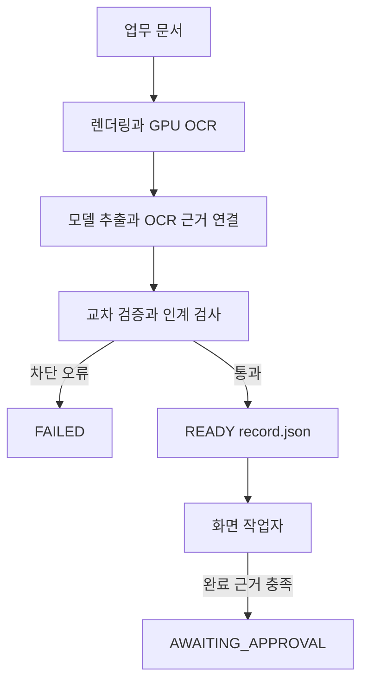
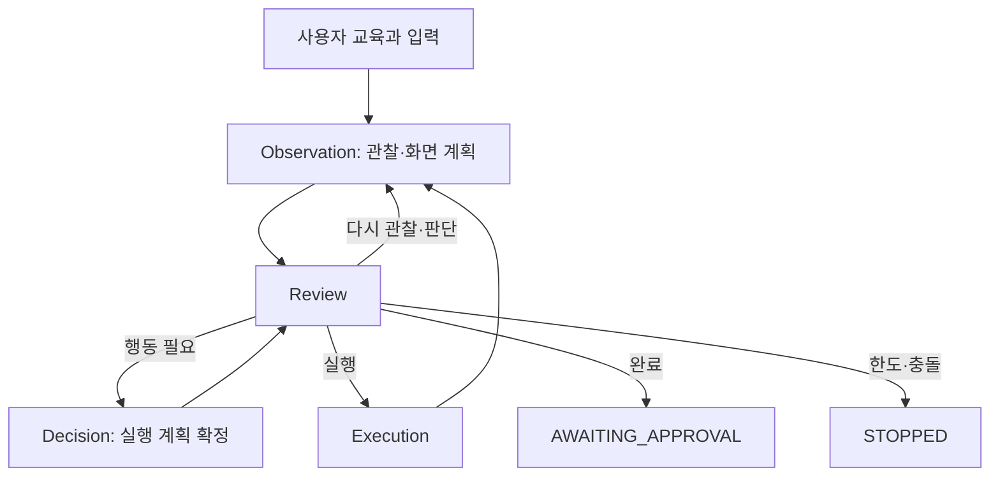
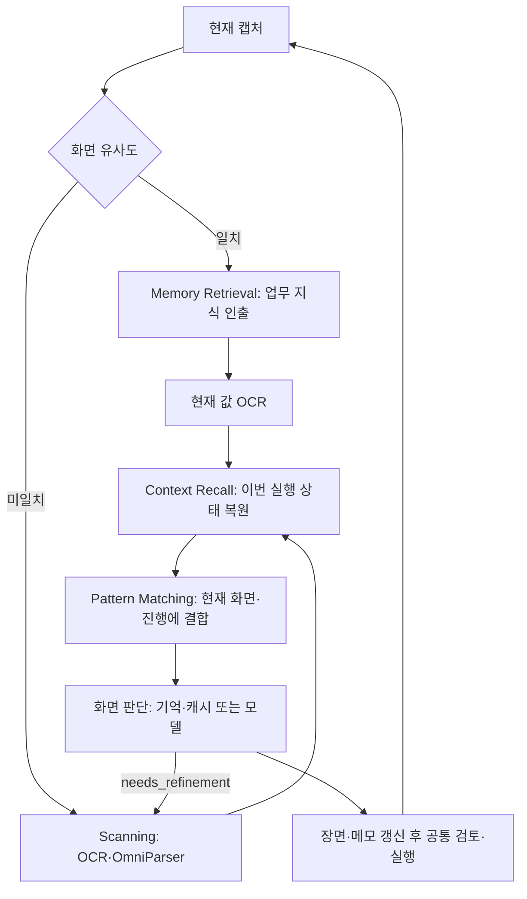

# 현재 코드 실행 흐름

기준일: 2026-10-21. 모델·비용·제거된 동작은 [현행 런타임 기준](current-runtime.md),
상태와 저장소 경계는 [계약 지도](contracts.md)를 함께 따릅니다.

## 서류에서 화면 작업까지



`pipeline.run`은 문서를 처리합니다. `brain.run --prepared-case`는 READY 상태, 같은 건의 record,
차단 없는 checks와 실행 정체성을 확인한 뒤 화면 작업을 시작합니다. 정답 파일은 평가기만 읽고
작업자나 추출 모델에 전달하지 않습니다.

## 작업자 그래프



실제 LangGraph 노드는 `observation`, `decision`, `review`, `execution` 네 책임으로 구성됩니다.
각 노드는 같은 실행의 `WorkerState`를 받아 자기 영역과 `lifecycle.route`를 갱신하고 같은 상태를
반환합니다. 라우팅은 선형 단계 번호가 아니라 현재 책임의 결과에 따라 네 노드 또는 `finish`로
이동합니다.

- **Observation**: relay 캡처 직후 화면 유사도를 확인합니다. 일치한 기억에서 필드 기하를
  인출하거나 OmniParser로 탐색하고, 현재 값은 GPU OCR로 읽습니다. 직전 행동이 있으면
  새 관찰에서 전달 효과를 확인합니다.
- **Decision**: Observation에서 생성한 화면 계획을 공통 실행 계약으로 확정합니다. 계획이
  없거나 다시 판단해야 하면 같은 `screen_decision` 경로로 들어갑니다. 현재 `screen_matching`
  설정은 화면 해석과 다음 행동을 한 응답으로 얻으므로 최초 모델 판단은 Observation 안에서 일어납니다.
  모델은 현재 관찰로 확인한 결과를 전제로 다음 행동을 함께 선택합니다. Observation은 상세
  검토 범위와 응답의 현재 증거를 메모에 반영하고, Decision은 같은 응답의 계획을 사용합니다.
  메모 반영을 이유로 계획을 폐기하거나 재호출하지 않습니다. 상세 재진입은 누적 검토 메모를
  초기화하지 않습니다. 행동 검증 오류는 유지하며 확인된 증거와 구분합니다.
- **Review**: 모델 제안과 현재 관찰 근거를 연결하고 다음 route를 정합니다. 현재 설정의
  `guard_mode = "observe_only"`를 존중하며 과거의 엄격한 휴리스틱을 지침만 보고 복원하지 않습니다.
- **Execution**: 준비된 `ExecutionRequest`를 공통 실행기에 전달하고 `ExecutionResult`를
  받습니다. relay 전달 성공은 업무 완료가 아니며 다음 Observation/Review가 효과를 판정합니다.

## 화면 의미 경로

화면 유사도를 먼저 확인하고 관찰 원천을 분기합니다. 함수와 데이터 계약은
[용어와 코드 대응](runtime-terminology.md)을 참고합니다.



메모리의 필드가 부족해 모델이 `ScreenMapping.needs_refinement=true`를 반환하면 탐색으로
돌아갑니다. 캡처와 OCR을 다시 수행하지 않습니다. 동일 캡처도 공통 문맥·판단 경로를 거칩니다.
모델이 새 계획을 내는 경우와 기억 계획을 쓰는 경우는 같은 검증·실행 경로를 거칩니다.

실행 중 유사 캡처의 카탈로그는 탐지 기하만 재사용합니다. 모델은 기존 판단 호출에서 현재
`screen_path`(부모 창 → 활성 탭)를 선택하고 해당 노드의 기억을 참고해 보이는 필드를 연결합니다.
현재 매핑은 이전 필드 목록을 교체하며, 다른 탭이나 스크롤 이전 좌표를 현재 요소로 보충하지
않습니다. 노드별 `screen_nodes`에는 현재 관찰만 갱신하고 보이지 않는 필드는 마지막 관찰로
보존합니다. 전체 업무 `observed_inputs`도 유지하여 탭 간 업무 판단에 사용합니다.
`current_screen_path`와 노드 기억은 수첩에 저장되고 다음 요청에는 이전 위치 및 과거 사실로
전달됩니다. 별도 모델 호출·상태 기계·스크롤 좌표 지도는 추가하지 않습니다.

로컬 의미 탐지는 후보 분류 과정에서 실행 중 marker ID를 사용하지만, task-level
`ScreenMapping`은 detector 번호를 업무 key로 쓰지 않습니다. 화면의 보이는 의미 이름과 bbox,
입력 key를 연결하고 모델이 고른 point를 현재 캡처에 묶습니다. 좌표와 번호의 수명은
[시각 경로](../brain/visual/README.md)에 정의합니다.

전체 픽셀 해시는 메타데이터와 캐시·안정화에 사용할 수 있지만, 같은 허용 창에서 픽셀이
달라졌다는 사실 하나만으로 실행을 거절하지 않습니다. 창·DPI·캡처 크기와 좌표 경계는 계속
검사합니다.

## 주요 구현 파일

```text
pipeline/workflow.py
  └─ pipeline.runner.prepare_case()

brain/run.py
  └─ Brain.run()
      └─ brain/graph/workflow.py
          ├─ observation_node -> engine._observe_node / _verify_node
          ├─ decision_node    -> engine._select_node
          ├─ review_node      -> engine._review_node
          └─ execution_node   -> engine._act_node

brain/graph/state.py          WorkerState
brain/graph/screen_mapping.py 화면 의미 JSON 계약
brain/graph/execution.py      ExecutionRequest / ExecutionResult
brain/visual/scanning.py    OCR·탐지·로컬 의미 관찰
brain/demo_learning/          성공 trace와 기억 편찬
```

사용자 교육은 특정 ERP 상태 기계로 컴파일하지 않습니다. 성공한 실행 trace는 전체 업무 성공을
확인한 뒤 편찬된 기억 후보가 되며, 현재 화면에 결합하지 못하면 모델 판단으로 폴백합니다.
