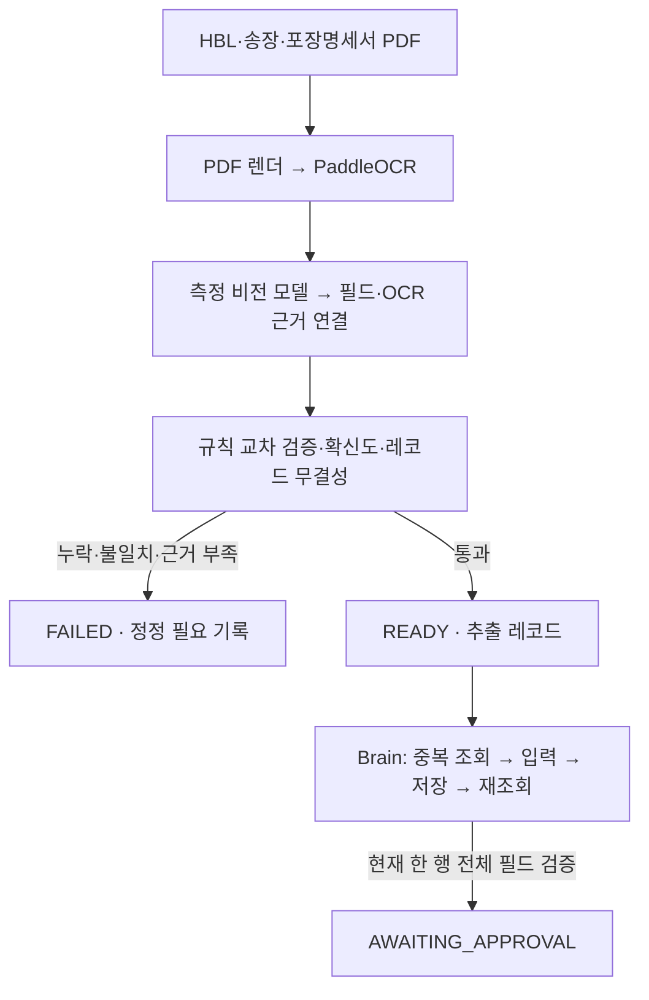
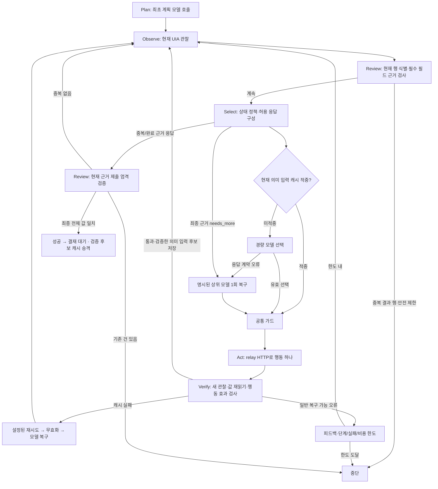

# M2 코드 실행 흐름

2026-09-29 M2 구현 기준. 실제 측정 결과는 `m2-implementation.md`와 공개 진행 기록에 별도로 남긴다.
이전 [L2C 비교](l2c-graph-comparison-20260929.md)는 M2 적용 전 구조의 분석이다.

## 서류부터 결재 대기까지



`pipeline.run`은 서류만 처리한다. `pipeline.workflow`는 공개 하네스가 호출할 수 있는
서류·두뇌 연결 CLI다. 입력 manifest와 PDF만 추출기에 제공하고 정답 파일은 별도 평가기만 읽는다.
준비된 건을 실행하는 `brain.run --prepared-case`는 READY 상태, 자기 건의 레코드,
차단 없는 checks와 필드 무결성을 다시 확인한다. API 비용은 한 건의 append-only 로그에서 합산한다.

## 화면 작업자 그래프



실제 LangGraph 노드는 `plan / observe / review / select / act / verify`다.
정책, 캐시, 모델 선택과 공통 가드는 `select` 안의 조건부 처리다.
`review`는 현재 관찰의 완료 가능 여부와 제출된 업무 근거 검증을 담당하며 별도 LLM을 호출하지 않는다.
허용 창 밖, 만료된 대상, 비용 불명 등 즉시 종료 조건은 모델 복구로 우회하지 않는다.

최종 행의 HBL이나 다른 열이 보이지 않으면 `complete`를 응답 스키마에서 제외한다.
관찰된 창 확장·이동을 선택하여 새 근거를 얻어야 한다. 검색 입력칸의 HBL이나 과거 관찰을
현재 행의 근거로 대신 쓰지 않는다. 실제 완료는 제출된 참조의 행 소속·필드별 값·참조 중복을 다시 검사한다.

## 핵심 파일과 호출 순서

```text
pipeline/workflow.py
  ├─ pipeline.runner.prepare_case()
  │   ├─ render_document → PaddleOcrEngine.read
  │   ├─ MeasuredModelClient.complete_json (이미지+OCR)
  │   ├─ bind_extraction (OCR 블록→출처 위치)
  │   └─ cross_validate → can_enter → READY 또는 FAILED
  └─ brain.run.main(--prepared-case)
      └─ Brain.run()
          ├─ _plan_node → measured ModelClient
          ├─ _observe_node → relay.observe → 민감정보 제거·스냅샷 저장
          ├─ _review_node → review_final → 완료 가능 여부
          ├─ _select_node
          │   ├─ DecisionPolicy → 현재 응답 스키마
          │   ├─ CacheSession.lookup 또는 _choose_decision
          │   └─ 공통 _guard_action
          ├─ _act_node → relay.act
          ├─ _verify_node → 재관찰·값/전이 검사 → stage_validated
          └─ 성공 후 CacheSession.finish → 원자적 승격·결재 대기
```

캐시 v0.1은 **등록 입력의 필드→의미 대상 대응**을 재사용한다. 로그인·탐색·저장·승인 순서,
좌표, AutomationId, 과거 ref, 실제 입력값은 저장하지 않는다. 매번 현재 관찰의 대상을 다시 찾고
새 레코드 값을 넣어 읽어 본다. 전체 업무 실패 시 새 후보는 승격하지 않는다.
손상 캐시는 파일을 보존하고 해당 실행에서 비활성화하여 모델 경로로 계속한다.

`relay --observation-only`는 입력 요청을 거부한다. `relay.record`가 수집한 연속 관찰과
명시된 합성 레코드를 `brain.demo_learning`에 주면 값 변화·포커스·고유 대응을 검증한
시연 후보가 만들어진다. 캐시 설치는 별도의 명시된 `--install-cache` 동작이다.

## L2C에서 반영한 부분과 남은 차이

업무 근거 검토, 조건부 경험 재사용, 모든 출처에 공통인 실행 가드, 명시적 상위 모델 복구,
성공 후 경험 승격을 반영했다. L2C의 사이트별 경로·좌표·업무 DB 접근은 사용하지 않는다.
Sawon은 정해진 선적 한 건을 처리하며 L2C의 상위 조사·답변 그래프는 없다.
상태는 아직 Brain 인스턴스에 보관하고 `verify` 재관찰 뒤 `observe`에서 다시 관찰할 수 있다.
그래프 모양을 같게 만드는 것과 실제 성공률을 증명하는 것은 별개다.
