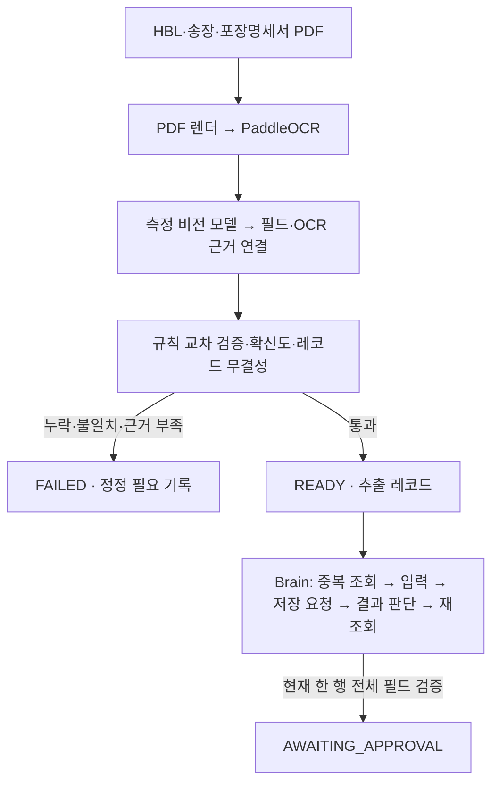
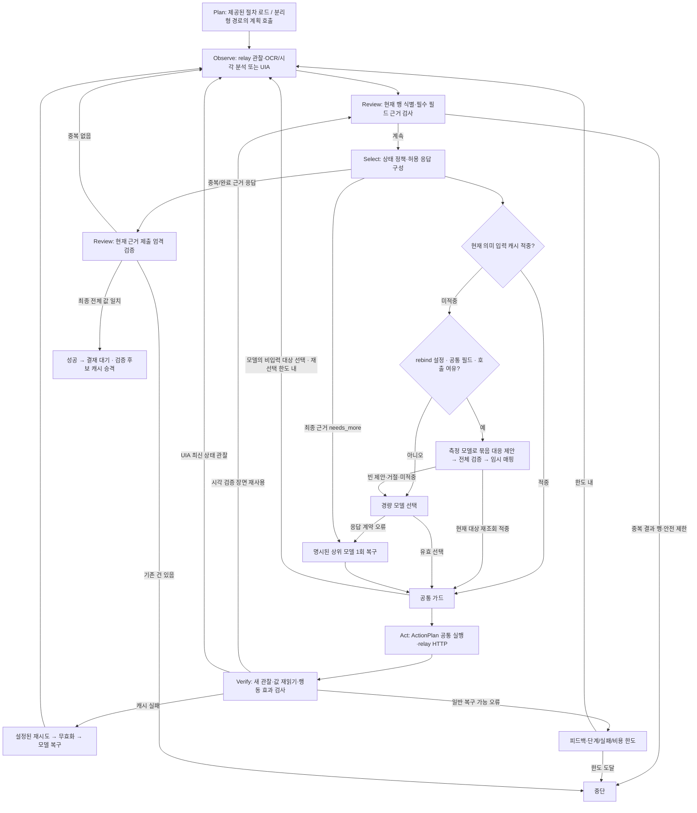

# M2 코드 실행 흐름

2026-10-01 현재 화면 매칭 경로와 지원 중인 M2 공통 실행 기준. 실제 측정 결과는 `m2-implementation.md`와 공개 진행 기록에 별도로 남긴다.
이전 [L2C 비교](l2c-graph-comparison-20260929.md)는 M2 적용 전 구조의 분석이다.

## 서류부터 결재 대기까지



`pipeline.run`은 서류만 처리한다. `pipeline.workflow`는 공개 하네스가 호출할 수 있는
서류·두뇌 연결 CLI다. 입력 manifest와 PDF만 추출기에 제공하고 정답 파일은 별도 평가기만 읽는다.
준비된 건을 실행하는 `brain.run --prepared-case`는 READY 상태, 자기 건의 레코드,
차단 없는 checks와 필드 무결성을 다시 확인한다. API 비용은 한 건의 append-only 로그에서 합산한다.

## 화면 작업자 그래프



실제 LangGraph 노드는 `plan / observe / review / select / act / verify`다.
정책·캐시·모델 선택은 `select`에서 ActionPlan을 준비한다.
로그인·등록 묶음도 `act`의 공통 실행기를 거쳐 `verify`에서 한 번 재관찰한다.
[2026-09-30 공통화 점검](architecture-review-20260930.md)이 최신 구조와 미해결 항목을 설명한다.
`review`는 현재 관찰의 완료 가능 여부와 제출된 업무 근거 검증을 담당하며 별도 LLM을 호출하지 않는다.
허용 창 밖, 만료된 대상, 비용 불명 등 즉시 종료 조건은 모델 복구로 우회하지 않는다.

모델이 `set_text/type_text` 대상으로 비입력 역할을 선택한 경우에는 행동을 보내지 않고
`max_input_target_retries`(기본1,0이면 비활성,최대3) 한도에서 새 관찰과 선택을 수행한다.
기존 하위 목표·단계·비용 한도도 적용된다. 이전 행동이 이미 전송됐거나 결과가 불명확한 경우,
없는 참조·비활성 대상·허용 창 이탈은 이 재선택 경로로 처리하지 않는다.

최종 행의 HBL이나 다른 열이 보이지 않으면 `complete`를 응답 스키마에서 제외한다.
관찰된 창 확장·이동을 선택하여 새 근거를 얻어야 한다. 검색 입력칸의 HBL이나 과거 관찰을
현재 행의 근거로 대신 쓰지 않는다. 실제 완료는 제출된 참조의 행 소속·필드별 값·참조 중복을 다시 검사한다.

## 핵심 파일과 호출 순서

```text
pipeline/workflow.py
  ├─ pipeline.runner.prepare_case()
  │   ├─ render_document → PaddleOcrEngine.read
  │   ├─ MeasuredModelClient.complete_json (이미지+OCR)
  │   ├─ bind_extraction (OCR 블록→출처 위치)
  │   └─ cross_validate → can_enter → READY 또는 FAILED
  └─ brain.run.main(--prepared-case, 선택적 cache-isolation, 전체 비용 상한)
      ├─ READY·자기 레코드·검증 보고서·기록 정체성 확인
      ├─ 선택적 건별 캐시 설치 (OCR 기록/비용 유지)
      └─ Brain.run()
          ├─ _plan_node → 화면 매칭은 절차 로드 / 분리형 경로는 measured ModelClient
          ├─ _observe_node → relay.observe → 민감정보 제거·스냅샷 저장
          ├─ _review_node → review_final → 완료 가능 여부
          ├─ _select_node
          │   ├─ DecisionPolicy → 현재 응답 스키마
          │   ├─ CacheSession.lookup (정확 일치 / 선택적 공통 라벨 재매칭)
          │   ├─ 미적중 시 선택적 build_rebind_request → 측정 호출 → install_rebind_proposal
          │   ├─ 미적중: 로그인/필드 묶음 또는 단일 결정 → ActionPlan
          │   ├─ save_result: 현재 근거·결과·다음 행동을 한 응답으로 판단
          │   │   └─ 거절→해당 필드 수정, 확인창→처리 후 재판정, 준비됨→최종 조회
          │   └─ 공통 _guard_action
          ├─ _act_node → execute_plan → 전체 계획 선검사 → 순서대로 relay.act
          ├─ _verify_node → 한 번 재관찰·단일/묶음 값·각 행동 전이 검사
          └─ 성공 후 CacheSession.finish → 원자적 승격·결재 대기
```

캐시 v0.1은 **등록 입력의 필드→의미 대상 대응**을 재사용한다. 로그인·탐색·저장·승인 순서,
좌표, AutomationId, 과거 ref, 실제 입력값은 저장하지 않는다. 매번 현재 관찰의 대상을 다시 찾고
새 레코드 값을 넣어 읽어 본다. 전체 업무 실패 시 새 후보는 승격하지 않는다.
손상 캐시는 파일을 보존하고 해당 실행에서 비활성화하여 모델 경로로 계속한다.

기본은 정확 일치다. `config/brain.m2-rebind.toml`은 같은 최상위 의미 문맥에서 유일하게 대응하는
공통 역할·라벨의 필드2개 이상을 근거로 중간 구조 변화를 허용한다. 라벨까지 달라진 남은 필드는
기본 최대1회 모델 호출로 묶어서 제안받는다. 응답 전체의 현재 관찰·역할·고유성을 검사한 뒤
임시 대응을 설치한다. 실패한 임시 대응은 원본 학습 항목과 분리해 무효화한다.
모델 대응의 의미적 정답은 보장되지 않으며 기존 값 재읽기·최종 업무 검증을 그대로 거친다.
자세한 범위와 미측정 항목은 [재연결 계획](cache-rebinding-plan-20260929.md)에 기록했다.

`relay --observation-only`는 입력 요청을 거부한다. `relay.record`가 수집한 연속 관찰과
명시된 합성 레코드를 `brain.demo_learning`에 주면 값 변화·포커스·고유 대응을 검증한
시연 후보가 만들어진다. 캐시 설치는 별도의 명시된 `--install-cache` 동작이다.

## L2C에서 반영한 부분과 남은 차이

업무 근거 검토, 조건부 경험 재사용, 모든 출처에 공통인 실행 가드, 명시적 상위 모델 복구,
성공 후 경험 승격을 반영했다. L2C의 사이트별 경로·좌표·업무 DB 접근은 사용하지 않는다.
Sawon은 정해진 선적 한 건을 처리하며 L2C의 상위 조사·답변 그래프는 없다.
상태는 Brain 인스턴스에 보관하며 `verify`의 최신 시각 관찰을 다음 판단에서 재사용한다.
그래프 모양을 같게 만드는 것과 실제 성공률을 증명하는 것은 별개다.

## 목표·계획과 화면 행동 연결

화면 전용 프로필은 `screen_matching=true`다. 제공된 업무 절차를 읽으므로 최초
계획 생성 모델 호출은 없다. 현재 OCR/탐지 JSON, 절차 단계와 작업 메모를 `ScreenMatch`
한 응답에 연결한다. `marker_contract`가 모델용 마커 번호를 내부 OCR 근거로 변환한다.
검증된 제안은 같은 관찰의 현재 정책을 통과해 공통 ActionPlan 실행기로 간다.
단계만 바뀌면 저장된 화면 양식으로 재매칭하며 이미지 보완은 필요한 경우에만 수행한다.
보완 탐지는 기본 판단의 업무 대상 누락 실패 때만 최대1회 수행한다.
내용/크기/스케일이 같은 창의 단순 이동은 새 캡처 원점으로 연결하며 전체 인식을 반복하지 않는다.
이전 번호 선택과 `VisualTurn` 판단 경로는 제거했다. Gemini/Luna/Jev의 현재 매칭,
분리형 의미 인식, UIA 보조 및 공통 실행·검증 경로는 유지한다.
