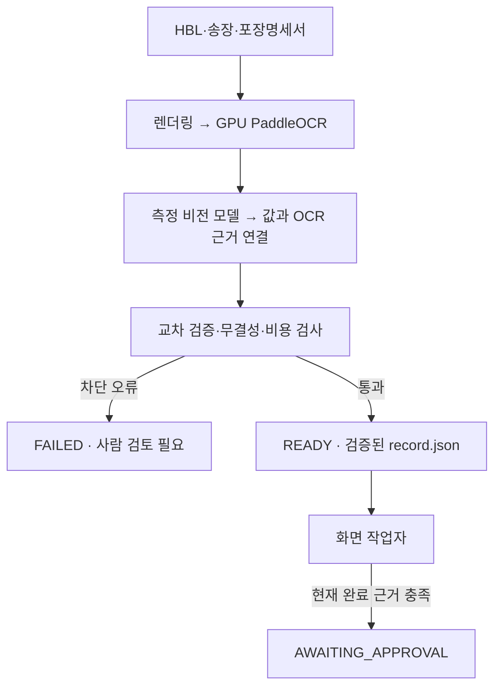
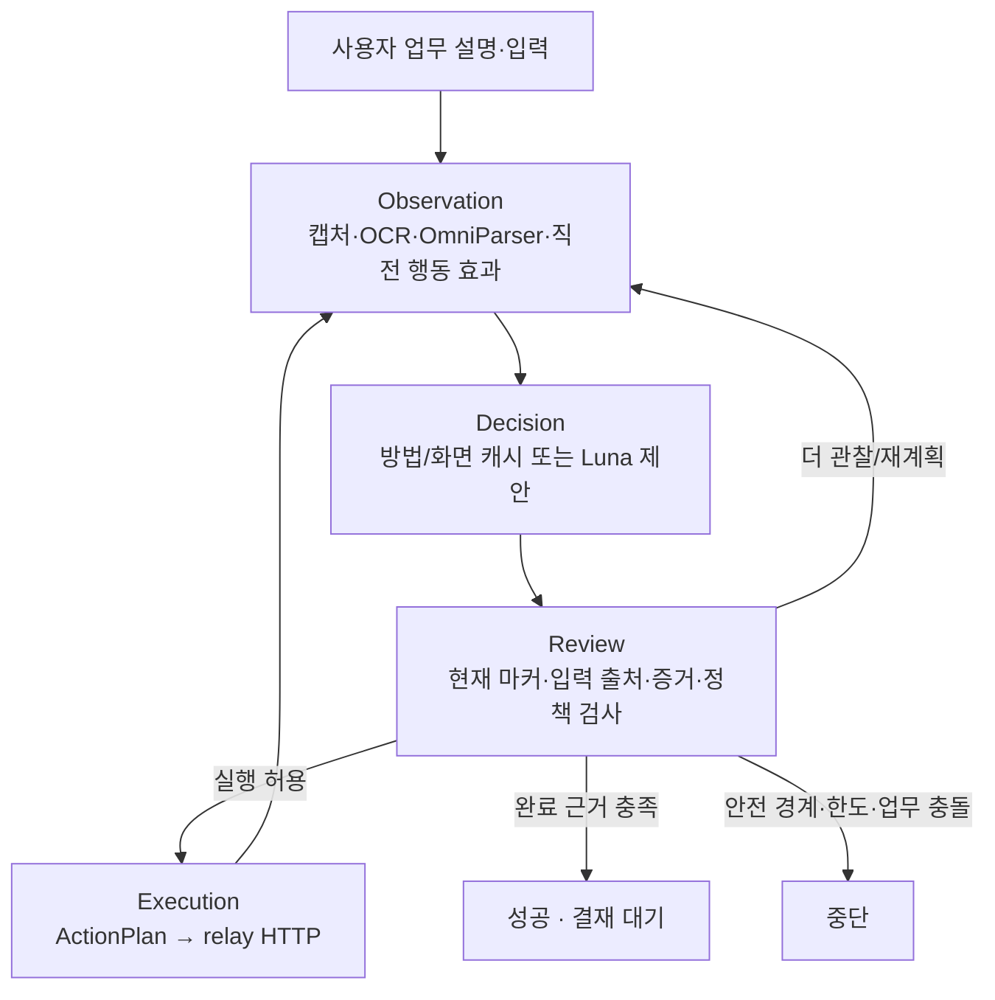

# 현재 코드 실행 흐름

기준일: 2026-10-08. 이 문서는 현재 운영 설정인 Luna 주 경로,
`visual_only=true`, `screen_matching=true`, 사용자 `TaskInstruction`을 기준으로 한다.
과거 UIA 캐시, `--procedure` 입력, 다중 `ProcedureStep` 후보, Jev 비교 프리셋은 현재
실행 흐름에 포함하지 않는다. 과거 측정 결과는 날짜가 붙은 보고서와 bench 진행 기록에 남긴다.

## 서류에서 결재 대기까지



`pipeline.run`은 서류만 처리한다. `brain.run --prepared-case`는 READY 상태, 같은 건의
`record.json`, 차단 없는 `checks.json`, 실행 로그 정체성을 다시 확인한 뒤 화면 작업을
시작한다. 정답 파일은 평가기만 읽으며 두뇌나 추출 모델에 전달하지 않는다. 서류와 화면
모델 호출은 모두 측정된 `ModelClient`와 한도 안에서 기록된다.

## 화면 작업자 상태 계약



실제 LangGraph 노드는 `observation`, `decision`, `review`, `execution` 네 개다.
각 노드는 `WorkerState`를 받아 같은 계약의 새 스냅샷을 반환하며 route는 이 네 이름과
`finish`만 사용한다.

- **Observation**은 허용된 ERP 창을 캡처하고 GPU OCR·OmniParser 결과를 현재 관찰로 만든다.
  직전 실행이 있으면 전달 성공 자체를 완료로 보지 않고 새 화면에서 효과를 확인한다.
- **Decision**은 현재 업무 목표, `TaskInstruction.procedure`, 입력 키, 진행·실패 기록과 현재
  마커를 결합한다. 학습 방법이나 화면 캐시가 현재 화면에 유일하게 결합되면 재사용하고,
  그렇지 않으면 Luna가 `ScreenMatch`를 만든다. 모든 경로는 같은 정규화와 plan 검사를 거친다.
- **Review**는 제안된 행동과 evidence를 현재 관찰에 묶고 실행 가능한지 판정한다.
  현재 시각 프로필에서는 모델이 업무 의미를 판단하며, 코드는 마커 존재, 입력 출처, 좌표 경계,
  허용 창, 비용·반복 한도와 전송 금지 같은 실행 경계를 검사한다. 통과할 때만 한 번 쓸 수 있는
  실행 권한을 발급한다.
- **Execution**은 승인된 `ExecutionRequest`를 공통 실행기에 넘긴다. 실행기는 Brain을 받지 않고
  relay 결과만 반환한다. 여러 직접 입력은 한 캡처에서 묶을 수 있고, 화면을 바꾸는 행동 뒤에는
  새 관찰을 얻는다.

화면 작업자는 `--task`/`task_path`만 사용한다. 사용자가 가르친 화면명·행동 순서·단계별
완료 조건은 `TaskInstruction.procedure`에 남지만, 실행기가 그 내용을 ERP 전용 상태 기계로
컴파일하지는 않는다. 현재 모델 상태에는 입력 범위, 허용 행동, 목표, 완료 조건을 가진 한 개의
`ActionCapability`가 `capability`로 들어간다. 응답·캐시의 `procedure_step` 문자열은 직렬화
호환을 위해 남아 있으며 구형 Procedure 로더를 의미하지 않는다.

## 호출 순서와 책임 파일

```text
pipeline/workflow.py
  ├─ pipeline.runner.prepare_case()
  │   ├─ 문서 렌더링 → PaddleOcrEngine.read
  │   ├─ MeasuredModelClient.complete_json
  │   ├─ OCR 근거 결합
  │   └─ cross_validate → READY 또는 FAILED
  └─ brain.run.main(--prepared-case, 전체 비용 상한)
      ├─ 설정·record·TaskInstruction·prepared case 검증
      └─ Brain.run()
          ├─ observation_node
          │   └─ relay.observe → visual perception → pending 효과 검증
          ├─ decision_node
          │   ├─ MethodRuntime 또는 VisualMatchCache
          │   └─ 미적중/모호함 → measured Luna ScreenMatch
          ├─ review_node
          │   └─ evidence 기록·현재 대상 결합·실행 권한 또는 종료
          ├─ execution_node
          │   └─ ExecutionRequest → execute_plan → relay.act
          └─ 성공한 실행만 화면 캐시·업무 방법 후보 승격
```

핵심 구현은 `brain/graph/workflow.py`, `state.py`, `matching.py`, `execution.py`,
`method_runtime.py`에 있다. 화면 인식은 `brain/visual`, 재사용은
`brain/cache/visual_match.py`와 `brain/cache/methods.py`, 실행 기록 기반 학습은
`brain/demo_learning/methods.py`가 담당한다. 환경 접근은 인증된 relay HTTP로만 수행한다.

## 재사용과 실패 처리

화면 캐시는 현재 OCR·마커 의미를 보관한다. 업무 방법은 성공 실행의 좌표와 대상 영역을
저장하되 같은 화면 크기와 허용 pHash 거리 안에서만 재사용하며, 새 입력값을 slot에 연결한 뒤
같은 Review/Execution 경계를 통과한다. 업무 방법은 사용자 교육 해시에 묶이며 성공한 실행에서만
승격한다. 화면 동일성이 성립하지 않으면 모델 판단으로 돌아간다.

동일한 PNG는 실행 중 catalog에서 OCR·탐지 결과를 재사용할 수 있지만 새 관찰 ID에 다시
결합한다. 화면이 바뀌면 다시 인식한다. 클릭을 전달했는데 기대한 업무 근거가 생기지 않은
경우에만 설정된 한도 안에서 이미지 좌표 보완을 요청한다. 보완 좌표는 현재 관찰에 한 번만
사용하며 캐시에 승격하지 않는다.

허용 창 이탈, 만료 대상, 입력 출처 오류, 알 수 없는 비용, 단계·반복 한도는 모델로 우회하지
않는다. 성공은 relay 응답이나 입력 전달만으로 판정하지 않으며 현재 완료 조건의 화면 근거가
필요하다. 자동 전송·승인은 하지 않고 `awaiting_approval`에서 끝난다.

구조 변경과 검증 근거는 [작업자 리팩토링](refactor-runtime-stages-20261008.md),
[잔여 계약 정리](runtime-residual-fixes-20261008.md), 실제 시각 실행의 한계는
[OmniParser v2 파일럿](omniparser-v2-pilot-20261008.md)을 따른다.
