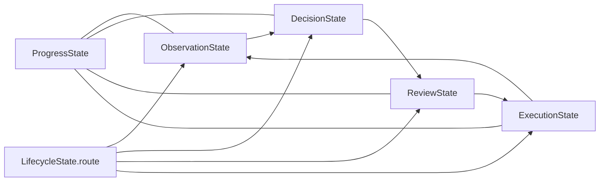

# 상태와 저장소 계약 지도

기준일: 2026-11-06

이 문서는 런타임 상태와 계층 간 인터페이스의 기준 위치를 한 곳에 모읍니다. 설명과 구현이
다르면 해당 계약을 소유한 코드와 이 문서를 같은 변경에서 맞춥니다.

## 계약 소유권

단계 명칭과 실제 구현 범위는 [화면 처리 용어](runtime-terminology.md)를 따른다.
Python 모듈 이름 변경은 `WorkerState` 키나 공개 실행 계약의 변경을 뜻하지 않는다.

| 계약 | 소유 위치 | 소비자 | 책임 |
|---|---|---|---|
| `WorkerState`와 하위 상태 | `brain/graph/state.py` | `brain/graph/workflow.py`, `engine.py`, graph 노드 | 한 실행 안의 관찰·판단·검토·실행·진행 상태 |
| 그래프 라우팅 | `brain/graph/workflow.py` | LangGraph | `lifecycle.route`를 다음 책임 노드 또는 `finish`로 연결 |
| `ExecutionRequest`/`ExecutionResult` | `brain/graph/execution.py` | `engine.py`, relay adapter | 준비된 행동 전달과 relay가 확인한 결과. 업무 성공을 판정하지 않음 |
| `ActionBatch`/`ActionBatchResult` | `../agent-sawon-bench/interfaces/sawon_interfaces/contracts.py` | core `execution.py`, relay `act_batch` | 같은 관찰·캡처에 연결한 시각 행동을 순서대로 전달하고, 한 번의 최종 관찰과 실제 전달 prefix를 반환 |
| `ActionPlan`과 화면 입력 계획 | `brain/graph/execution.py`, `screen_batch.py` | `screen_decision`, `selection`, `engine` | 로그인과 일반 행동을 같은 순서 실행기로 전달. `ScreenFillPlan`은 입력과 현재 화면의 후속 행동을 함께 표현 |
| 화면 의미 매핑 | `brain/graph/screen_mapping.py` | `screen_decision`, `memory_retrieval` | 의미 이름·bbox·입력 key·행동 point의 모델 경계 |
| 현재 화면 모델 입력 | `brain/visual/frame.py`의 `frame_input` | `context_recall`, 화면 판단, 관찰 녹화기 | 현재 OCR·후보 영역·포함 텍스트를 한 번 투영. 내부 마커 번호를 모델 계약에 노출하지 않음 |
| 교육 단계 관찰 결과 | `brain/task_instruction.py`의 `ObservedStepResult` | `screen_mapping`, `screen_decision`, `cache/methods`, engine | 현재 모델 응답의 교육 완료를 실행 상태에 반영. 편찬물의 과거 결과는 현재 응답으로 복원하지 않음 |
| 선택 결과의 요청 문맥 | `brain/graph/screen_decision.py`의 `ScreenSelection.prepared` | `decide_screen` → `ground_screen_response` | 같은 판단에서 확장한 교육 상세를 빈 행동 보완에 전달. 거절 후 재계획은 기존 prepared 사용. 턴 간 영구 상태가 아님 |
| 기억 편찬 응답 | `brain/demo_learning/memory_compilation.py`의 `MemoryAssembly` / `MemoryGroupSelection` | 모델 클라이언트, `compile_memory` | 후보 ID로 전달 행동을 선택하고 `field_renames`로 잘못된 필드 이름을 교정. context_anchors는 첫 8개를 보존하고 초과분 경고 기록 |
| 인출된 화면·행동과 저장 결과 | `brain/cache/methods.py`의 `MethodActionGroup`, `MethodCompletion` | `method_from_match`, `compile_memory`, `MemoryRetrieval._restore_structure`, `screen_decision` | 화면 경로·행동 좌표·필드 기하·입력 키, 저장 결과 메시지 및 검토 조건을 결합. 과거 필드 값은 저장·복원하지 않음 |
| 실행 문맥 회상 | `brain/graph/context_recall.py`의 `recall_context` | `DecisionPromptContext.state` | 캐시·모델이 필요할 때 이번 실행의 이력·누적 증거·남은 입력·진행 상태를 한 번 조립. 선택·모델 호출·상태 변경 없음 |
| 화면 트리 기억 | `brain/graph/screen_memory.py`, `ProgressState.screen_nodes` | engine, context_recall, notebook | 방문한 경로별 필드·컨트롤 발견과 입력 전달 이력을 누적. 모델용 트리는 같은 상태에서 파생하며 과거 좌표를 포함하지 않음 |
| 재탐색 요청 | `ScreenMapping.needs_refinement` → `ScreenPlan`/`ScreenMatch` → `SemanticDetection` | `ScreenScanner._resolve` | 필요한 보이는 컨트롤이 없으면 동일 캡처·OCR로 탐색 재진입. provider 스키마에도 존재 |
| pHash 유사 캡처의 화면 해석 | `SemanticRequest` / `_SceneCatalog` | `Brain._detect_visual` → `screen_decision` | 로컬 탐지 기하는 재사용하고 OCR은 현재 프레임에서 다시 실행. 현재 문맥·판단은 공통 순서로 수행 |
| 로컬 컨트롤 탐지 | `ControlDetector`, `OmniParserDetector` → `DetectorSession` | `ScreenScanner` | 이미지·보완 영역·탐지 설정을 전달. OCR과 탐지 결과의 병합은 scanner가 소유하며 워커에 OCR 박스를 전달하지 않음 |
| 관찰 경로 선택 | `ScreenScanner.scan` / `MemoryRetrieval.retrieve_screen_memory` | `_SceneCatalog`, `screen_decision` | 캡처·현재 OCR → 다음 기억 결합 → 메모리 기하 또는 탐지. 행동 선택은 아직 하지 않음 |
| 시각 공용 자료형 | `sawon_runtime/visual.py` | OCR·탐지·pipeline | 렌더 페이지와 OCR block 계약 |
| 공개 record/action/observation/event | `../agent-sawon-bench/interfaces/sawon_interfaces/contracts.py` | core와 bench | 두 저장소가 공유하는 버전 있는 Pydantic 계약 |
| 공개 스키마 export | `../agent-sawon-bench/interfaces/sawon_interfaces/export_schemas.py` | 외부 소비자·검사 | `sawon_interfaces` JSON Schema 생성 |
| 실행·웜 재현 측정 | `../agent-sawon-bench/harness/reproduction.py` | bench metrics, runner, summary | 신규 결과에 실행 상태 3값과 호출·캐시·메서드 원시 집계를 추가. 기존 결과 필드는 유지하며 과거 기록은 재판정하지 않음 |

core가 bench 구현에서 직접 import할 수 있는 것은 `sawon_interfaces`뿐입니다. 화면 캡처, 입력,
창 관리는 relay HTTP 경계 뒤에 둡니다. `WorkerState`에는 SDK client, relay, 열린 파일 같은
서비스 객체를 넣지 않습니다.

`DecisionPromptContext`는 한 판단 안의 임시 객체다. 실행 capability는 즉시 준비하고,
모델용 문맥은 처음 읽을 때 생성한다. 메서드 결합이 수정할 수 있는 화면 투영·메서드 문맥은
결합 전에 확보한다. 교육 확장 응답은 확장한 문맥을 후속 보완에 전달한다. 생성하지 않은
문맥을 진단 때문에 만들지 않으며 그 판단에는 `match_context_size` 이벤트가 없다.
`DecisionPromptContext.cache_key`는 같은 문맥에서 한 번 계산한다. `ScreenPatternCache.lookup`
과 이후 후보 저장은 그 키를 공유하며, 캐시 저장소는 요청 문맥을 다시 해석하지 않는다.

`SemanticRequest.page`는 원본 캡처다. `markers.png`와 `markers-refined.png`는 진단 파일로
분리한다. `_SceneCatalog.key`의 캡처 해시를 관찰·판단·장면 결합이 공유하고 마커 이미지는
탐지 기하가 만들어지거나 바뀔 때만 생성한다. 현재 프레임 OCR은 생략하지 않는다.

`RetrievalState.staged`는 `LearnedMethod`를 직접 보관한다. `MethodDocument`는 파일 입출력
경계이며 내부 병합을 위해 메서드 한 개를 문서로 감싸지 않는다. `merge_method_contents`는
그룹·슬롯·완료 내용의 병합만 공유하고, 호출자가 기존 메타데이터·성공 횟수 정책을 유지한다.
승격은 실제 전달 그룹 선택 → 정제·중복 제거 → 남은 경로 연결 순서로 수행한다.
기억 라이브러리는 파일 내용이 바뀐 때만 JSON을 다시 검증한다. 파일 읽기와 잠금은 유지하여
동일 크기·수정 시각의 외부 변경도 확인한다. 선택한 메서드는 결합기로 직접 전달한다.

## 상태 수명

노드는 같은 실행의 `WorkerState`를 받아 자기 책임 영역과 `lifecycle.route`를 갱신하고 같은
상태를 반환합니다. `ExecutionResult`의 전달 성공은 업무 완료가 아닙니다. 후속 관찰과 검토가
입력 효과, 저장 결과와 사용자 완료 조건을 확인합니다.

로그인도 일반 행동과 같은 `ActionPlan`으로 실행한다. 모델·화면 캐시·기억에서 받은 준비 클릭,
credential 입력, 키보드와 제출 행동의 순서를 보존하며 별도 로그인 계획으로 변환하지 않는다.
계획 전체의 사전 검사에서는 앞선 credential 입력이 성공할 때 성립할 사실을 로컬로 계산한다.
이 예상 사실을 실제 상태에 쓰지 않는다. 실제 `credential_submissions`는 공통 전달 수용 경계에서
relay가 확인한 credential 쓰기만 한 번 기록하며, 중간 실패 이후의 행동은 전달하지 않는다.
마지막 전달의 intent가 login이면 입력 대상과 제출 대상의 descriptor로 다음 관찰을 검토한다.
입력 전달은 인증 성공을 뜻하지 않는다. `ScreenFillPlan`을 직접 요청하는 경로도 같은 실행기를
사용하며, 입력만 있는 일반 필드 계획의 배치 전달·검토는 유지한다.

현재 장면의 대상 ref를 가진 다중 행동 계획은 검토 방식과 관계없이 `ActionBatch`로 전달한다.
core는 실행 직전에 캡처를 한 번 갱신하고 모든 좌표·입력값을 준비한 뒤 relay를 호출한다.
공개 배치는 클릭·더블클릭·입력·대상 있는 키·스크롤을 같은 obs ID와 capture ID로 전달한다.
클릭 뒤 같은 위치에 입력하는 순서를 표현할 수 있으므로 대상 좌표의 중복을 거절하지 않는다.
relay는 단일 행동과 배치에서 같은 물리 입력 함수를 사용하며, 배치 중간에는 캡처하지 않고
마지막에 한 번 안정된 관찰을 얻는다. 창·DPI·포커스·좌표 검사와 실패 시 후속 행동 중단은 유지한다.
`ExecutionResult`는 실제 확인된 성공 prefix만 작업자 메모에 반영한다.

`입력 3개 → 스크롤`도 한 계획으로 보낼 수 있다. 스크롤은 현재 보이는 영역의 좌표와 방향으로
실행하며 아직 가려진 다음 필드의 좌표를 요구하지 않는다. 다음 관찰에서 새 필드의 위치를
연결하고 기존 입력 전달 메모를 유지한다. 다음 화면에서 처음 드러날 대상을 현재 계획에 추측해
넣지 않는 모델 계약은 유지하며, relay가 화면 의미나 업무 절차를 다시 추론하지 않는다.

### 입력 메모와 계획 결합

`ScreenMapping.observed_step_results`는 `ObservedStepResult`로 교육 단계 ID, 관찰 결과, 완료
여부를 담는다. 모델은 현재 관찰과 화면 트리에 누적한 읽기를 사용자 교육의 완료
조건에 대조한다. 숨겨진 필드도 확인 이력을 유지하며, 현재 가시성·행동 좌표는 현재 이미지로 판단한다.
`ScreenPlan`/`ScreenMatch`가 같은 목록을 전달하고
`_remember_model_task_evidence()`가 관찰 경로와 별도 선택 경로 모두에서 실행 전에
완료된 항목을 기존 `completed_taught_steps`에 누적한다. 등록된 교육 ID만 반영하며 중복은 무시한다.
다음 요청의 `taught_procedure_progress.completed_step_ids`에 노출한다. 부분 관찰도
`screen_nodes`의 노드별 `observed_step_results[step_id]` 목록에 결과·완료값·관찰 ID·순번으로
누적한다. 동일한 관찰 결과의 중복 반영은 생략하며, 다른 부분 결론은 덮어쓰지 않는다.
`recall_screen_tree`는 관찰 ID를 제외한 사실 목록을 다음 판단에 전달한다. 이 메모는 이미
진행된 사실이며 `completed=false`는 단계 전체가 미완료라는 뜻이다. 부분 사실을 무효화하지
않는다. 명시적인 완료만 기존 완료 ID에 반영한다. 행동 선택·전달만으로
완료를 추론하거나 전체 업무 성공으로 바꾸지 않는다. 기존 응답은 빈 목록으로 읽는다.
화면 캐시는 전체 판단 문맥이 일치할 때 행동 구조를 재사용하며 과거 관찰값과 완료 판단은
현재 응답에서 제거한다. `MethodActionGroup`과 `MethodCompletion`의 `observed_step_results`는
편찬 기록에 남지만 `MethodLibrary.bind_with_context`·`bind_completion_with_context`는 이를
결합 응답에 싣지 않으며 `MemoryRetrieval.match_pattern`의 현재 응답에서는 빈 목록으로 읽는다.
실행 전체의 `completed_taught_steps` 집합이나 개별 과거 완료 결과를 다른 관찰로 복사하지 않는다.
교육 완료 갱신과 경로 재개는 현재 수용한 모델 응답을 근거로 한다.
관찰 설명의 업무 값과 비밀값은 기존 편찬·저장 경계에서 정제한다.

| 상태 | 의미 |
|---|---|
| `screen_nodes` | 화면별 명시적 읽기와 실제 입력 전달의 단일 원본 |
| `completed_taught_steps` | 현재 모델이 결과를 확인한 교육 단계 ID |
| `pending` | 전달한 행동과 다음 관찰에서 확인할 효과 |

`ExecutionFacts.delivered_field_names`는 화면 노드의 이번 실행 전달 기록에서 파생한다.
같은 입력 키의 더 늦은 관찰이 있으면 이전 전달은 이 자격에서 제외한다. `observed_inputs()`는
최신 관찰값이 이번 입력값과 맞고 최신 전달보다 나중에 읽힌 입력을 원본에서 계산한다.
별도 verified 사본이나 증거 소유권 원장을 저장하지 않는다. 불일치는 저장 자격에서 빠지며,
이후 재전달은 다시 자격을 얻는다.
`verified_field_names`와 함께 저장 행동의 자격을 계산하지만, `remaining_fields`나 최종 완료
증거에는 합치지 않는다. 모델 문맥에도 `delivered_fields`와 `verified_facts`를 구분해 전달한다.

`state_property`와 `progress_property`는 WorkerState의 값을 읽고 쓰는 접근자이며 별도 상태
복사본이 아니다. 확인된 필드가 후속 화면에서 보이지 않는 것만으로 전체 메모를 지우지 않는다.
현재 관찰값 불일치와 증거 대체는 갱신 사유다. 메모에 기록된 입력 확인과 ERP 저장 완료는 구분한다.
모델 검토 모드에서는 결정론적 SavedEvidence용 필드·선택 행 바인딩을 준비하지 않는다.
결정론적 경로의 행 연결은 이미 검증된 SceneObservation의 부모 구조와 공용 `ancestors`를
사용하며 모델 controls에서 별도의 부모 트리를 다시 순회하지 않는다.
현재값과 일치하는 필드의 첫 관찰과 교육 단계의 첫 완료는 기존 진전 기록으로 실패 횟수를
초기화한다. 같은 관찰을 반복한 것은 새 진전이 아니다. 저장 상세의 별도 진행 플래그나
필드 개수 기반 자동 완료는 없다.

### 화면 노드 선택과 관찰 기억

`ScreenMapping.screen_path`는 현재 이미지에서 모델이 선택한 부모 창 → 활성 탭/하위 화면의
의미 경로다. 기존 이름을 재사용하고 스크롤은 같은 경로를 유지한다. 빈 경로는 미식별이며
이전 경로를 자동 승계하지 않는다. 이 필드는 기존 화면 판단 응답에 포함되며 추가 호출은 없다.

탐색이 확정한 화면 경로는 `MethodActionGroup.screen_path`에도 보존한다. 인출과 행동 결합은
`MemoryRetrieval._matching_route`를 공유한다. 편찬된 그룹은 원본 trace 순서대로 실행하며,
trace가 없는 편찬물은 저장된 그룹 순서를 유지한다. 교육 단계 순서로 재정렬하지 않는다.
처음에는 같은 교육 digest·목표인 메서드들의 다음 진입 화면을 비교하고, 선택 후에는
`active_method_id`의 남은 첫 그룹만 화면에 결합한다. 경로가 끝난 경우에만 완료 기억을 고른다.
선택한 그룹의 화면 경로·필드 연결·행동으로 값 없는 구조 매핑을 만든다. 이번 실행의 누적
메모는 현재 상황으로 별도 전달하며 그 값을 인출한 매핑에 다시 넣지 않는다.
다른 그룹의 유사 화면 필드를 섞어 노드를 추정하지 않는다. 구조 매핑도 `remember_screen`을
거쳐 발견한 필드와 컨트롤을 보존하지만 `last_observation`이나 교육 완료를 발행하지 않는다.
다음 메서드 행동이 결합되면 조회 입력의 미확인·상세 진입 대기도 모델 호출 조건으로 쓰지 않는다.
정상 경로는 현재 업무 값으로 이어가고, 미결합·실행 실패에서는 기존 모델로 관찰과 다음 행동을 얻는다.
모델 복구의 임시 대상 ID가 바뀌어도 원본 행동 그룹의 bbox를 기준으로 같은 행동을 연결한다.
같은 창 크기에서 남은 원본 행동의 순서·종류·입력 키·키 조합을 비교한다. 클릭·입력은 원본
point 또는 target bbox를 비교하지만, 휠 스크롤은 방향만 연결하고 필드 bbox에 위치를 귀속하지
않는다. 이 진도 연결에는 화면 전체 pHash 유사도를 요구하지 않는다. 저장된 좌표로 다음
그룹을 실행할 때의 화면 유사도 검사는 유지한다.
배치 길이 일치는 요구하지 않는다. `action_progress={group_id,start,end}`는 원본 그룹의
수행한 연속 범위(0부터 시작, end 제외)를 기존 전달 이력에 보존한다. 효과 검토 성공 또는
relay가 확인한 fill만의 검토 유예(`success=None`)에서 범위를 반영한다. 후자는 값 확인이
아니므로 history 상태는 `provisional`이다. 다음 관찰은 검토 대기 범위를 임시로 사용한다. 앞 범위의 검토가 실패하면
그 임시 진도로 준비한 뒷 범위가 누락된 앞부분까지 완료한 것으로 연결되지 않는다.
인출된 절차와 실행 계획은 수행한 앞부분을 제외한다. 남은 부분을 재생하면 그 실제 행동만
학습·승격하므로 다음 편찬에서 앞부분을 중복 복원하지 않는다. 새 상태 클래스는 두지 않는다.
`RetrievalState.used`에는 실제로 전달한 그룹만 넣는다. 검토를 통과한 같은 행동의 대체는
실행 이력의 `replaced_edge`로 연결하며, 원본 그룹의 마지막 행동까지 연결된 때에만 기록한다.
다른 경로로 도착한 경우 현재 수용된 모델 응답은 `resume_group_id`로 해당 메서드에서 다음에
필요한 그룹을 지정할 수 있다. 그 앞의 남은 그룹만 경유 생략으로 기록한다. 이 선택은 교육
단계 전체 완료나 입력값 검증을 뜻하지 않는다. 모델 문맥에는 남은 그룹 전체의 목적·화면 경로·
행동·기대 결과를 제공하며 과거 좌표와 입력값은 제공하지 않는다. 미등록·이미 지난 그룹 ID의
지정 자체는 진도를 바꾸지 않는다. 유효한 지정이 없으면 기존 `observed_step_results`가 완료를 확인한 교육
단계에 속하는 남은 연속 선두 그룹만 건너뛴다.
이 재개는 이력의 `resumed_group_ids`와 `method_route_resumed` 이벤트에 남기며 전달로 세지 않는다.
편찬물에 저장된 과거 완료 결과나 전역 `completed_taught_steps`로 그룹의 실행 자격을 만들지 않는다.
같은 교육 단계가 경로 뒤에 다시 나타나더라도 중간의 미완료 그룹을 넘어 생략하지 않는다.
`screen_decision`은 화면 캐시 응답의 재개 지점을 비우고 `allow_recovery=False`를 전달한다.
캐시의 과거 완료 판단·재개 지점은 경로를 재개하거나 차단을 해제하지 않는다. 거절된 경로도 복구 문맥에는 유지하며,
새 모델 응답을 수용하면 다시 결합할 수 있다. 거절 전에 만들었던 임시 계획이 없어도 복구
행동을 고정된 다음 그룹과 비교하여, 실제 전달·효과 검토 후 `replaced_edge`로 연결한다.

`Brain._fail`은 `suspend_failed_execution`에 실패를 전달한다. 실패한 전달의 진도와 미리
결합된 재사용 계획을 무효화하고 해당 메서드를 차단한다. `recovery_required`는 활성 메서드의
차단 여부에서 파생하며 별도 상태로 저장하지 않는다. 이때 화면 캐시를 우회해 현재 모델로
복구한다. 실패 이력은 유지하고 모델 응답 수용 후 경로를 재개한다. 단순 `success=False`나
무변화 관찰만으로는 중지하지 않으며 실제 `_fail`이 발생했을 때 적용한다.
관찰이 모델 복구 계획을 먼저 준비한 뒤 이전 행동 검토가 실패하면, 실패한 진도로 되돌린 후
같은 응답을 다시 결합하여 `action_progress`를 계산한다. 추가 모델 호출은 하지 않는다.
현재 pending의 `recovery_response`는 실제 수용한 모델 응답의 출처이며 편찬물에 저장하지 않는다.
화면 캐시와 재생한 남은 행동은 이 출처를 갖지 않으므로 실패 시 폐기한다. 보존한 모델 복구는
출처를 유지하며, 그 행동이 모두 전달된 때에만 앞선 실패로 설정된 경로 차단을 해제한다.

편찬에서 연속된 후보를 제거하면 첫 제거 후보의 행동 전 관찰이 다음 유지 행동의 진입
관찰이 된다. 유지 행동의 좌표·대상 기하는 원본 프레임에서 해석하고, 화면 경로·해시·필드 구조·
관찰 완료 기록·저장 메시지는 진입 관찰에서 가져온다. 서로 다른 프레임의 마커 ID를 합치지
않는다. 메시지와 행동의 이름이 겹치지만 위치가 다르면 메시지 이름만 내부적으로 구분한다.

`read_memory_candidates`가 의미 매핑을 다시 투영할 때 전달된 행동의 임시 대상 ID는 원본
컨트롤의 의미 이름을 통해 새 필드 ID로 연결한다. 실제 전달된 행동·좌표·입력 키는 유지하며
미실행 행동을 복원하지 않는다. 관찰 뒤 교육 판단은 해당 `after_obs_id`와 전달 이후 계획 순서를
함께 확인하여 `after_observed_step_results`로 편찬에 전달한다. 없는 후속 판단은 빈 목록이다.
편찬 요청은 필드 이름·role·bbox·입력 키, OCR 텍스트·bbox, 의미 이름으로 연결한 행동과
후속 관찰을 제공한다. 현재 입력 값과 과거 의미를 혼동하지 않도록 필드 관찰값은 보내지 않는다.
`MemoryGroupSelection.field_renames`는 편찬 그룹의 기존 필드를 `old_name`에서 `new_name`으로
교정한다. 제거 구간의 진입 관찰까지 연결한 뒤 최종 그룹의 행동 대상·관찰 필드·입력 키 연결·
메시지 참조에 한 번 적용하므로 진입 관찰이 과거 이름을 되살리지 않는다. role·bbox·
입력 키·전달 좌표를 수정할 수 없으며, 없는 필드 참조나 이름 충돌은 편찬 오류다. 생략된 목록은
빈 목록으로 읽는다. 산출물 형식과 인출 경계는 유지하며 과거 산출물은 소급 변경하지 않는다.

`screen_plan_proposed.mapping`은 편찬의 의미 매핑 원본이다. 최종 성공 종료와 같은 관찰의
수용된 `operation=complete`를 연결하여 완료 화면을 편찬한다. `MethodCompletion`은 완료
화면의 경로·유사도·크기와 관찰 대상의 기하 및 사용자 조건 번호를 저장한다. 입력 증거와
완료 조건 대상의 합집합을 보존하며, 상태창·토스트처럼 입력 키가 없는 대상의 `slot`은 null이다.
입력 키가 있는 대상만 슬롯을 연결한다. 완료 anchor는 입력 필드와 같은 대상일 필요가 없다.
편찬 경로가 소진되면 이 기하와 조건을 현재 마지막 화면에 결합한다.
`completion_receipt`는 활성 경로의 소진과
현재 화면의 일치를 `_matching_route`로 확인한다. 모델의 method ID나 과거 성공 플래그만으로
이 결과를 만들지 않는다. `Brain`은 이를 모델 응답 스키마로 다시 포장하지 않고 정상 종료하며,
`method_route_complete`, reviewer=`memory_route`,
proof_kind=`executed_route_and_matching_terminal_screen`으로 기록한다.
종료 사유는 `task_completed_with_remembered_route`이며 모델의 필드별 검증과 구분한다.
현재 값이나 과거 교육 완료 결과를 채우지 않는다.
새 산출물에는 `field_values`가 없으며 구형 산출물의 해당 키는 로더에서 제거한다. 관찰 순번과
전달 이력도 편찬하지 않는다. 구형 산출물에 없는 경로·완료 조건을 자동 생성하지 않는다.
편찬은 별도의 필드 확인 집합이나 자동 완료 이벤트를 읽지 않는다. 인출은 마지막 화면의
검토 대상만 복원하며 기억 경로는 이번 실행의 진행과 현재 종료 화면으로 완료를 판정한다.
탐색·복구에서는 현재 모델이 사용자 조건과 누적 관찰을 대조하여 `complete`를 반환하고,
기존 `evaluate_task_completion`이 사용자 조건과 현재 참조의 실행 계약을 확인한다.
모델 전용 경로의 `completion_evidence`는 선택적 주석이다. 생략해도 이미 수용한 모델의
완료 선언을 다시 거절하지 않으며, 제공된 조건 번호·대상 참조는 계속 검증한다. 비모델 검토는
조건 주석을 요구한다. 코드가 생략된 주석의 조건 번호나 현재 관찰값을 만들어 채우지 않는다.

`ProgressState.screen_nodes`는 화면 트리의 단일 상태 저장소이며 경로의 JSON 문자열로
인덱싱한다. 노드는 path·업무 키별 fields·이름별 controls를 보관하고, 관찰값은 각 필드의
`last_observation` 한 곳에 둔다. 전역 observed_inputs나 노드별 별도 복사본은 두지 않는다.
`screen_memory.remember_screen()`은 모델의 `screen_path`, 명시적 `fields[].source`,
`fields[].value`를 이번 관찰의 기억 갱신으로 적용한다. 모델은 이전 `screen_tree`, 전달한 행동과
현재 이미지/OCR을 함께 받는다. 코드는 방문한 부모/자식 경로를 만들고 해당 항목만 병합한다.
기억 연결은 정확한 업무 입력 키를 사용하며 다음 fill 행동, 같은 입력 문자열, 마커/OCR 투영에서
다시 추론하지 않는다. 명시적 빈 값은 빈칸 관찰로 기록하고 생략된 값은 기존 관찰을 유지한다.
관찰 ID·순번은 런타임이 붙인다. 이 변경은 모델 호출이나 응답 스키마를 추가하지 않는다.
스크롤 뒤 보이지 않는 필드는 삭제하지 않으며 새 관찰 위치는 같은 필드에 갱신한다.
버튼과 탭도 controls에 기억하지만 열어보지 않은 탭의 자식 내용은 만들지 않는다.
라벨·role·bbox·관찰 ID는 마지막 관찰 기록이며 bbox는 스크롤을 보정한 절대좌표가 아니다.

`context_recall`은 같은 상태에서 fields·controls·children 구조의 `screen_tree`를 파생한다.
알려진 화면은 루트 children 아래 이름별로 연결한다. 경로 없는 관찰은 경로 `[]`인 루트
fields에만 보존하며 마지막으로 방문한 화면에 넣지 않는다. 필드는 업무 키로 연결하고
label·role·last_observation·delivery를 노출한다. 전체 트리는 과거 사실이며 현재 가시성
플래그를 보내지 않는다. 과거 bbox·ref·관찰 ID는 이 모델용 트리에서 제외하고,
값과 관찰 순번으로 읽기·전달의 선후 관계를 제공한다. 모델은 현재
이미지와 OCR에서 현재 노드와 좌표를 다시 연결한다. `previous_screen_path`도 직전 해석이며
다음 캡처의 정체성이 아니다. 트리는 읽기 전용 투영으로 별도 상태 복사본을 유지하지 않는다.

relay가 입력 전달을 확인하면 `_accept_dispatched_action()`이 해당 노드·필드의 delivery에
전달값·관찰 ID·기존 관찰 순번을 기록한다. 다음 입력 배치가
실행돼도 이 이력은 남는다. 실패한 입력은 기록하지 않으며 부분 전달은 성공한 접두부만 기록한다.
전달 대상이 아직 필드 source로 선언되지 않았다면 실제 행동의 source와 대상 메타데이터로
전달 항목을 만든다. 이 연결은 관찰값을 만들지 않는다. 전달 처리 뒤 `notebook.remember()`로
기존 JSON 파일에 저장한다. 후속 모델 응답의 명시적 값을 `last_observation`에 반영한다.
delivery의 상태 문자열은 저장하지 않는다. `pending_screen_inputs()`는 같은 입력 키의
최신 관찰 순번이 마지막 전달 당시보다 나중이 아니면 확인 대기로 계산한다.
실제 관찰 회차를 사용하므로 같은 캡처 ID나 같은 값만으로 재확인을 간주하지 않는다.
전달만으로 확인된 관찰·저장 성공을 만들지 않는다. 필드별 전달 기록이 없는 경로만
직전 전달 행동을 참고한다.
`remaining_inputs`는 미확인 목록이지 미입력 목록이 아니다.

모델 전용 경로는 관찰 응답이 이미 다음 계획을 만들었으므로 순수 입력 배치를 별도로
재판정하지 않는다. 읽지 않은 값이나 불일치는 원문 메모에 남기고 모델이 다음 행동을 선택한다.
메서드 효과는 독립 확인이 없으면 `None`이며 기존 `verify_delivery`가 순수 입력 전달만
provisional 진도로 기록한다. 비모델 경로의 입력 검증과 `SavedEvidence`는 유지한다.

모델 응답은 `fields.source/value`로 입력 증거를 전달한다. 별도 모델용 `evidence` 목록은
사용하지 않으며 과거 로그/캐시에 남은 이 항목은 읽을 때만 무시한다. 내부 실행 계약의
`ScreenMatch.evidence`와 `completion_evidence`는 유지한다. 모델 JSON 파싱 시에는 의미 매핑만
보관하고, 실제 화면과 입력이 제공된 시점에 실행 참조와 입력 증거를 한 번 생성한다.
최종 모델 프롬프트는 상태 dict에서 직접 만들며 중간 숫자 프롬프트를 역파싱하지 않는다.
`frame_input`은 현재 캡처의 전체 OCR와 컨트롤 안의 `contained_text` 연결을 보존한다.
`build_decision_prompt`가 결합 전 이 화면 snapshot을 만들고 `recall_context`와
`mapping_prompt`는 같은 자료를 재사용한다. serializer는 raw screen을 다시 받거나 덮어쓰지 않는다.
교육 확장과 복구 설명은 문맥에 추가하며, 이전 화면 기억과 인출된 구조는 현재 관찰값과 구분한다.
모델 경계는 일반 판단·보완·관찰 녹화기 모두 `ScreenMappingWire`/`ScreenMapping`을 사용한다.
실행 판단의 `ScreenPlan`/`ScreenMatch` provider 스키마는 관찰 전용과 달리 현재 관찰을
반영한 다음 실행 행동까지 요구한다. 설명문만으로 행동을 대체하지 않는다. 완료·중단과
교육 조회·재탐지 요청의 빈 행동은 유지하며, 새로운 거절이나 재시도 조건은 추가하지 않는다.
숫자 마커 응답용 보완·복호화 프로토콜은 사용하지 않는다. `ScreenMatch`와 `SemanticDetection`의
숫자 참조는 로컬 장면·실행 및 과거 기록을 읽는 내부 계약이다.

`ScreenMapping.local_payload`는 현재 selected_fields와 model_selected 기하를 교체한다.
같은 매핑의 재투영이 번호나 마커 목록을 누적하지 않는다. `ScreenScanner`는 모델의
현재 매핑에 이전 노드 필드를 보충하지 않는다. 실행 중 pHash 카탈로그는 탐지 기하만 재사용하며,
필드의 의미·source를 자동 승계하지 않는다. 경로 없는 과거 편찬물은 특정 노드로 배정하지 않는다.
그 기존 메서드 실행 경로는 유지하며, 노드 기억은 새 의미 매핑이 있는 관찰에서만 갱신한다.
노드별 기억은 현재 실행 수명이며 이번 변경은 편찬물에 화면 트리를 저장하는 기능이 아니다.

화면 판단의 마지막 `ScreenMapping.fields`가 기억과 증거 갱신의 공통 입력이다.
필드 안의 `source`는 정확한 업무 키이며 컨트롤은 null을 사용한다. 별도 assignments와
행동·증거·같은 문자열에서 입력 연결을 역추론하는 경로는 없다. `_remember_model_task_evidence`
는 같은 읽은 값을 노드에 반영한다. 입력 일치 목록은 이 원본을 조회하여 파생한다.

의미 매핑의 실행용 입력 evidence도 `fields.source/value`에서만 파생한다. 응답의 선택적
`evidence` 목록은 필드 연결을 추가하거나 덮어쓰지 않는다. 입력 record가 있는 실행 경계에서는
정확한 source와 현재 값을 비교하고, record 없는 변환 단계의 evidence는 읽은 값의 연결일 뿐
입력 일치나 업무 성공의 판정이 아니다. 값이 같다는 이유로 다른 업무 키를 선택하지 않는다.
같은 화면 노드의 같은 입력 source는 처음 모델이 정한 이름을 유지하고 현재 기하·값을
갱신한다. `ScreenMapping.reuse_names`는 현재 응답의 입력 연결이 유일하고 이름 충돌이 없을 때
필드와 그 참조를 기존 이름으로 통일한다. 다른 노드나 미식별 경로의 이름은 승계하지 않는다.
대상은 선언 이름·유일한 source로 연결한다. 이름이 어긋난 클릭·입력·키 행동은 현재 응답의
좌표를 포함하는 조작 가능한 선언 영역이 유일하면 그 이름을 사용한다. 과거 좌표·문자열 유사도나
role만으로 대상을 추측하지 않는다. 스크롤 좌표는 문맥 필드의 영역과 독립이므로 이 연결을
사용하지 않는다. 미해결 보조 주석·grid·row는
`unresolved_annotations`에 기록하고 증거로 사용하지 않는다. 미해결 행동 대상은 기존 대상
조회 오류를 유지한다. 관찰 중 다음 행동의 대상이 미선언이면 실행 steps를 비우고
`ScreenDecisionResult.plan_error`로 인계하여 현재 필드 관찰을 보존한다. 원문 mapping에는
거절된 행동을 남기며 실행·캐시·메서드 학습에는 넘기지 않는다. 정확한 대상과 좌표를 가진
행동에 새로운 거절 조건을 추가하지 않는다.
관찰 전용 실행과 녹화기도 같은 의미 매핑을 사용한다. `fields.parent`는 부모의 의미 이름이며
실행 투영에서만 현재 ID로 바꾼다. `fields.focused`, `fields.table_state`는 기존 관찰 계약의
포커스와 빈 표·행 존재·불확실 상태를 보존한다. 생략한 표 상태는 기존 투영 기본값을 따른다.
관찰 전용 소비자는 행동을 실행하거나 기억하지 않는다.
모델의 `needs_refinement` 및 내부 응답의 `needs_image`는 실행 가능한 대상이 함께 있다는
이유로 취소하지 않는다. 기존 재탐지·이미지 보완 경로가 처리하며 재시도 한도는 유지한다.
실행용 OCR 투영은 이 읽은 값을 덮어쓰지 않으며 구조 매핑의 누락된 값을 채우지도 않는다.
의미 매핑의 `local_payload`는 현재 로컬 OCR ID를 직접 사용한다. 외부 마커 번호로 바꿨다가
다시 복호화하지 않는다. `marker_contract`의 모델 번호 codec은 제거했다.
최종 수용 계획은 `ScreenMatch.accepted_mapping`으로 의미 매핑에 반영한 뒤 캐시·편찬에 전달한다.
관찰 필드와 설명 원문은 보존하며, 검증에서 제거·수정한 행동이 원래 mapping에서 부활하지 않는다.
이 동기화 전후만으로 메서드 대체 여부를 바꾸지 않는다.
`bind_scene`은 현재 selected_fields가 있으면 그 이름·값으로 요소를 한 번 생성한다.
별도 재순회로 OCR 추정값을 모델 값으로 덮지 않으며, 매핑 없는 요소의 OCR 해석은 유지한다.
값 생략은 미확인, 현재 모델 응답의 명시적 빈 문자열은 빈칸이다.
캐시에 매핑을 저장할 때도 생략 여부를 보존한다. 화면 캐시 키는 현재 화면 입력 구조와
업무 계약을 포함한다. 입력 구조가 달라진 과거 키는 맞지 않으며 과거 파일은 삭제·변환하지 않는다.
현재 매핑이 없는 인출 메서드/화면 캐시는 기존 화면 판단 호출로 현재 이미지·문맥을 해석한다.
이 호출은 새 기억 전용 모델이 아니며, 반환한 관찰과 행동 모두 공통 경로로 처리한다.
빈 행동 보완에는 앞 응답의 관찰을 전달하되 완전한 현재 관찰을 다시 받는다. 마지막 응답이
권위 있는 관찰이며 앞 응답과 필드·연결·증거를 합치지 않는다. 따라서 보완에서 제외한 오탐을
되살리지 않는다. 이전 턴에서 실제 관찰해 누적한 노드 기억은 계속 유지한다.
안 보이는 필드의 마지막 관찰은 유지하며 다른 노드의 좌표에서 다시 읽지 않는다. 현재 읽은 값이
입력 요구와 다르면 파생된 일치 목록에서 제외하지만 실제 읽은 값은 그대로 보존한다.
저장 전후의 의미는 화면 경로·전달 행동·관찰 순번과 사용자 조건으로 모델이 판단한다.
`notebook.remember()`가 노드·활성 경로를 JSON에 저장하고
`context_recall`이 다음 요청에 전달한다. 모델 경계·생산자는 screen_mapping/scanning/engine와
screen_memory, 상태 소유자는 state, 소비자는 context_recall/notebook이다. 공개 relay 계약은
변경하지 않는다. 이 기억은 현재 실행에 속하며 편찬물에 화면 트리를 영구 저장하는 기능은 아니다.

`execution_context.last_delivered_actions`는 relay가 성공 응답한 직전 행동의
intent·입력 source와 출발 screen_kind,
행동 종류·실제 대상 이름과 키/스크롤 방향을 전달한다. 대상은 전달 당시의 관찰에서 찾으며
찾지 못한 이름을 목적문에서 추측하지 않는다. 과거 frame ref와 좌표를 현재 행동 대상으로
재노출하지 않는다. 각 행동의 subgoal과 기억·피드백의 목적문은 다음 모델 입력에 복사하지 않는다.
내부 Decision.subgoal, 메서드 목적·진도 이력과 원본 실행 로그는 그대로 보존한다.
이 목록은 execution 한 곳에만 전달한다. 고정 성공 플래그, 별도의 검토 대기 플래그,
예상 확인값이나 별도 증거 원장을 모델 문맥에 만들지 않는다. 내부 실행 상태 `pending`은
유지하며 확인·남은 입력 목록은 원본 관찰과 전달 순서에서 계산해 notebook에 제공한다.
scratchpad에 이 목록을 복사하지 않는다. 입력 키는 inputs 자체에서 읽는다.

모델용 `task`가 업무 목표와 완료 조건의 원본이다. `ActionCapability`는 허용 행동과 입력 범위만
소유하며 목표·완료 문장을 다시 저장하지 않는다. 저장 검토 안내는 `execution.guidance`에 한 번,
결과별 허용 행동과 필드 대응은 `execution.save_review`에 한 번 전달한다. 최상위에 같은 검토
객체를 다시 복사하지 않는다. 실제 빈 행동 응답의 보완 요청은 현재 관찰과 누락 사유를 유지한다.

`scan()`은 해석과 다음 계획을 함께 생성한다. `_remember_model_task_evidence()`는 교육 결과와
명시적 필드 관찰을 먼저 반영한 뒤 같은 응답의 계획을 Decision/Review/Execution으로 전달한다.
모델은 요청의 메모와 현재 관찰을 합쳐 다음 행동이나 전체 업무의 `complete`를 선택한다.
메모 반영 자체로 계획을 버리거나 모델을 다시 호출하지 않는다. 잘못된 다음 행동이 거절되어도
이미 읽은 화면 관찰은 보존한다. 교육 단계 선택은 이미 관찰한 완료를 되돌리지 않는다.
현재 관찰의 완료·중단 응답은 Review로 전달한다. 종료는 사용자 완료 조건 검증을 거치며,
코드가 입력 개수나 저장 상세 플래그만으로 모델 계획을 건너뛰어 성공 처리하지 않는다.

`ScreenMatch.from_plan`은 새 계획의 값을 기존 화면 해석보다 우선한다. 전체 ScreenMatch가
반환되면 controls·화면 종류도 새 응답을 사용한다. 직렬화에서 제외되는 mapping은 명시적으로
연결한다. 호출 위치는 `screen_decision.py`의 기존 해석 기반 `grounded_screen_plan` 경로와
`validate_or_replan`의 거절 후 재계획 경로다. 회귀 검증은 `tests/test_plan_composition.py`에 있다.

## 계약 변경 절차

1. 계약 소유 파일에서 필드, 의미와 수명을 먼저 수정합니다.
2. 모든 생산자와 소비자를 저장소 전체에서 검색해 함께 수정합니다.
3. `sawon_interfaces` 변경이면 bench의 계약, export schema, core editable 설치 소비자를 함께
   검사하고 schema version 변경 필요성을 판단합니다.
4. `WorkerState` 변경이면 `create_worker_state`, 네 그래프 노드, fake/replay fixture와 상태
   직렬화 소비자를 확인합니다.
5. 실행 계약 변경이면 relay 전달 성공과 업무 완료가 섞이지 않는지 검증합니다.
6. Pydantic 계약의 JSON Schema가 외부 응답 형식에 영향을 주면 fixture를 의도적으로 갱신하고
   차이를 검토합니다.
7. 이 문서와 [현행 런타임 기준](current-runtime.md)을 같은 변경에서 갱신합니다.

서비스에 전체 `Brain`을 넘기거나 같은 상태를 별도 객체에 반복 복사해 새 계약처럼 만들지
않습니다. 이미 존재하는 공용 계약을 확장할 수 있는지 먼저 확인합니다.

## 인출된 구조와 현재 증거·저장 결과

`MethodActionGroup.observed_fields`는 필드의 의미·bbox·role을, `field_sources`는 필드 이름 →
업무 입력 key를 저장합니다. `MethodCompletion`도 검토 대상의 기하·입력 키·조건을 저장합니다.
두 모델에서 `field_values`는 제거했습니다. 구형 산출물은 `_discard_legacy_field_values`를 통해
해당 키를 버리고 나머지 구조를 읽으며 원본 파일은 변경하지 않습니다. 런타임 학습과 편찬 CLI가
공유하는 `method_from_match`·`method_completion_from_match`도 관찰값을 산출물에 넣지 않습니다.

| 자료 | 생산자·소유자 | 소비자 | 허용되는 사용 |
|---|---|---|---|
| 필드 이름·role·bbox·source와 행동 point | `method_from_match`, `compile_memory` → `MethodActionGroup` | `retrieve_screen_memory`, `_restore_structure`, 실행 계획 | 다음 입력 위치와 행동 재사용 |
| 현재 업무 입력 문자열 | `Brain.values` → `ScreenDecisionRequest.values` | 입력 출처 연결, `ActionWiringRequest.values` | fill에 전달할 문자열. 관찰값으로 사용하지 않음 |
| 현재 실행의 누적 관찰·전달 | `remember_screen`, `remember_input_delivery` → `ProgressState.screen_nodes` | `context_recall`, notebook | 이력 보존과 현재 모델 판단의 문맥 |
| 현재 모델이 읽은 값·교육 완료 | `ScreenMapping.fields.value`, `observed_step_results` | `_remember_model_task_evidence`, `remember_screen` | 원본 관찰·현재 교육 완료 갱신 |
| 완료 화면과 검토 대상 | `method_completion_from_match` → `MethodCompletion` | `bind_completion_with_context`, `completion_receipt`, engine | 이번 실행의 경로 소진과 현재 완료 화면 일치 확인. 과거 값 검증의 재발행은 하지 않음 |

`MemoryRetrieval._restore_structure`는 `ScreenMapping.fields`에 `value`를 넣지 않습니다.
`ScreenField.value`의 Python 기본값은 빈 문자열이지만 `model_fields_set`에는 값이 없고,
`local_payload`와 `bind_mapping`은 `exclude_unset=True`로 이 차이를 보존합니다. 인출한
`ScreenMatch.evidence`와 `observed_step_results`도 비웁니다. `RetrievalContext`는 누적 메모를
읽어 값을 복원하지 않습니다. 현재 실행의 메모는 `ScreenDecisionRequest.screen_nodes`를 통해
모델 문맥으로 전달하며 관찰 번호·ID를 갱신한 새 증거로 재발행하지 않습니다.

`MemoryRetrieval.retrieve_screen_memory`는 위 경로 선택 규칙으로 다음 그룹 하나의 기하·입력 키
대응·절차를 반환합니다. 일반 그룹과 최초 메서드 선택은 viewport·pHash 조건을 사용하고,
활성 메서드의 다음 저장 결과 그룹은 아래 현재 메시지·대상 결합 계약을 사용합니다.
경로가 소진되면 완료 기억을 반환합니다.
최초 메서드 선택의 최소 거리가 동률이면 기억을 선택하지 않습니다. 서로 다른 그룹의 관찰은
합치지 않으며, 선택한 그룹 내부의 중복 기하는 같은 role과 공용 `same_control_region`으로 합칩니다.
이 읽기는 pending·used나 현재 관찰값을 갱신하지 않습니다. 화면이 비슷하다는 사실은 행동 선택이나
완료 증거가 아닙니다. `match_pattern`도 같은 다음 그룹을 결합한 뒤 구조 매핑을 공통 실행
경로에 전달합니다. 입력값은 현재 업무 값으로 공급하며 과거 값과 OCR로 현재 입력 증거를 만들지 않습니다.
현재 프레임의 marker ID는 새로 배정합니다.

`retrieve_screen_memory`의 필드에는 현재 슬롯에 연결한 `source`가, `procedure`에는 학습한
행동·선행 그룹·예상 결과가 들어갑니다. `group_input_sources`는 인출과 입력 키 연결의
공용 변환입니다. 행동 후보 선택 전에 이 지식을 `remembered_fields`와 `retrieved_procedure`로
모델에 전달합니다. 이 정보는 과거 지식이며 이번 실행의 완료 상태와 구분합니다.

OCR 일치로 인출된 증거를 만들던 `MethodLibrary.bind_visible_value_evidence`는 제거했습니다.
현재 프레임의 같은 role·겹치는 입력 영역은 공용 `same_control_region`으로 연결하고 저장된
클릭 point는 유지합니다. 이 ID는 현재 장면 결합용이며 메서드의 영구 업무 key가 아닙니다.
`ScreenScanner._apply_field_values`는 구조 매핑에 값이 없으면 현재 요소 값도 미확인으로 둡니다.

`select_screen_response`는 메서드 결합을 먼저 수행합니다. 정상 경로의 조회 입력·상세 진입·
완료는 탐색용 미확인 입력 조건 때문에 모델로 넘기지 않습니다. 미확인 전달은 문맥에 남기며
현재 관찰값으로 바꾸지 않습니다. 경로·필수 구조·저장 결과가 결합되지 않거나 실행이 실패하면
기존 `ScreenMatch`로 현재 관찰과 다음 행동을 함께 얻습니다.
화면 캐시가 매핑을 재사용할 때도 과거 value·교육 완료·저장 결과·완료
주석과 수정 대상 목록을 제거합니다. 캐시는 `operation="act"`인 행동 계획만 재사용하며,
중복 조회 결과·완료·중단 판정은 현재 모델이 맡습니다. 입력 후 검토에서는 캐시를 건너뜁니다.
같은 실행에서 모델이 앞서 확인한
필드는 화면 밖으로 나가도 메모에 남으며 현재 검토에서 활용합니다. 별도 기억 확인 모델은 만들지 않습니다.

`MethodActionGroup`의 `save_result`, `message_targets`, `repair_fields`는 모델 판단의 저장 결과를
보존합니다. `message_targets`에는 `targets`의 이름을 저장하고, 해당 대상의 bbox와
`anchor_texts`에 메시지 위치와 텍스트를 보관합니다. 입력값 부분은 입력 key 자리표시자로
바꿉니다. 생산자는 `method_from_match`이며 런타임 학습과 편찬 CLI가 이 함수를 공유합니다.

소비자는 `MethodLibrary.bind_with_context`입니다. 활성 메서드의 다음 저장 결과 그룹은 현재
OCR 메시지를 입력값이 치환된 텍스트와 정규화 비교하고, 실행 대상의 실제 OCR 앵커·상대 기하로
현재 위치를 결합합니다. `action_group_from_match`가 메시지와 행동 대상의 앵커를 기존
`MethodTarget` 필드에 보존합니다. 모델이 만든 의미 이름을 실제 버튼 문구로 추정하지 않습니다.
현재 대상에 저장된 클릭의 상대 위치를 적용하며, 인출과 행동 준비는 같은 결합 결과의 현재
기하를 사용합니다. 과거 `observed_fields` bbox로 현재 결합을 덮어쓰지 않습니다.
이 저장 결과 계약은 전체 이미지 pHash 거리를 요구하지 않으며, 일반 그룹과 최초 메서드 선택의
viewport·pHash 기준은 유지합니다. 관계없는 관찰 필드는 저장 결과 결합의 필수 대상이 아닙니다.
`screen_decision`은 재결합된 결과와 메시지가 있는 메서드를 `save_result` 단계에서도 선택합니다.
`compile_match`와 `SaveReviewResponse`의 기존 변환·검증은 유지합니다. 이 결과는 다음 행동을
위한 저장 화면 해석이며 작업 전체 성공 선언이 아닙니다.
`compile_match`가 조립한 딕셔너리는 `bind_proposal`에서 원본을 변경하지 않고 현재 장면의
참조로 결합합니다. 임시 Pydantic 모델을 거치지 않으며, 최종 실행 스키마의 검증은 유지합니다.

새 필드가 없는 이전 메서드는 기본값 `None` / 빈 목록으로 읽습니다. 메시지가 없거나 현재
내용이 다르면 저장 결과를 재사용하지 않고 `save_result` 단계의 현재 모델 검토로 넘깁니다.
이전 산출물에 없던 메시지·행동 대상 앵커는 자동 복원하지 않으므로 새 저장 결과 재사용에는
원본 OCR·모델 매핑·저장된 편찬 응답을 사용하는 재편찬이 필요합니다. 원본 산출물은 보존합니다.
이 저장 결과 전달은 공개 인터페이스와 행동 응답의 필드·제약을 바꾸지 않습니다.
편찬 응답 타입의 이름 변경은 [화면 처리 용어](runtime-terminology.md)에 별도로 기록합니다.

기억 편찬의 앵커 절단 경고는 logging과 편찬 실행의 RunLog verify 이벤트
`warm_context_anchors_truncated`에 남긴다. 이벤트에는 group_index, retained, discarded를
기록하고 앵커 원문은 넣지 않는다. 앵커 리스트의 원래 순서를 유지하며, 후보 ID·행동·좌표·
입력 출처 검증 및 다른 응답 필드의 제한은 이 경고 정책으로 완화하지 않는다.

편찬 전체 설명인 `MemoryAssembly.purpose`는 1–300자를 허용하며 `LearnedMethod.purpose`에
원문을 보존합니다. 300자를 넘으면 파싱 단계에서 거절합니다. 그룹별 설명인
`MemoryGroupSelection.purpose`의 160자 제한과 `expected_result`의 240자 제한은 별도입니다.

## 거절 진단 산출물

거절 기록은 판단 계약이 아니라 비공개 진단 산출물이다. `sawon_runtime/storage.py`의
`record_rejection`은 기존 `verify` 이벤트에 검증 경계·예외 발생 위치·산출물 경로를 추가한다.
`case/diagnostics/*.json`에는 거절 이유, 해당 경계가 받은 응답, 문맥과 예외 위치를 저장한다.
이 응답은 이미 정규화된 객체일 수 있으므로 공급자 원문과 구분한다.
공급자 원문은 `models/base.py`가 `diagnostics/model-<call_id>.json`에 보관하며,
`model_call` 이벤트의 `call_id`, `context`, `response_artifact`로 추적한다.

화면 비교 거절은 `brain/visual/scanning.py`가 실제 비교한 두 캡처와 pHash·거리·기준을
기록한다. bench의 `relay/service.py`와 `relay/api.py`는 relay artifact 디렉터리의
`diagnostics/<id>/rejection.json`에 요청과 이유를 기록한다. relay는 현재 pHash를 판정에
사용하지 않으므로 값은 null과 미사용 사유로 표시한다. HTTP 오류 응답에는 원문을 노출하지 않는다.
진단 파일·이벤트 저장 실패는 기존 거절·재시도·종료 결과를 변경하지 않는다. 다만 기존 필수
비용 로그의 저장 실패 정책은 그대로다. 이 산출물은 Git에 포함하지 않는다.

## 신규 실행 측정 계약

bench 외부 에이전트 설정의 `execution_phase`로 cold/warm/unknown을 명시한다.
신규 trial 결과의 `execution_outcomes`는 ERP 채점, 작업자 정상 성공 종료, 웜 성공,
웜 재현을 분리하며 `true`, `false`, `unknown` 문자열로 저장한다. 화면 캐시 허용·비허용
재현값을 모두 보존하고 공식 정책을 임의로 선택하지 않는다. `execution_trace`에는 purpose별
호출, 호출 분류, 캐시 선택, origin별 메서드 중단·전달 수를 남긴다.
검토 호출은 모델 개입으로 집계하고 문서 추출·로컬 탐지는 별도로 센다.
정의와 생산자·소비자는 bench `harness/README.md`, `reproduction.py`, `metrics.py`,
`runner.py`, `run.py`, 회귀 검증은 `tests/test_reproduction.py`가 소유한다.
이 측정은 종료 후 하네스 집계이며 작업자의 행동·종료 판정이나 공개 RunEvent 계약은 바꾸지 않는다.

### OCR 카탈로그 재사용

`ScreenScanner`는 SHA256 대신 pHash 해밍 거리로 실행 중 로컬 탐지 기하를 선택한다.
같은 창 handle·화면 크기에서 `methods.max_phash_distance` 이내인 가장 가까운 원본 카탈로그를
재사용하며, 거리가 같은 경우 최근 항목을 선택한다. 재사용한 프레임으로 기준 해시를 이동시키지 않는다.
`screen_similarity.source=phash_catalog`, `similar_form_reused.phash_distance`에 판정을 기록한다.
OCR은 pHash 거리와 관계없이 매 캡처에서 다시 실행한다. 따라서 입력값과 버튼 문구 같은 현재
텍스트를 이전 프레임에서 가져오지 않는다. pHash 유사도 자체는 입력값 또는 업무 완료의 증명이 아니다.
입력칸 값 OCR은 독립 검출기의 작은 경계 오차를 허용하기 위해 OCR 상자의 85% 이상이 해당
`edit`/`combobox` 영역에 포함되면 연결한다. 일반 텍스트와 구조 부모의 포함 계약은 바꾸지 않는다.

### 행동 전후 구조 변화

생산자는 `brain/observe/progress.py:compare_navigation`과
`brain/visual/frame_change.py:compare_frames`, 소비자는 `Brain._verify_node`이다.
`ScreenScanner.scan`의 캡처 저장 직후 `on_capture` 콜백으로 현재 캡처와
`PendingAction.before_observation`의 캡처를 비교한다. `PendingAction.structure_observation`에
두 obs ID와 비교 결과를 저장하고, `execution.last_action_observation`으로 모델에게 먼저
전달한다. 같은 obs ID의 재해석은 비교·로그를 중복 생성하지 않는다. 이후 `_verify_node`는
저장된 결과를 사용한다. `navigation_state`는 캡처 없는 주입 관찰의 의미 비교에만 사용한다.

ORB는 긴 변 최대 960px, 특징점 최대 1,200개, Hamming 최근접 비율 0.75를 사용한다.
대응점 20개 이상에서 3px 넘게 이동한 비율이 0.15보다 크거나 대응점 커버리지가 0.5보다
작으면 구조 변화로 기록한다. 창이나 캡처 크기의 변화도 구분해 기록한다. 캡처 누락과
대응점 부족은 `changed=null`이며 이동 성공이나 무진행으로 확정하지 않는다.
이미지 없는 주입 관찰은 기존 의미 관찰 비교를 유지한다.

`verify/check=screen_structure_comparison`에는 비교한 두 obs ID, 방법·사유·판정과 ORB의
대응점 수·커버리지·이동 비율·계산 시간을 남긴다. `ActionTransition.observed_effect`의
`unknown`은 관찰은 했지만 구조 변화가 불확실한 경우다. `unchecked`(관찰 전)와 달리
after obs ID와 독립적으로 확인한 사실을 보존한다. 별도 사실이 없다면 기억 실행 검토에
`success=None`을 전달하고 해당 행동을 성공한 캐시로 승격하지 않는다.
입력 검증·저장 결과·완료 검토와 pHash 기반 기억 인출·좌표 재결합 계약은 바꾸지 않는다.

관찰은 직전 행동의 구조 변화와 현재 화면을 모델에게 함께 전달한다. 다음 행동은 그 관찰에서
생성된 모델 계획을 사용한다. 무변화·같은 대상 재선택·과거 화면으로의 복귀를 별도 실패
분류기로 거절하거나 좌표 보완 모델을 다시 호출하지 않는다. 전달 사실과 구조 변화는
`ActionTransition`과 최근 행동 이력에 남기며, 변화가 없거나 미확인이라는 결과를 성공으로
바꾸지 않는다. 기억 실행은 이 관찰 결과를 `verify_delivery`로 계속 전달받는다.

모델 응답의 steps는 action으로 구분되는 세 형식이다. `NamedAction`은 fill/click/double_click과
대상·point·선택적 입력 source를, `NamedKeyAction`은 key와 실제 키보드 keys를,
`NamedScrollAction`은 scroll과 direction(up/down)을 표현한다. 클릭에는 keys/direction이 없고,
스크롤에는 keys/source가 없다. 키보드 목록은 공용 키 목록에서 pageup/pagedown을 제외한다.
스크롤 target은 현재 보이는 필드의 문맥 이름이며 point는 스크롤할 화면 영역이다. target의
bbox 안을 클릭한다는 의미가 아니다. 별도의 포커스 클릭을 자동 삽입하지 않는다.

`ScreenMapping.local_payload`만 새 scroll을 기존 실행기의 key/pageup 또는 key/pagedown으로
변환한다. 기존 편찬물·공개 relay 계약은 유지하며 relay에는 scroll과 wheel_delta가 전달된다.
모델에 회상시키는 retrieved_procedure도 새 scroll 표현으로 투영하되 저장된 원본은 수정하지 않는다.
화면 캐시 키는 새 응답 계약으로 구분하므로 이전 형식의 응답을 그대로 읽지 않는다.
과거 실행을 편찬할 때 매핑에서는 필드 기하만 읽고, 행동은 실제 전달 이력에서 얻은 steps를 사용한다.
Anthropic 전송에서는 ScreenPlan/ScreenMatch의 `anthropic_unions`가 지정한 steps만 단일 객체로
펼친다. action/target/intent/point/source/keys/direction을 전송하며 미사용 필드는 빈 문자열로
표현한다. `models/schema.py`의 기존 codec이 action discriminator로 내부 형식을 선택하고
미사용 필드의 명시적 빈 값만 제거한다. 비어 있지 않은 혼합 필드는 유지하여 기존 Pydantic
검증에서 거절한다. source의 null 복원과 실행 의미는 유지한다. 다른 공급자·원본 모델 스키마는
변경하지 않는다. 전송 계측의 codec은 `nullable-sentinels-flat-actions-v2`로 구분한다.
화면 밖 필드는 동일 캡처의 탐지 보완으로 노출되지 않는다.

## 화면 전용 공개 관찰

### 화면 행동의 좌표와 거절 피드백

`VisualPointBindings.bind`는 click·fill·일반 key의 명시 좌표를 선언한 컨트롤 bbox에
결합한다. `key+pagedown/pageup`은 휠 동작이므로 컨트롤 bbox 대신 현재 캡처 범위에서
좌표를 검증한다. 의미 대상 ref는 현재 관찰에 존재해야 하지만 휠 위치를 그 필드 안으로
옮기지 않는다. 실행기는 동일한 `is_wheel_scroll` 판정으로 휠 명령을 생성한다.
현재 창·프레임 갱신과 relay의 좌표 범위·전경 검사는 유지한다.

좌표 결합은 계획 전체의 전달 전에 수행한다. `VisualPointError`는 실패한 steps 인덱스
(0부터 시작), 행동·키·대상 이름·bbox·point·image_size를 보존한다. `_select_node`가
기존 `_fail(validation_errors=...)` 경계로 이를 전달하여 다음 모델 요청에 포함한다.
`plan_delivery=not_dispatched`, `delivered_actions=0`은 해당 계획의 앞선 입력도 미전달임을
뜻한다. 부분 실행, 재시도 횟수, 완료 판정은 변경하지 않는다.

relay의 `Observation`은 `visual_only` 캡처 봉투이며 `elements=[]`이다. 화면이
차단되지 않았다면 창과 캡처 geometry가 필요하다. `SceneObservation`만 OCR 의미
요소와 부모·행 관계를 가진다. `UIElement`에는 외부 자동화 식별자 필드가 없다.
relay 입력은 내부 요소 ref를 현재 캡처의 `ImageTarget`으로 변환한 뒤 전달한다.
트리 탐색 깊이 설정은 사용하지 않는다. 공용 계약을 바꾸면 bench schema export와
core의 HTTP·장면 테스트를 함께 확인한다.
