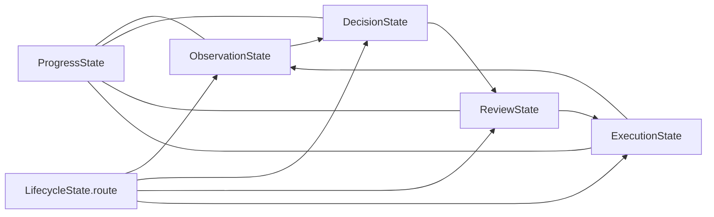

# 상태와 저장소 계약 지도

기준일: 2026-10-21

이 문서는 런타임 상태와 계층 간 인터페이스의 기준 위치를 한 곳에 모읍니다. 설명과 구현이
다르면 해당 계약을 소유한 코드와 이 문서를 같은 변경에서 맞춥니다.

## 계약 소유권

단계 명칭과 실제 구현 범위는 [화면 처리 용어](runtime-terminology.md)를 따른다.
Python 모듈 이름 변경은 `WorkerState` 키나 공개 실행 계약의 변경을 뜻하지 않는다.

| 계약 | 소유 위치 | 소비자 | 책임 |
|---|---|---|---|
| `WorkerState`와 하위 상태 | `brain/graph/state.py` | `brain/graph/workflow.py`, `engine.py`, graph 노드 | 한 실행 안의 관찰·판단·검토·실행·진행 상태 |
| 그래프 라우팅 | `brain/graph/workflow.py` | LangGraph | `lifecycle.route`를 다음 책임 노드 또는 `finish`로 연결 |
| `ExecutionRequest`/`ExecutionResult` | `brain/graph/execution.py` | `engine.py`, relay adapter | 준비된 행동 전달과 relay가 확인한 결과. 업무 성공을 판정하지 않음 |
| 화면 의미 매핑 | `brain/graph/screen_mapping.py` | `screen_decision`, `memory_retrieval` | 의미 이름·bbox·입력 key·행동 point의 모델 경계 |
| 선택 결과의 요청 문맥 | `brain/graph/screen_decision.py`의 `ScreenSelection.prepared` | `decide_screen` → `ground_screen_response` | 같은 판단에서 확장한 교육 상세를 빈 행동 보완에 전달. 거절 후 재계획은 기존 prepared 사용. 턴 간 영구 상태가 아님 |
| 기억 편찬 응답 | `brain/demo_learning/memory_compilation.py`의 `MemoryAssembly` / `MemoryGroupSelection` | 모델 클라이언트, `compile_memory` | 후보 ID로 성공 행동을 선택. context_anchors는 타입 검증 후 첫 8개를 보존하고 초과분 경고 기록 |
| 인출된 화면·행동과 저장 결과 | `brain/cache/methods.py`의 `MethodActionGroup` | `method_from_match`, `compile_memory`, `MemoryRetrieval`, `screen_decision` | 행동 좌표, 관찰 필드 기하·입력 키, 저장 결과 분류·메시지 대상을 보존하고 현재 화면에 결합 |
| 실행 문맥 회상 | `brain/graph/context_recall.py`의 `recall_context` | `screen_decision.build_decision_prompt` | 이번 실행의 이력·누적 증거·남은 입력·진행 상태를 읽음. 선택·모델 호출·상태 변경 없음 |
| 재탐색 요청 | `ScreenMapping.needs_refinement` → `ScreenPlan`/`ScreenMatch` → `SemanticDetection` | `ScreenScanner._resolve` | 필요한 보이는 컨트롤이 없으면 동일 캡처·OCR로 탐색 재진입. provider 스키마에도 존재 |
| pHash 유사 캡처의 화면 해석 | `SemanticRequest` / `_SceneCatalog` | `Brain._detect_visual` → `screen_decision` | 로컬 탐지 기하는 재사용하고 OCR은 현재 프레임에서 다시 실행. 현재 문맥·판단은 공통 순서로 수행 |
| 관찰 경로 선택 | `ScreenScanner.scan` / `MemoryRetrieval.retrieve_screen_memory` | `_SceneCatalog`, `screen_decision` | 캡처 직후 유사도 확인 → 메모리 기하 또는 탐지. 행동 선택은 아직 하지 않음 |
| 시각 공용 자료형 | `sawon_runtime/visual.py` | OCR·탐지·pipeline | 렌더 페이지와 OCR block 계약 |
| 공개 record/action/observation/event | `../agent-sawon-bench/interfaces/sawon_interfaces/contracts.py` | core와 bench | 두 저장소가 공유하는 버전 있는 Pydantic 계약 |
| 공개 스키마 export | `../agent-sawon-bench/interfaces/sawon_interfaces/export_schemas.py` | 외부 소비자·검사 | `sawon_interfaces` JSON Schema 생성 |
| 실행·웜 재현 측정 | `../agent-sawon-bench/harness/reproduction.py` | bench metrics, runner, summary | 신규 결과에 실행 상태 3값과 호출·캐시·메서드 원시 집계를 추가. 기존 결과 필드는 유지하며 과거 기록은 재판정하지 않음 |

core가 bench 구현에서 직접 import할 수 있는 것은 `sawon_interfaces`뿐입니다. 화면 캡처, 입력,
창 관리는 relay HTTP 경계 뒤에 둡니다. `WorkerState`에는 SDK client, relay, 열린 파일 같은
서비스 객체를 넣지 않습니다.

## 상태 수명

노드는 같은 실행의 `WorkerState`를 받아 자기 책임 영역과 `lifecycle.route`를 갱신하고 같은
상태를 반환합니다. `ExecutionResult`의 전달 성공은 업무 완료가 아닙니다. 후속 관찰과 검토가
입력 효과, 저장 결과와 사용자 완료 조건을 확인합니다.

### 입력 메모와 계획 결합

| 상태 | 의미 |
|---|---|
| `verified` | 현재 실행에서 확인한 입력과 대상 descriptor |
| `post_save_verified` | 저장 후 상세 검토에서 확인한 입력 키 |
| `evidence_ledger` | 입력 표면의 소유권·대체·무효화 이력 |
| `pending` | 전달한 행동과 다음 관찰에서 확인할 효과 |

`state_property`와 `progress_property`는 WorkerState의 값을 읽고 쓰는 접근자이며 별도 상태
복사본이 아니다. 확인된 필드가 후속 화면에서 보이지 않는 것만으로 전체 메모를 지우지 않는다.
현재 관찰값 불일치와 증거 대체는 갱신 사유다. 메모에 기록된 입력 확인과 ERP 저장 완료는 구분한다.

`execution_context.pending_actions`는 직전 행동의 intent·입력 source와 출발 screen_kind,
물리 action 종류, 의도한 subgoal을 전달한다. subgoal은 계획의 목적이며 관찰된 성공 사실이
아니다. 과거 frame ref와 좌표를 현재 행동 대상으로 재노출하지 않는다.

저장 후 상세 화면의 첫 관찰에서는 `scan()`이 해석과 다음 계획을 함께 생성한 뒤
`_begin_saved_detail_review()`가 검토 범위와 교육 완료를 확정한다. 이 경계에서는 현재 증거를
먼저 보존하고 확정 전의 다음 계획·후보·계획 오류만 해제한다. Decision은 같은 캡처와 해석에서
갱신된 문맥으로 다시 선택하며 OCR·탐지를 반복하지 않는다. `screen_plan_context_changed`로
이를 기록한다. 해당 경계에서 모델 호출이 하나 늘 수 있으며 매 화면 적용하는 규칙은 아니다.
상세 재진입은 pending 전환을 소비하지만 누적 검토 증거를 초기화하지 않는다. 교육 단계의
선택만으로 관찰된 완료를 되돌리거나 완료 단계로 교육 초점을 덮어쓰지 않는다. 앞 단계로 가는
행동을 거절하는 규칙은 아니며 미완료 교육 단계의 재선택은 유지한다.

`ScreenMatch.from_plan`은 새 계획의 값을 기존 화면 해석보다 우선한다. 전체 ScreenMatch가
반환되면 controls·화면 종류도 새 응답을 사용한다. 직렬화에서 제외되는 mapping은 명시적으로
연결한다. 호출 위치는 `screen_decision.py`의 기존 해석 기반 `grounded_screen_plan` 경로와
`validate_or_replan`의 거절 후 재계획 경로다. 회귀 검증은 `tests/test_plan_composition.py`에 있다.

## 계약 변경 절차

1. 계약 소유 파일에서 필드, 의미와 수명을 먼저 수정합니다.
2. 모든 생산자와 소비자를 저장소 전체에서 검색해 함께 수정합니다.
3. `sawon_interfaces` 변경이면 bench의 계약, export schema, core editable 설치 소비자를 함께
   검사하고 schema version 변경 필요성을 판단합니다.
4. `WorkerState` 변경이면 `create_worker_state`, 네 그래프 노드, fake/replay fixture와 상태
   직렬화 소비자를 확인합니다.
5. 실행 계약 변경이면 relay 전달 성공과 업무 완료가 섞이지 않는지 검증합니다.
6. Pydantic 계약의 JSON Schema가 외부 응답 형식에 영향을 주면 fixture를 의도적으로 갱신하고
   차이를 검토합니다.
7. 이 문서와 [현행 런타임 기준](current-runtime.md)을 같은 변경에서 갱신합니다.

서비스에 전체 `Brain`을 넘기거나 같은 상태를 별도 객체에 반복 복사해 새 계약처럼 만들지
않습니다. 이미 존재하는 공용 계약을 확장할 수 있는지 먼저 확인합니다.

## 인출된 증거와 저장 결과

`MethodActionGroup.observed_fields`는 관찰한 필드의 의미·bbox·role을, `field_sources`는
필드 이름 → 업무 입력 key를 저장합니다. 이전 입력값은 저장하지 않습니다. 생산자는
`ScreenMapping.local_payload`의 내부 `selected_fields`와 `method_from_match`이며,
런타임 학습·편찬 모두 이 함수를 사용합니다. `compile_method_candidate`의 중복 판정에도
이 필드를 포함해 서로 다른 관찰 정보를 지우지 않습니다. 옛 산출물은 빈 기본값으로 읽습니다.

`MemoryRetrieval.retrieve_screen_memory`은 같은 교육 digest·목표의 기억에서 기존 viewport·pHash
조건을 적용해 가장 가까운 화면의 기하·입력 키 대응·절차를 반환합니다. 같은 거리의 그룹은
같은 role과 공용 `same_control_region` 판정으로 합치며 bbox 완전일치를 요구하지 않습니다.
이 읽기는 pending·used·verified를 갱신하지 않습니다. 화면이 비슷하다는 사실은 행동 선택이나
완료 증거가 아닙니다. `match_pattern`이 기존 단계 문맥으로 행동을 결합하고, 현재 OCR에서
일치한 값만 공통 증거 갱신 경로에 들어갑니다. 현재 프레임의 marker ID는 새로 배정합니다.

`retrieve_screen_memory`의 필드에는 현재 슬롯에 연결한 `source`가, `procedure`에는 학습한
행동·선행 그룹·예상 결과가 들어갑니다. `group_input_sources`는 인출과 현재 값 증거 연결의
공용 변환입니다. 행동 후보 선택 전에 이 지식을 `remembered_fields`와 `retrieved_procedure`로
모델에 전달합니다. 이 정보는 과거 지식이며 이번 실행의 완료 상태와 구분합니다.

`MethodLibrary.bind_visible_value_evidence`는 현재 OCR에서 입력값이 일치한 경우에만 증거를
만듭니다. 이때 증거 대상도 행동 대상과 동일한 `screen.markers` / `selected_fields`에 등록합니다.
현재 프레임의 같은 role·겹치는 입력 영역은 같은 ID를 사용하며, 다른 그룹의 새 대상에는 새 ID를
배정합니다. 영역 판정은 장면의 기존 중복 기준(IoU >= 0.85)을 기억 인출·좌표 결합·장면 보충이
공유합니다. bbox의 1–2픽셀 차이로 같은 칸을 두 번 만들지 않으며, 저장된 클릭 point는 바꾸지
않습니다. 이 ID는 현재 장면 결합용이며 메서드의 영구 업무 key가 아닙니다.
이후 `ground_meanings` → `bind_scene` → `_remember_model_task_evidence`의 기존 경로가 메모를
갱신합니다. 전달 성공만으로 입력이나 저장 완료를 메모에 추가하지 않습니다.

`MethodActionGroup`의 `save_result`, `message_targets`, `repair_fields`는 모델 판단의 저장 결과를
보존합니다. `message_targets`에는 `targets`의 이름을 저장하고, 해당 대상의 bbox와
`anchor_texts`에 메시지 위치와 텍스트를 보관합니다. 입력값 부분은 입력 key 자리표시자로
바꿉니다. 생산자는 `method_from_match`이며 런타임 학습과 편찬 CLI가 이 함수를 공유합니다.

소비자는 `MethodLibrary.bind_with_context`입니다. 기존 viewport·pHash 조건을 통과한 뒤 현재
메시지를 입력값이 치환된 텍스트와 정규화 비교하여 저장 결과를 재결합합니다.
`screen_decision`은 재결합된 결과와 메시지가 있는 메서드를 `save_result` 단계에서도 선택합니다.
`compile_match`와 `SaveReviewResponse`의 기존 변환·검증은 유지합니다. 이 결과는 다음 행동을
위한 저장 화면 해석이며 작업 전체 성공 선언이 아닙니다.
`compile_match`가 조립한 딕셔너리는 `bind_proposal`에서 원본을 변경하지 않고 현재 장면의
참조로 결합합니다. 임시 Pydantic 모델을 거치지 않으며, 최종 실행 스키마의 검증은 유지합니다.

새 필드가 없는 이전 메서드는 기본값 `None` / 빈 목록으로 읽습니다. 메시지가 없거나 현재
내용이 다르면 저장 결과를 재사용하지 않고 기존 화면 캐시·모델 판단 경로로 넘깁니다.
이전 산출물에 없던 메시지는 자동 복원하지 않으므로 새 저장 결과 재사용에는 재편찬이 필요합니다.
이 저장 결과 전달은 공개 인터페이스와 행동 응답의 필드·제약을 바꾸지 않습니다.
편찬 응답 타입의 이름 변경은 [화면 처리 용어](runtime-terminology.md)에 별도로 기록합니다.

기억 편찬의 앵커 절단 경고는 logging과 편찬 실행의 RunLog verify 이벤트
`warm_context_anchors_truncated`에 남긴다. 이벤트에는 group_index, retained, discarded를
기록하고 앵커 원문은 넣지 않는다. 앵커 리스트의 원래 순서를 유지하며, 후보 ID·행동·좌표·
입력 출처 검증 및 다른 응답 필드의 제한은 이 경고 정책으로 완화하지 않는다.

편찬 전체 설명인 `MemoryAssembly.purpose`는 1–300자를 허용하며 `LearnedMethod.purpose`에
원문을 보존합니다. 300자를 넘으면 파싱 단계에서 거절합니다. 그룹별 설명인
`MemoryGroupSelection.purpose`의 160자 제한과 `expected_result`의 240자 제한은 별도입니다.

## 거절 진단 산출물

거절 기록은 판단 계약이 아니라 비공개 진단 산출물이다. `sawon_runtime/storage.py`의
`record_rejection`은 기존 `verify` 이벤트에 검증 경계·예외 발생 위치·산출물 경로를 추가한다.
`case/diagnostics/*.json`에는 거절 이유, 해당 경계가 받은 응답, 문맥과 예외 위치를 저장한다.
이 응답은 이미 정규화된 객체일 수 있으므로 공급자 원문과 구분한다.
공급자 원문은 `models/base.py`가 `diagnostics/model-<call_id>.json`에 보관하며,
`model_call` 이벤트의 `call_id`, `context`, `response_artifact`로 추적한다.

화면 비교 거절은 `brain/visual/scanning.py`가 실제 비교한 두 캡처와 pHash·거리·기준을
기록한다. bench의 `relay/service.py`와 `relay/api.py`는 relay artifact 디렉터리의
`diagnostics/<id>/rejection.json`에 요청과 이유를 기록한다. relay는 현재 pHash를 판정에
사용하지 않으므로 값은 null과 미사용 사유로 표시한다. HTTP 오류 응답에는 원문을 노출하지 않는다.
진단 파일·이벤트 저장 실패는 기존 거절·재시도·종료 결과를 변경하지 않는다. 다만 기존 필수
비용 로그의 저장 실패 정책은 그대로다. 이 산출물은 Git에 포함하지 않는다.

## 신규 실행 측정 계약

bench 외부 에이전트 설정의 `execution_phase`로 cold/warm/unknown을 명시한다.
신규 trial 결과의 `execution_outcomes`는 ERP 채점, 작업자 정상 성공 종료, 웜 성공,
웜 재현을 분리하며 `true`, `false`, `unknown` 문자열로 저장한다. 화면 캐시 허용·비허용
재현값을 모두 보존하고 공식 정책을 임의로 선택하지 않는다. `execution_trace`에는 purpose별
호출, 호출 분류, 캐시 선택, origin별 메서드 중단·전달 수를 남긴다.
검토 호출은 모델 개입으로 집계하고 문서 추출·로컬 탐지는 별도로 센다.
정의와 생산자·소비자는 bench `harness/README.md`, `reproduction.py`, `metrics.py`,
`runner.py`, `run.py`, 회귀 검증은 `tests/test_reproduction.py`가 소유한다.
이 측정은 종료 후 하네스 집계이며 작업자의 행동·종료 판정이나 공개 RunEvent 계약은 바꾸지 않는다.

### OCR 카탈로그 재사용

`ScreenScanner`는 SHA256 대신 pHash 해밍 거리로 실행 중 로컬 탐지 기하를 선택한다.
같은 창 handle·화면 크기에서 `methods.max_phash_distance` 이내인 가장 가까운 원본 카탈로그를
재사용하며, 거리가 같은 경우 최근 항목을 선택한다. 재사용한 프레임으로 기준 해시를 이동시키지 않는다.
`screen_similarity.source=phash_catalog`, `similar_form_reused.phash_distance`에 판정을 기록한다.
OCR은 pHash 거리와 관계없이 매 캡처에서 다시 실행한다. 따라서 입력값과 버튼 문구 같은 현재
텍스트를 이전 프레임에서 가져오지 않는다. pHash 유사도 자체는 입력값 또는 업무 완료의 증명이 아니다.
입력칸 값 OCR은 독립 검출기의 작은 경계 오차를 허용하기 위해 OCR 상자의 85% 이상이 해당
`edit`/`combobox` 영역에 포함되면 연결한다. 일반 텍스트와 구조 부모의 포함 계약은 바꾸지 않는다.

## 화면 전용 공개 관찰

relay의 `Observation`은 `visual_only` 캡처 봉투이며 `elements=[]`이다. 화면이
차단되지 않았다면 창과 캡처 geometry가 필요하다. `SceneObservation`만 OCR 의미
요소와 부모·행 관계를 가진다. `UIElement`에는 외부 자동화 식별자 필드가 없다.
relay 입력은 내부 요소 ref를 현재 캡처의 `ImageTarget`으로 변환한 뒤 전달한다.
트리 탐색 깊이 설정은 사용하지 않는다. 공용 계약을 바꾸면 bench schema export와
core의 HTTP·장면 테스트를 함께 확인한다.
