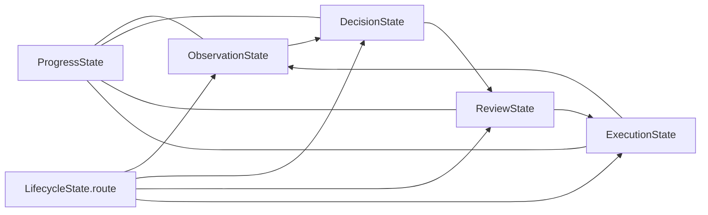

# 상태와 저장소 계약 지도

기준일: 2026-10-18

이 문서는 런타임 상태와 계층 간 인터페이스의 기준 위치를 한 곳에 모읍니다. 설명과 구현이
다르면 해당 계약을 소유한 코드와 이 문서를 같은 변경에서 맞춥니다.

## 계약 소유권

| 계약 | 소유 위치 | 소비자 | 책임 |
|---|---|---|---|
| `WorkerState`와 하위 상태 | `brain/graph/state.py` | `brain/graph/workflow.py`, `engine.py`, graph 노드 | 한 실행 안의 관찰·판단·검토·실행·진행 상태 |
| 그래프 라우팅 | `brain/graph/workflow.py` | LangGraph | `lifecycle.route`를 다음 책임 노드 또는 `finish`로 연결 |
| `ExecutionRequest`/`ExecutionResult` | `brain/graph/execution.py` | `engine.py`, relay adapter | 준비된 행동 전달과 relay가 확인한 결과. 업무 성공을 판정하지 않음 |
| 화면 의미 매핑 | `brain/graph/screen_mapping.py` | matching, method runtime | 의미 이름·bbox·입력 key·행동 point의 모델 경계 |
| 선택 결과의 요청 문맥 | `brain/graph/matching.py`의 `MatchSelection.prepared` | `match_screen` → `ground_match_response` | 같은 판단에서 확장한 교육 상세를 빈 행동 보완에 전달. 거절 후 재계획은 기존 prepared 사용. 턴 간 영구 상태가 아님 |
| 웜 편찬 응답 | `brain/demo_learning/warm_methods.py`의 `WarmMethodAssembly` / `WarmGroupSelection` | 모델 클라이언트, `compile_warm_method` | 후보 ID로 성공 행동을 선택. context_anchors는 타입 검증 후 첫 8개를 보존하고 초과분 경고 기록 |
| 시각 공용 자료형 | `sawon_runtime/visual.py` | OCR·탐지·pipeline | 렌더 페이지와 OCR block 계약 |
| 공개 record/action/observation/event | `../agent-sawon-bench/interfaces/sawon_interfaces/contracts.py` | core와 bench | 두 저장소가 공유하는 버전 있는 Pydantic 계약 |
| 공개 스키마 export | `../agent-sawon-bench/interfaces/sawon_interfaces/export_schemas.py` | 외부 소비자·검사 | `sawon_interfaces` JSON Schema 생성 |

core가 bench 구현에서 직접 import할 수 있는 것은 `sawon_interfaces`뿐입니다. 화면 캡처, 입력,
창 관리는 relay HTTP 경계 뒤에 둡니다. `WorkerState`에는 SDK client, relay, 열린 파일 같은
서비스 객체를 넣지 않습니다.

## 상태 수명

노드는 같은 실행의 `WorkerState`를 받아 자기 책임 영역과 `lifecycle.route`를 갱신하고 같은
상태를 반환합니다. `ExecutionResult`의 전달 성공은 업무 완료가 아닙니다. 후속 관찰과 검토가
입력 효과, 저장 결과와 사용자 완료 조건을 확인합니다.

## 계약 변경 절차

1. 계약 소유 파일에서 필드, 의미와 수명을 먼저 수정합니다.
2. 모든 생산자와 소비자를 저장소 전체에서 검색해 함께 수정합니다.
3. `sawon_interfaces` 변경이면 bench의 계약, export schema, core editable 설치 소비자를 함께
   검사하고 schema version 변경 필요성을 판단합니다.
4. `WorkerState` 변경이면 `create_worker_state`, 네 그래프 노드, fake/replay fixture와 상태
   직렬화 소비자를 확인합니다.
5. 실행 계약 변경이면 relay 전달 성공과 업무 완료가 섞이지 않는지 검증합니다.
6. Pydantic 계약의 JSON Schema가 외부 응답 형식에 영향을 주면 fixture를 의도적으로 갱신하고
   차이를 검토합니다.
7. 이 문서와 [현행 런타임 기준](current-runtime.md)을 같은 변경에서 갱신합니다.

서비스에 전체 `Brain`을 넘기거나 같은 상태를 별도 객체에 반복 복사해 새 계약처럼 만들지
않습니다. 이미 존재하는 공용 계약을 확장할 수 있는지 먼저 확인합니다.

웜 편찬의 앵커 절단 경고는 logging과 편찬 실행의 RunLog verify 이벤트
`warm_context_anchors_truncated`에 남긴다. 이벤트에는 group_index, retained, discarded를
기록하고 앵커 원문은 넣지 않는다. 앵커 리스트의 원래 순서를 유지하며, 후보 ID·행동·좌표·
입력 출처 검증 및 다른 응답 필드의 제한은 이 경고 정책으로 완화하지 않는다.

## 거절 진단 산출물

거절 기록은 판단 계약이 아니라 비공개 진단 산출물이다. `sawon_runtime/storage.py`의
`record_rejection`은 기존 `verify` 이벤트에 검증 경계·예외 발생 위치·산출물 경로를 추가한다.
`case/diagnostics/*.json`에는 거절 이유, 해당 경계가 받은 응답, 문맥과 예외 위치를 저장한다.
이 응답은 이미 정규화된 객체일 수 있으므로 공급자 원문과 구분한다.
공급자 원문은 `models/base.py`가 `diagnostics/model-<call_id>.json`에 보관하며,
`model_call` 이벤트의 `call_id`, `context`, `response_artifact`로 추적한다.

화면 비교 거절은 `brain/visual/perception.py`가 실제 비교한 두 캡처와 pHash·거리·기준을
기록한다. bench의 `relay/service.py`와 `relay/api.py`는 relay artifact 디렉터리의
`diagnostics/<id>/rejection.json`에 요청과 이유를 기록한다. relay는 현재 pHash를 판정에
사용하지 않으므로 값은 null과 미사용 사유로 표시한다. HTTP 오류 응답에는 원문을 노출하지 않는다.
진단 파일·이벤트 저장 실패는 기존 거절·재시도·종료 결과를 변경하지 않는다. 다만 기존 필수
비용 로그의 저장 실패 정책은 그대로다. 이 산출물은 Git에 포함하지 않는다.
