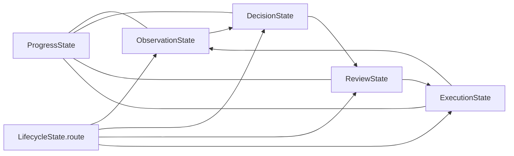

# 상태와 저장소 계약 지도

기준일: 2026-10-18

이 문서는 런타임 상태와 계층 간 인터페이스의 기준 위치를 한 곳에 모읍니다. 설명과 구현이
다르면 해당 계약을 소유한 코드와 이 문서를 같은 변경에서 맞춥니다.

## 계약 소유권

| 계약 | 소유 위치 | 소비자 | 책임 |
|---|---|---|---|
| `WorkerState`와 하위 상태 | `brain/graph/state.py` | `brain/graph/workflow.py`, `engine.py`, graph 노드 | 한 실행 안의 관찰·판단·검토·실행·진행 상태 |
| 그래프 라우팅 | `brain/graph/workflow.py` | LangGraph | `lifecycle.route`를 다음 책임 노드 또는 `finish`로 연결 |
| `ExecutionRequest`/`ExecutionResult` | `brain/graph/execution.py` | `engine.py`, relay adapter | 준비된 행동 전달과 relay가 확인한 결과. 업무 성공을 판정하지 않음 |
| 화면 의미 매핑 | `brain/graph/screen_mapping.py` | matching, method runtime | 의미 이름·bbox·입력 key·행동 point의 모델 경계 |
| 시각 공용 자료형 | `sawon_runtime/visual.py` | OCR·탐지·pipeline | 렌더 페이지와 OCR block 계약 |
| 공개 record/action/observation/event | `../agent-sawon-bench/interfaces/sawon_interfaces/contracts.py` | core와 bench | 두 저장소가 공유하는 버전 있는 Pydantic 계약 |
| 공개 스키마 export | `../agent-sawon-bench/interfaces/sawon_interfaces/export_schemas.py` | 외부 소비자·검사 | `sawon_interfaces` JSON Schema 생성 |

core가 bench 구현에서 직접 import할 수 있는 것은 `sawon_interfaces`뿐입니다. 화면 캡처, 입력,
창 관리는 relay HTTP 경계 뒤에 둡니다. `WorkerState`에는 SDK client, relay, 열린 파일 같은
서비스 객체를 넣지 않습니다.

## 상태 수명

노드는 같은 실행의 `WorkerState`를 받아 자기 책임 영역과 `lifecycle.route`를 갱신하고 같은
상태를 반환합니다. `ExecutionResult`의 전달 성공은 업무 완료가 아닙니다. 후속 관찰과 검토가
입력 효과, 저장 결과와 사용자 완료 조건을 확인합니다.

## 계약 변경 절차

1. 계약 소유 파일에서 필드, 의미와 수명을 먼저 수정합니다.
2. 모든 생산자와 소비자를 저장소 전체에서 검색해 함께 수정합니다.
3. `sawon_interfaces` 변경이면 bench의 계약, export schema, core editable 설치 소비자를 함께
   검사하고 schema version 변경 필요성을 판단합니다.
4. `WorkerState` 변경이면 `create_worker_state`, 네 그래프 노드, fake/replay fixture와 상태
   직렬화 소비자를 확인합니다.
5. 실행 계약 변경이면 relay 전달 성공과 업무 완료가 섞이지 않는지 검증합니다.
6. Pydantic 계약의 JSON Schema가 외부 응답 형식에 영향을 주면 fixture를 의도적으로 갱신하고
   차이를 검토합니다.
7. 이 문서와 [현행 런타임 기준](current-runtime.md)을 같은 변경에서 갱신합니다.

서비스에 전체 `Brain`을 넘기거나 같은 상태를 별도 객체에 반복 복사해 새 계약처럼 만들지
않습니다. 이미 존재하는 공용 계약을 확장할 수 있는지 먼저 확인합니다.
