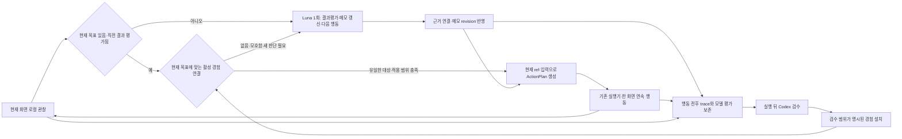

# 업무 메모와 경험 재사용 수정 계획 · 2026-10-03

상태: **제안·독립 설계 검토 반영 완료**. 이번 작업은 계획과 검토이며 생산 코드 변경이나 실화면 실행이 아니다.
기준 소스: core `b9960ffd0a2eb9f437a897739492c836579d2934`, bench `ee99053d61daec7ac5a8523f8d76ec19bad97401`.
현재 M1/M2 미완료, Luna 주 경로, 모델 화면 판단과 마지막 Codex 영상·로그 검수 조건을 유지한다.

## 1. 목적과 검토에서 바로잡은 전제

목적은 사용자가 설명한 일을 수행하면서 얻은 경험을 다음 실행의 현재 화면에 다시 연결하는 것이다.
L2C의 사이트명·검색어 계약을 복사하기보다 `목표 → 관찰 → 경험 적용/새 판단 → 실행 → 결과 기록`을 적용한다.

직전 분석 중 다음 단정은 수정한다.

- `task_plan`은 완전 미사용이 아니다. `Brain.plan`을 통해 초기화·notebook 저장·일부 프롬프트에 사용된다.
  부족한 것은 목표별 진척, 입력을 사용한 맥락, 관찰된 결과를 보존하는 구조다.
- 네 책임 그래프는 공유 상태와 실행 승인 순서를 실제로 관리한다. 단순 이름 변경으로 평가하지 않는다.
  Observation 안의 의미 검증과 `Brain`에 남은 상태의 소유권을 좁은 변경으로 정리한다.
- generic task는 `phase=task`로 분리되고 레거시 조회·완료 분기의 일부를 이미 우회한다.
  레거시 코드가 존재한다는 사실만으로 최신 실패 원인이라고 단정하지 않는다.
- TaskGraph 전체 생성기와 별도 계획 모델 호출은 첫 단계의 필수품이 아니다.
  먼저 모델이 정한 현재 하위 목표와 작업 메모를 보존한다. 의존 그래프는 이 계약이 필요로 할 때 확장한다.
- 의미·행동을 한 모델 응답으로 받는 것은 유지할 가치가 있다. 내부 책임 분리와 API 호출 분리는 다르다.
- seed0/17/27/10은 같은 선적 업무의 화면 변형이다. 시드 변경 성공으로 다른 업무 호환을 주장하지 않는다.
- 067–069 원본 `record.json` 6개를 비교하니 업무 fields는 모두 같았다. harness는 기본적으로 같은
  record를 쓰고 case_id만 바꾼다. 앞선 '시드별 업무값이 달라져 miss'는 이 실행의 실증 원인으로
  확정할 수 없다. key에 값이 포함돼 새 값 재사용을 막는 구조 문제와 실제 UI/계약 차이를 구분한다.

근거: `brain/graph/engine.py`의 `_plan_node`, `_decision_policy`, 네 책임 노드,
`brain/graph/matching.py`의 `task_action_contract`, `compile_match`, `brain/graph/notebook.py`.

## 2. 수정 우선순위의 근거

| 확인된 현상 | 원인 범위 | 계획에 반영 |
| --- | --- | --- |
| 022에서 입력 후 예전 fill 계획이 거절됨 | 관찰 결과 적용과 다음 제안의 상태 버전 불일치 | 결과 평가를 메모에 반영한 뒤 제안 수용 |
| 024–028에서 올바른 선택·값에도 다음 단계 실패 | source/effect/anchor/배치 경계 사이 정보 손실 | 기존 ActionPlan·전이 계약을 공통으로 사용 |
| 033의 현재 대상이 catalog에서 빠져 단일 클릭 반려 | 일부 의미 해석을 전체 대상 목록으로 취급 | 원본 후보와 해석을 분리하고 참조 대상만 결합 |
| 061–062에서 정상 입력이 코드 IoU 검토에 반려 | 과거 geometry로 업무 의미를 다시 판정 | 모델 의미 평가 유지, 기계적 실행 검사와 분리 |
| 038에서 중복 행동 0/30, 시간 239.400초 | 실행 순서 개선과 속도 개선은 별개 | 정확성·호출·지연을 별도 판정 |
| 042→043에서 203.725→82.352초, Luna 26→5회 | 검증된 동일 상황 재사용 효과 | 재사용 단위를 현재 값과 분리 |
| 045에서 38.604초, OpenAI 0회 | 직후 동일 상태 exact hit | 범용 무모델 실행의 증거로 확대하지 않음 |
| 067–069에서 타 시드 exact hit 0 | 전체 상태 key, 계약 변화, 모델 경로 실패 | 값 변경·화면 변경·업무 변경을 나눠 측정 |

개별 패치와 전체 성공 사이의 인과는 대부분 통제된 A/B가 아니다. 위 표는 기록에서 확인된 현상과
직접 코드 원인을 뜻하며 모든 개선의 일반 성공률을 입증하지 않는다.

## 3. 유지할 구현과 새 책임

재사용: `MeasuredModelClient`, 상주 GPU OCR/탐지, `resolve_input_key`, `VisualPointBindings`,
`ActionPlan/execute_plan`, `PendingAction/ActionTransition`, append-only `RunLog`, 원자 상태 저장,
기존 네 책임 그래프와 relay HTTP. UIA/고정 절차/모델 비교 경로는 별도 프로필로 재현 가능하게 둔다.

| 책임 | 데이터/판단 소유자 | 코드가 확인할 것 |
| --- | --- | --- |
| 사용자 요구 | 불변 TaskInstruction·TaskInputRecord | 스키마, 입력 key, 버전 |
| 현재 화면 | 현재 캡처/OCR/탐지 후보, 모델의 관련 해석 | 현재 ID·범위·출처 연결 |
| 업무 진척·다음 하위 목표 | 모델이 현재 근거로 갱신하는 TaskProgress | 관찰/행동 참조와 메모 revision |
| 행동 전달 | 기존 ActionPlan·relay | 허용 창, source, 좌표, 순서, 실제 전달/부분 실패 |
| 업무 의미·완료 평가 | 현재 화면 모델, 실행 뒤 Codex 검수 | 현재 근거 참조의 존재; 값/IoU로 재판정하지 않음 |
| 경험 활성화 | 원본 trace와 Codex 검수 artifact를 연결하는 명시적 설치 | 출처·범위·해시·버전, 모델 주장과 검수 구분 |

현재 model-only 설정에도 단일 입력/선택의 코드 값 검사가 일부 남아 있다. 이름만으로 제거됐다고
간주하지 않고 일반 경로의 실제 호출자를 정리한다. 현재 좌표·source 검사까지 제거하지 않는다.

목표 흐름은 다음과 같다. 화살표는 책임 이동이지 추가 유료 호출을 뜻하지 않는다.

## 4. 계약 초안

### TaskProgress — 재작성 가능한 업무 메모

- `revision`, `current_subgoal{id, purpose, input_keys}`, `pending_effect`, `outcomes`, `work_notes`.
- 하위 목표 ID는 메모 내 안정된 ID다. 공통 capability ID인 `task-action`과 분리한다.
  이 실행별 ID를 영속 Skill key로 사용하지 않는다. Skill은 scope·목적·슬롯 계약으로 후보를 검색한다.
- `outcomes`에는 `action/group_id`, 현재 `observation_id`, 모델의 `achieved/not_achieved/uncertain`,
  근거 ID와 작성 주체를 기록한다. 코드가 수행 성공을 새로 추론하지 않는다.
- 입력은 영구 완료 플래그로 처리하지 않는다. 같은 값의 조회·등록·저장 후 확인을 각각의 사용 맥락에 기록한다.
  `available_inputs`와 `current_subgoal.input_keys`, 맥락별 증거를 분리한다.
- 모델은 하위 목표를 수정할 수 있고 이미 달성된 목표를 다시 수행할 때는 현재 변경 근거를 남긴다.
  목표 문자열이 바뀌었다는 이유만으로 기존 반복 한도를 초기화하지 않는다.
- 전체 작업 지시와 제약은 매 판단에 보존한다. 큰 전체 이력은 재전송하지 않고 근거 참조를 갖춘 짧은 메모를 보낸다.

### 기존 응답·전이 계약 확장

기존 `ScreenMatch/ScreenPlan`에서 현재 의미, 이전 행동의 `outcome_assessment`, `progress_update`,
다음 행동을 같은 호출로 받는다. 내부에서는 별도 필드로 보존하며 `expected_result`를 성공 근거로 사용하지 않는다.
새 관찰 결과로 메모를 갱신한 뒤 같은 응답의 다음 제안을 그 revision에 결합한다.
`based_on_revision`과 `requires_outcome[{group_id,status}]`로 명시된 참조 불일치만 검사하며,
코드가 자연어 업무 의미를 비교하는 검토기를 만들지 않는다. 참조가 충돌한 제안만 재판단하고,
같은 화면 OCR과 정상 대상은 재사용한다.

현재 하위 목표가 없는 최초 화면은 사용자 선언 또는 최초 통합 모델 응답이 목표를 정한다.
`pending_effect`가 미평가이면 다음 관찰의 기존 통합 호출에서 결과평가와 다음 행동을 함께 받는다.
이때 Skill 후보를 같이 전달해 사용할 기술을 고를 수 있지만 결과평가 뒤 별도 판단 호출을 추가하지 않는다.
캐시 hit만으로 목표를 선택하거나 이전 결과를 성공 처리하지 않는다. 한 기술은 우선 한 화면의 행동
묶음으로 제한하며, 그 안의 연속 입력은 기존처럼 한 번의 후속 관찰로 평가한다. 화면 경계를 넘는
미평가 행동을 무제한 이어붙이는 다단계 재생은 이번 첫 구현 범위에 넣지 않는다.

기존 `ActionTransition`에 하위 목표·배치 ID·모델 업무 평가 provenance를 연결한다. `delivered`,
`model_assessed`, `codex_reviewed`를 구분한다. 한 화면 묶음 중 일부만 전달된 경우를 완전 성공으로 기록하지 않는다.
무모델 실행에도 전달과 다음 관찰 trace를 기록한다. 모델 평가가 없으면 미평가로 남기고 pending을 덮어쓰지 않는다.

### LocalSceneCatalog와 BoundExperience — 유료 호출 전 접지 경계

`VisualPerception`의 기존 `_SceneCatalog`·상주 수집 코드를 이용해 현재 wire/capture/OCR/detector/marker를
담는 `LocalSceneCatalog`를 만들고, `_resolve/self.detect` 의미 호출을 그 뒤의 선택 경계로 분리한다.
기존 semantic lookup의 위치만 앞당기면서 모델이 만든 SceneObservation을 요구하는 순환은 만들지 않는다.
`BoundExperience`는 그 로컬 관찰에서 찾은 현재 target/ref/좌표/slot map만 갖고 기존 ActionPlan으로 컴파일한다.
`semantic.py`의 입력 전용 저장소나 `rebind.py`의 복수 필드 전제를 새 범용 경험 계약에 강제로 적용하지 않는다.

### Skill 경험 — 실행 가능한 좁은 기술

- `scope`: 앱 계열/관찰 모드/계약 버전, 기술의 목적, 적용 전제. HWND·시드 번호를 기술 식별자로 쓰지 않는다.
- `inputs`: 현재 업무 input key에 결합할 슬롯과 의미. 실제 값은 실행 시 공급한다.
  다른 업무에서 key 이름이 달라지면 사용자 선언 또는 모델이 명시한 slot map을 사용하며 이름 유사도로 추정하지 않는다.
- `target`: 역할·관찰된 라벨·주변 문맥·필요 관계와 식별 가능한 세부 영역. ERP별 라벨을 공통 코드에 쓰지 않는다.
- `actions`: 기존 실행기가 받는 공통 행동 템플릿. 현재 binding 뒤 ActionPlan으로만 실행한다.
- `expected_effect`: 다음에 관찰할 상태와 평가 주체. 클릭 전달/화면 변화는 업무 완료 근거가 아니다.
- `provenance`: 전후 관찰·행동·모델 평가·Codex 검수 범위의 참조와 해시; 원본 데이터는 비공개 artifact에만 둔다.

과거 marker/ref/절대 좌표를 실행 대상으로 복원하지 않는다. 병합 OCR의 세부 클릭은 현재 문자 영역이
따로 식별되거나 검수된 같은 영역 문맥이 성립할 때만 현재 위치에 연결한다. 불명확하면 기존 이미지
좌표 판단 경로를 사용한다. bbox 중심으로 되돌리는 재생은 허용하지 않는다.
과거 `evidence`, `verified`, `complete`, 조회 건수·저장 성공 판정은 실행 템플릿으로 복사하지 않는다.
원본 trace의 ID·좌표·증거는 감사용으로 보존하되 새 실행의 주소나 사실로 사용하지 않는다.

후보 검색용 signature에서는 값·UUID·confidence 노이즈를 제외할 수 있지만, 원본 관찰과 로그는 보존한다.
현재 값, 행 내용, 저장 결과를 지워서 판단 근거를 같게 만드는 정규화는 금지한다. 검색 key는 실행 허가가 아니다.

## 5. 단계별 구현과 완료 조건

| 단계/커밋 단위 | 구체적 수정 | 대상 파일 | 다음 단계 진입 조건 |
| --- | --- | --- | --- |
| P0. 실패 경계와 비교 조건 고정 | 022/033/061–062/065/067–069에서 대표 실패를 합성 replay로 축소; 단일/배치/완료 학습 경로 계측 | 기존 matching/worker/transition/cache 테스트, bench 결과 분석 | 실제 오류 가족과 지연 구간을 재현; 정답을 가짜 출력으로 되돌리는 fixture 제거 |
| P1. 업무 메모 연결 | TaskProgress 추가, 현재 목표·입력 사용 맥락·결과평가 보존; 내부 capability와 모델 하위 목표 분리 | 신규 `brain/graph/task_progress.py`, `state.py`, `notebook.py`, `matching.py`, `context.py`, `engine.py` | 조회에 쓴 값이 새 입력 화면에서도 사용 가능; 검증 전 제안이 최신 메모와 충돌하지 않음; 단계 순서 하드코딩 0 |
| P2. 일반 작업자의 판단 경계 정리 | 단일 ScreenMatch 응답을 해석/평가/행동으로 내부 분리; 원본 후보와 부분 의미 catalog 분리; 일반 task의 잔여 값/IoU 이중 검토와 선적 전용 prompt 문구 정리 | `matching.py`, `visual/perception.py`, `visual/markers.py`, `engine.py`, `screen_batch.py`, `schemas.py` | 관련 없는 분류 오류가 유효 행동을 거절하지 않음; 필요한 target 누락은 국소 보완; 통상 한 화면 추가 계획 호출 0 |
| P3. 경험 기록·검수 설치 | 기존 전이를 확장하고 실패 실행의 정상 부분도 trace/proposed로 보존; Skill 직렬화·검수 manifest 연결 | `transitions.py`, `execution.py`, 신규 `brain/cache/skills.py`, `runtime/storage.py` 재사용 | 후반 실패해도 앞 전이의 근거가 보존됨; 미검수 후보의 자동 실행 0; 부분 전달을 성공으로 승격하지 않음 |
| P4. 현재 화면 재연결과 캐시 격리 | 유료 해석 전 로컬 관찰 경계에서 활성 Skill 조회; 기존 descriptor/rebind 구현에서 모델 불필요 부분 재사용; 모든 캐시의 case별 격리 | `visual/perception.py`, `cache/rebind.py`, `cache/semantic.py`, `cache/visual_match.py`, `cache/experiment.py`, `run.py`, `settings.py` | hit는 Luna 선행 호출 없이 현재 ref/source로 실행; miss는 현재 캡처를 그대로 모델에 전달; 원본 snapshot 해시 불변 |
| P5. 제한 실측·검수·정리 | 아래 학습1쌍+효과4쌍 비교, 직접 영상·로그 검수, 실패 분모 포함 보고; 새 경로로 대체된 분기·테스트만 제거 | bench `harness/run.py`, `harness/runner.py`, `harness/notebook.py`, 관련 기존 테스트·문서 | 실제 저장/최종 확인 결과와 학습·hit·호출·시간을 분리 보고; 통과해도 M1/M2 또는 다른 ERP 완료 선언 없음 |

P1–P2가 첫 구현 묶음이다. 기존 worker·ActionPlan을 통째로 재작성하지 않는다. generic 책임을 먼저
작은 함수/상태 소유자로 옮기고, `Brain`의 더 큰 파일 분리는 동작 안정화 뒤 진행한다.
각 단계에 별도 커밋을 남겨 상태 변경과 캐시 효과를 분리한다. 비교 프로필은 해당 단계 직전 설정으로 고정한다.

## 6. 학습·캐시 정책의 구체적 정리

현재 코드와 문서의 차이:

- visual exact cache는 model-only에서도 단일/이동/완료 응답을 stage하고 최종 success에서 승격할 수 있다.
  model-only fill 배치는 `matched_fields`를 채우지 않으므로 같은 경로로 충분히 학습되지 않는 비대칭이 있다.
- semantic cache는 기본 Luna 프로필에서 꺼져 있고, 조회 위치가 유료 의미 해석 뒤여서 켜는 것만으로
  화면 모델 호출이 사라지지 않는다. exact cache는 `match_screen` 안에서 유료 호출 전에 조회한다.
- 현재 `--cache-isolation`은 semantic cache만 대상으로 하고 `cache.enabled=true`를 요구한다.
  exact cache와 새 경험 저장소까지 격리하는 기능은 구현해야 한다.

새 경로 제안:

1. append-only trace는 실패 여부와 무관하게 남긴다. actor의 성공 판단은 `proposed`의 근거다.
2. 마지막 Codex가 영상·전후 캡처·로그로 판정한 전이만 검수 manifest에 포함한다. 기존 bench 평가와
   Codex의 판정은 별도 필드로 남긴다. actor 자신의 `complete`를 독립 검수로 표시하지 않는다.
3. 기존 사용자 요청의 마지막 Codex 검수 범위 안에서, 검수된 manifest만 후속 제한 파일럿에 명시적으로
   설치한다. 이것은 새 자동 학습 승인이나 외부 업무 승인/전송 권한이 아니다. 구현 전에는 제안 상태다.
4. 처음에는 입력 묶음과 화면 이동 기술을 적용한다. 검색의 결과 해석, 새 행 선택, 저장 성공, 최종 완료는
   현재 화면 모델이 평가한다. 기술 적용 여부와 다음 목표 선택까지 모호하면 모델 호출을 생략하지 않는다.
5. 최초 구조 기준은 재사용 행동의 현재 대상·새 값 결합이다. 결과평가/완료 모델까지 0회라는 목표를 두지 않는다.
   실제 성능은 전체 유료 요청 수·토큰·비용·시간으로 판단한다. cold의 '평가+판단' 1회가 warm의
   '평가' 1회가 되는 경우 호출 수 절감은 0으로 보고한다. 실행계획 생성의 무모델 hit와 전체 무모델 완료를 구분한다.
6. exact 응답과 Skill을 같은 cache 문서에 혼합하지 않는다. 새 실험은 Skill만 활성화해 효과를 분리하고,
   기존 exact/semantic은 고정 비교 프로필로 보존한다. 기존 43개 응답을 새 기술로 자동 변환하지 않는다.
7. 잘못된 재생/불명 결과는 해당 적용을 끝내고 현재 관찰로 돌아간다. 실패 유형과 scope를 기록하고
   같은 상태에서 해당 기술을 되풀이하지 않는다. 한 번의 탐지 miss로 다른 업무의 경험 전체를 폐기하지 않는다.

## 7. 무료 검사와 실측 설계

기존 테스트를 다음 계약별로 통합·보강한다. 과거 실패마다 테스트 파일을 추가하지 않는다.

| 검사 | 입증할 것 |
| --- | --- |
| 메모·상태 | 하위 목표 유지/수정, 조건부 제안 순서, 입력의 여러 화면 재사용, 무효 제안이 fact를 바꾸지 않음 |
| 접지·실행 | marker 재번호·필드 이동·병합 OCR·중복 라벨·무관 parent 오류; 현재 좌표와 source의 실제 relay 호출 |
| 학습 | 실패 실행의 trace 보존, 부분 배치 전달, actor/Codex provenance, 미검수 후보 실행 금지 |
| 경험 적용 | 데이터 A로 배운 템플릿이 B를 입력; A가 실행 요청에 남지 않음; 애매한 연결은 miss와 기존 모델 경로 |
| 캐시 경계 | 선행 모델 없이 hit; 미일치 때 OCR 재실행 없음; off/cold/snapshot 격리; snapshot·원본 로그 불변 |
| 레거시 호환 | 고정 procedure/UIA/Jev 비교 어댑터의 기존 계약과 비용·비밀값 경계 보존 |

변경한 코드 범위의 집중 replay와 함께 양 저장소 필수 `python -m ruff check .`,
`python -m ruff format --check .`, `python -m pytest`를 실행한다. 유료 모델과 GUI는 여기 포함하지 않는다.
새 업무를 흉내 낸 독립 fake relay도 동작 계약 검사로만 표시한다.

실측 조건은 구현 후 실행 전에 동결한다. 추가 상시 스케줄이나 300/1,200건 sweep을 만들지 않는다.

- 학습 비교 1쌍: P1–P4 코드의 seed17 데이터 A에서 cache-disabled와 cold-empty를 실행한다.
  cold-empty 실행의 Codex 검수 결과만 snapshot S로 만든다. 전체 실행 실패여도 검수된 부분만 S에
  설치할 수 있으나 full workflow warm과 구분한다. 사용 가능한 검수 기술이 0이면 후속 warm 비교를 중단한다.
- 효과 비교 4쌍: seed17 데이터 B/C 두 쌍(배치 유지·입력 변경), seed10/27 데이터 B 한 쌍씩
  (B를 고정해 배치 변경 효과 분리). 각 쌍은 같은 업무·값·DB 초기상태의 cold-empty와 S-warm이다.
- 합계 최대 10건이다. A/B/C는 명시적인 별도 합성 record 파일로 만든다. seed를 바꾸는 것만으로
  데이터가 달라진다고 가정하지 않는다. cache-disabled는 영속 기억 조회·학습을 끄지만 원본 실행 로그는 남긴다.
- 모든 warm은 **동일한 동결 snapshot S의 독립 복사본**을 받는다. 쌍의 cold나 앞선 warm 결과로 S를
  갱신하지 않는다. 원본 S와 검수 manifest 해시는 모든 실행 전후에 비교한다.
- cold-empty는 경험 기능을 켠 빈 저장소이며 모델-only cache-off와 다르다. semantic/visual/skill 종류별
  enabled·스키마·working copy·원본 snapshot을 분리한다. 모든 조건은 새 DB·case-dir·프로세스로 시작하고
  OCR/GPU 초기화 정책을 같게 유지해 초기화 시간을 분리한다.
- 실행 순서는 사전 고정해 일부는 cold 먼저, 일부는 warm 먼저 진행한다. 중간 코드 수정 시 남은 셀을
  기존 비교에 합치지 않고 새 revision 실험으로 기록한다.
- ERP 저장값·중복·전송 여부는 bench가 독립 평가하고, 코어에는 ERP 내부/정답/export를 넘기지 않는다.
  worker 상태 성공, ERP 저장 성공, 사용자 저장 후 확인 완료, Codex 검수 결과를 각각 기록한다.
- 구조 목표: 양 조건이 업무를 완료한 쌍에서 새 값/현재 대상의 Skill 적용과 결과 근거가 1회 이상 확인됨.
  성능 목표: 전체 유료 요청·토큰·비용·벽시계 시간의 변화가 원시 수치로 확인됨. 토큰만 줄고 호출/시간이
  같으면 그대로 보고한다. 네 효과 쌍의 실패·부분 완료를 분모에 남기고, 양쪽 성공한 쌍이 없으면 속도 개선을 선언하지 않는다.
- 호출은 화면 판단/좌표 보완/결과평가/완료/로컬 OCR로 나누고, 비용은 학습·검수 준비와 실행을 분리한다.
  `candidate_found`, `bound`, `executed`, `outcome_assessed`를 구분해 단순 검색을 hit 성과로 세지 않는다.
  한 요청이 평가·판단을 함께 수행하면 목적 tags를 여러 개 달아도 total은 1회다. 학습/검수 비용을 포함해
  `S 학습비 + n × warm 비용`과 `n × cold 비용`을 비교하고, 반복 횟수별 상각도 별도 보고한다.
- snapshot/config/task/input/소스/모델/가격/OCR·탐지 환경 hash와 화면 배율·창 크기, DB 초기조건,
  코드 및 review 정책 버전을 manifest에 남긴다. 새 기술 활성화나 표본 제외도 사유를 기록한다.
- 건당 기존 $1/누적 $50 한도 안에서 학습2+비교8건의 제안 상한은 $10다. 실행 시 최신 원장과 미확정
  호출 상태를 다시 읽어 실제 남은 한도를 적용한다. 새 비용 미확정 또는 같은 원인의 반복은 자동 확장 대신 원인 검토로 끝낸다.
  잘못된 신규 값 저장, snapshot 해시 변경, 필수 로그 누락이면 후속 배치를 멈춘다. 같은 원인이 두 쌍에서
  반복되면 남은 쌍을 자동 재시도하지 않는다. 수정 후에는 새 manifest를 사용한다.

4쌍으로 통계적 우월성이나 다른 업무 호환을 주장하지 않는다. 다른 업무는 사용자 설명·입력 의미·완료
조건이 실제로 달라지는 후속 별도 시험이며, 우선 독립 fake/replay로 엔진의 선적 비의존성만 확인한다.

## 8. 설계 검토표와 되돌리기

| 검토 질문 | 판정/조치 |
| --- | --- |
| TaskGraph 신설이 먼저 필요한가? | 보류. TaskProgress부터 붙이고 추상 목표와 경험이 연결되는지 검증 |
| 모델 호출을 분리해야 책임이 분리되는가? | 아니오. 한 응답을 내부 책임별 데이터로 분리하고 적용 순서를 고정 |
| 코드 업무 검토기를 되살리는가? | 아니오. 현재 참조·전달 검사는 유지하고 업무 의미는 모델/마지막 Codex가 평가 |
| 실패 실행도 즉시 신뢰하는가? | 아니오. trace/proposed 보존과 검수된 기술 활성화를 분리 |
| 동적 값을 key에서 빼면 충분한가? | 아니오. 예전 target/좌표 응답을 새 화면에 직접 적용하지 않고 binding을 다시 수행 |
| 프롬프트가 커지는가? | TaskInstruction·현재 목표·관련 슬롯·pending/결과·짧은 메모만 전달하고 원본 이력은 참조로 보존 |
| 새 캐시만 켜면 빨라지는가? | 선행 유료 해석을 피한 경로까지 검증해야 함. 역할/대상 의미가 불명하면 모델 사용 |
| 전면 리팩터링이 필요한가? | 아니오. 기존 실행기/전이를 재사용하며 P1–P2와 P3–P4 효과를 따로 측정 |

각 단계의 profile/계약 버전을 고정한다. 문제 발생 시 해당 프로필의 Skill 실행을 끄고 동일 공통 실행기의
Luna 판단 경로로 돌아간다. 기술 저장소는 삭제하지 않고 비활성 scope와 이유를 기록한다. 이전 실행 로그,
43개 exact 항목, UIA 증거, 레거시 비교 프로필은 자동 수정하지 않는다.

관련 근거: bench `docs/luna-recorded-pilot-analysis-20261002.md`,
`docs/luna-primary-034-action-audit-20261002.md`, `docs/luna-verified-visual-reuse-pilot-20261003.md`,
`docs/luna-cross-seed-cold-warm-20261003.md`, `docs/progress.md`의 056–069 기록.

검토 이력: 런타임/계약, 경험/접지, 비교 실험의 세 독립 읽기 검토를 수행했다. 초안에서 지적된
pending 결과 선처리, 하위 목표 ID의 실행별 범위, 무모델 경로 trace, 호출 수 중복 집계,
캐시 격리 범위와 동일 입력값 문제를 반영했다. 이번 검증은 소스·원본 record 비교와 문서 검토이며
생산 테스트·유료 호출·GUI 입력 결과를 새로 만들지 않았다.
