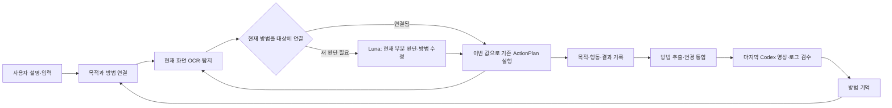

# 업무 수행 방법을 배우고 재사용하는 구현 계획 · 2026-10-03

상태: **1차 방법 학습·현재 화면 결합·기존 실행기 연결 구현, 실제 콜드·웜 저장 성공**.
구현 범위는 보이는 입력 묶음이다. 아래 조회·선택·분기 조합까지 모두 완성했다는 뜻은 아니다.
직전 계획의 `P1 업무 메모 → P2 책임 분리` 우선순위를 이 계획으로 대체한다.
첫 산출물은 **실제 기록에서 방법을 생성하고, 다른 데이터·화면에서 그 방법으로 행동하는 연결된 기능**이다.
Luna 주 경로와 마지막 Codex 영상·로그 검수를 유지한다.

## 1. 현재 부족한 기능

| 현재 코드 | 실제 동작 | 필요한 변화 |
| --- | --- | --- |
| `matching.py:task_action_contract`, `compile_match` | 일반 작업 capability를 task-action으로 표현하고 화면 행동 컴파일 | capability와 별도로 행동의 목적·사용 방법을 실행 전체에서 유지 |
| `cache/visual_match.py:visual_match_key` | 화면·메모·계약 전체 key로 이전 응답 조회 | 목적·입력 역할로 방법을 찾고 현재 값·화면 대상에 연결 |
| `demo_learning/convert.py:_convert` | 연속 관찰의 값 변화를 입력 필드 캐시로 변환 | 목적·행동·관찰 결과를 연결해 수행 방법 생성 |
| `engine.py:_detect_visual` | 로컬 OCR/marker를 받은 뒤 match_screen 호출 | 같은 진입점에서 배운 방법을 먼저 적용 |

TaskProgress는 이번 실행을 기억하는 상태다. 이를 추가하는 것만으로 다음 실행에 쓸 방법이 생기지는 않는다.
앞 계획은 그 차이를 설명하면서도 구현 순서를 상태·검사·분리에 집중했다. 아래는 실제 동작을 만드는 순서다.

## 2. 구현할 세 기능

### A. 기록에서 방법 생성: learn_method(task, trace)

사용자 설명, 실제 입력 출처, 행동 전후 관찰, 전달 행동과 모델의 결과 해석을 기존
ActionTransition·모델 응답에서 모아 MeasuredModelClient를 통해 구조화 추출한다.

모델이 실제로 수행할 변환:

1. 행동들을 목적별로 묶는다. 예: 여러 입력·클릭을 “대상을 조회해 선택”하는 방법으로 묶는다.
2. 업무값을 슬롯으로 바꾼다. A상사 대신 “선택할 대상” 역할과 입력 출처를 남긴다.
3. 대상의 라벨·역할·주변 문맥을 행동에 연결한다. 과거 marker는 기록 참조로 남긴다.
4. 어떤 관찰 때문에 다음 행동을 골랐는지 연결하고 반복·실수·복구를 본 경로와 구별한다.
5. 생성한 방법을 저장하고, 실행기가 그 파일을 읽어 쓰게 한다.

출력은 기존 도구로 실행 가능한 데이터다. 핵심은
`purpose, slots, entry_context, action_groups, observed_branches, result, source_transitions`다.
방법 전체뿐 아니라 “대상 조회·선택”, “관련 필드 묶음 입력”처럼 다른 업무에서도 조합할 수 있는
목적 단위를 추출한다. 특정 ERP 라벨은 경험 데이터에 있고 공통 코드에는 넣지 않는다.

```text
실행 기록: A상사 입력 → 조회 → 다시 조회 → 결과 행 선택 → 확인

생성한 방법:
  목적: 지정한 대상을 조회하여 선택
  슬롯: 선택할 대상
  조회 화면: 슬롯값 입력·조회
  결과 화면: 현재 결과에서 대상 선택·확인
  관찰한 분기와 결과: 원본 전이 참조
```

실제로 경험한 분기와 사용자 설명에서만 받은 요구를 구분한다. 한 번 본 화면에서 모든 분기의 성공을
추론하지 않는다. 실행 끝의 Codex는 생성한 방법이 영상·로그와 맞는지 검수한다.
학습 기능은 모델이 구조화 데이터를 만들고 기존 실행기가 읽는 형태로 구현한다.

### B. 새 입력·현재 화면에 적용: apply_method(method, task, scene, progress)

새 업무에서 목적·입력 역할·앱 문맥으로 방법 후보를 찾는다. 첫 화면의 기존 Luna 판단에 후보를 함께 보내
사용할 방법과 이번 입력의 슬롯 대응을 얻는다. 같은 요청 유형의 저장된 대응은 재사용한다.
새로운 업무의 슬롯 의미를 코드가 이름 유사도만으로 결정하지 않는다.

이후 적용 순서:

1. 현재 목적에 연결된 방법과 관련 슬롯을 읽는다.
2. 현재 OCR/탐지 목록에서 학습한 라벨·역할·문맥에 맞는 대상을 연결한다.
3. 이번 입력값·현재 marker/ref/좌표로 ScreenMatch를 만들고 기존 ActionPlan으로 컴파일한다.
4. 같은 화면 행동을 묶어 실행하고 다음 관찰에서 방법의 이어갈 지점을 찾는다.

순서 인덱스로 앞 화면부터 재생하지 않는다. 방법에 “조회 화면에서 입력”과 “결과 화면에서 선택”이
있다면 현재 관찰과 연결되는 부분을 사용한다. 사용자 설명의 선후 조건은 이번 업무 계획에 유지한다.

현재 대상과 방법의 대응이 성립하면 행동 생성에 모델을 호출하지 않는다. 낯선 용어·새 선택창에서는
`현재 목적 + 선택한 방법 + 관련 슬롯 + 현재 화면`을 기존 통합 호출에 보내 해결한다.
조회 결과 해석·저장 완료처럼 새 업무 사실의 의미 판단이 필요하면 같은 호출에서 결과와 다음 행동을 받는다.
방법을 찾은 뒤에도 전체 ScreenMatch를 매번 호출한다면 호출 절감 기능을 완성한 것이 아니다.

구체 접점은 `engine.py:_detect_visual`이다. 이 함수는 이미 로컬 OCR/marker를 받는다.
여기서 현재 방법을 결합한 ScreenMatch를 먼저 만들고, 이후
`_selection_call → compile_match/compile_screen_action_plan → ActionPlan/execute_plan`을 그대로 사용한다.
처음부터 perception을 대규모로 분해할 필요가 없다. hit의 현재 관찰 ID·visual_proposal 연결까지 기존 경로로 전달한다.

### C. 새 상황에서 방법 수정: adapt_method(method, scene, outcome)

배운 방법은 거래처 직접 입력인데 새 화면에서는 조회창으로 선택해야 할 수 있다.
모델은 “거래처 지정” 목적과 현재 화면을 받아 그 부분의 새 행동 묶음·적용 문맥을 반환한다.
이를 현재 실행의 방법 초안에 반영하고, 새 행동을 수행한 뒤 원래 업무 목표를 이어간다.

- 라벨만 바뀌면 대상 대응을 수정한다.
- 입력 방식이 바뀌면 해당 행동 묶음을 수정한다.
- 업무 조건이 바뀌면 해당 목적의 분기를 수정한다.

수정은 `target_mapping, action_group, branch`에 대한 구조화 변경이다.
기존 화면 판단에서 현재 행동과 method_patch를 함께 받아 상시 별도 학습 호출을 추가하지 않는다.
종료 시 기존 방법과 달라진 부분·근거를 모아 검수하고 후속 실행용 버전으로 저장한다.
**수정된 방법이 같은 실행의 후속 행동을 바꿔야 한다.** 오류 설명을 로그에 추가하는 것만으로 완료하지 않는다.

## 3. 방법 기억과 이번 실행의 연결

| 데이터 | 내용 | 용도 |
| --- | --- | --- |
| 방법 기억 | 목적·슬롯·행동 묶음·관찰 분기·학습한 대상 대응 | 여러 실행에서 재사용 |
| 이번 업무 계획 | 사용자 요구를 수행할 목적들과 관련 방법·입력 대응 | 이번 업무에 맞는 방법 조합 |
| 실행 메모 | 현재 목적·사용 방법·현재 결과·남은 입력 | 진행을 이어가고 국소 수정 |

계획은 사용자 설명과 방법 기억을 모델이 연결한 데이터다. 공통 코드에 선적 업무 순서를 작성하지 않는다.
다른 업무에는 그 설명에 맞는 목적을 세우고 공통 방법 조각을 조합한다. 같은 선적 업무의 시드 변경은
이 중 화면 변화 대응을 시험하는 것이며 다른 업무 호환의 시험과 구분한다.



L2C에서 가져올 핵심은 실행 이벤트를 목적 단위로 묶고 입력을 매개변수화해 다음 실행에 사용하는 연결이다.
참고 구현은 `recipe_execution_graph_service.py:build_candidate_graph_payload`,
`recipe_candidate_review_service.py:_llm_review_graph`, `experience_rule_schema.py:ExperienceRule`이다.

## 4. 구현 순서와 실제 산출물

| 순서 | 구현 범위 | 완료를 보여주는 결과 |
| --- | --- | --- |
| 1. 방법 하나 학습·재사용 | trace 수집 → 모델 추출 → 저장 → 현재 로컬 화면 결합 → 기존 실행을 한 묶음으로 구현 | 기록 A에서 생성한 방법 파일을 실행 B가 읽고 B의 값·현재 대상으로 행동. 해당 warm 행동 생성 구간의 유료 호출 0회 |
| 2. 새 상황에서 방법 수정 | ScreenMatch에 목적·사용 방법·부분 변경을 연결하고 같은 실행에 적용 | 새 선택창 등에서 해당 부분을 보완한 후 업무를 이어가고 다음 실행이 수정 방법을 읽음 |
| 3. 사용자 설명으로 방법 조합 | 목적별 조각 검색·슬롯 대응·진척을 연결해 전체 업무 수행 | 개발자가 절차 코드를 바꾸지 않고 새 설명·입력으로 방법을 조합해 저장·최종 확인까지 완료 |

첫 구현 예제는 “보이는 양식의 관련 슬롯 묶음 입력”이다. A의 실제 대응·실행에서 방법을 생성하고,
B에서는 값과 input key를 바꿔 슬롯을 대응시킨 뒤 현재 필드에 입력한다. C에서는 한 필드가 조회창으로
바뀌도록 하여 그 목적의 방법만 보완한다. 이후 조회·선택·화면 이동 등 방법 종류를 확대한다.

첫 커밋의 중심은 1번의 연결된 기능이다. 필요한 메모 필드·호출 위치 변경은 이 기능에 포함한다.
대규모 코드 분리·새 승인 단계·오류별 방어 규칙 추가를 선행 작업으로 두지 않는다.

수정 위치:
- `brain/demo_learning`: 기존 입력 전용 변환과 구분되는 실제 trace→방법 생성. measured 호출·atomic 저장 재사용.
- `brain/cache`: 방법 저장·검색·대상 연결. 기존 descriptor/label matching의 공통 부분 재사용.
- `engine.py:_detect_visual`: 유료 호출 전 방법 적용. 기존 visual_proposal과 실행 경로 재사용.
- `matching.py, state.py, notebook.py`: 실제 목적·방법·slot map·method_patch 전달. task-action capability가 목적을 덮어쓰지 않게 함.
- `transitions.py`: 목적·방법·현재 결과 연결. ActionPlan·VisualPointBindings·relay는 공통 실행기로 유지.

## 5. 실험과 현재 상태

첫 무료 replay는 기록 A로 생성한 방법을 B의 값·현재 관찰에 결합해 실행 요청으로 이어지는지 확인한다.
실제 모델 추출은 보존된 trace로 측정하고, 이어 실화면에서 새 값을 입력하는지 본다.
수작업 정답 방법이나 fake 추출만 통과시킨 결과를 실제 학습 성공으로 보고하지 않는다.

비교는 같은 화면의 새 값 → 같은 값의 다른 배치 → 같은 목적의 다른 입력 방식 순서로 넓힌다.
각 비교에서 실제 새 값 입력 결과, 적용한 방법·행동 수, 방법 수정 수, 전체 모델 호출·시간·업무 결과를 남긴다.
최종 Codex는 생성·수정된 방법과 영상·로그를 함께 검수한다.
의미 판단 호출이 남으면 해당 호출도 합산한다. 학습 호출 비용을 실행 비용과 함께 보고한다.

이전 최대 10건 비교안은 후속 실측 설계로 보존한다. seed17의 명시적 데이터 A/B/C와 seed10/27의 같은 B로
값 변화와 배치 변화를 나눌 수 있다. cold/warm은 같은 코드·입력·DB 조건과 동결된 방법 snapshot으로 비교한다.
기존 exact/semantic과 새 방법 기억의 효과를 분리한다. 기존 총 $50·건당 $1 범위에서 최신 원장을 적용한다.

유지할 분석 근거:
- 같은 시드 042→043은 203.725→82.352초, Luna 26→5회였다. 직후 반복 045는 OpenAI 0회였다.
  이미 결정한 행동을 재사용하는 방향에는 실제 효과가 있었다.
- 061–062의 과거 입력 상자 IoU 재검토 제거 후 065에서는 실제 저장·10/10 필드 일치를 확인했다.
  올바른 판단의 중복 재판정 제거도 효과가 있었지만 그것만으로 방법 학습이 생기지는 않았다.
- 067–069 시드27/10 비교의 영속 exact hit는 0이었다. 원본 record 6개의 업무값은 같았다.
  해당 실패를 시드마다 입력값이 달라진 탓이라고 확정하지 않는다.
- task_plan·네 책임 그래프·일반 업무 경로는 이미 실제 역할이 있다. 이 계획은 그 경로에 방법 생성·적용·수정을 연결한다.

### 2026-10-03 구현·실측 반영

- `demo_learning.methods`: 실제 전달 행동과 전후 화면을 연결하고, measured Luna 호출로 목적·슬롯의
  의미를 추출한다. 전체 입력 묶음이 전달된 기록만 선택하며 원본 응답의 대상 대응을 현재 화면 결합용으로 변환한다.
- `cache.methods`: 목적·슬롯·라벨 관계·라벨 기준 상대 기하를 저장한다. 현재 OCR과 후보 상자에 연결해
  새 입력값의 ScreenMatch를 만든다. 과거 절대 좌표·marker 번호를 실행 대상으로 재사용하지 않는다.
- `graph.method_runtime`: 기존 화면 판단에서 다음 목적·사용 방법·슬롯 대응을 선택한다. 선택된 방법을
  관찰 시 먼저 적용하고, 결합할 수 없으면 같은 모델 경로로 현재 행동을 판단한다. 실제 전달된 새 입력 묶음은
  실행별 `methods-working.json`에 변형으로 기록한다. 원본 방법 파일은 수정하지 않는다.
- `ScreenMatch → ActionPlan → 공통 실행기`와 관찰별 대상 연결을 재사용한다. 같은 픽셀의 새 관찰에서도
  방법 적용이 가능하며, 로그인·조회·저장·결과 판단은 이번 방법 캐시의 대상이 아니다.
- 실제 기록065에서 Luna 1회($0.0016984)로 11개 입력 역할을 추출했다. 값을 바꾼 seed17 B의
  071 콜드/072 웜은 모두 저장10/10 일치, 중복·승인0건이었다. 전체145.226→124.656초,
  입력 계획 구간13.294→0.487초였다. 웜의 해당 11필드 행동 생성은 모델 호출0회지만,
  로그인 재시도가 추가되어 **전체 Luna 호출은 양쪽13회**였다. 한 쌍의 관측값이며 평균 효과가 아니다.
  ERP 평가기와 core는 성공을 반환했지만 Codex 검수에서는 저장 뒤 별도 재조회를 하지 않은 점을 확인했다.
  따라서 저장·값 일치는 확인했고, 사용자 요구의 재조회까지 이행한 결과로는 계산하지 않는다.
- 다른 배치인073에서는 옅은 입력 테두리가 고정 밝기 임계값에 지워져 모델이 라벨·표 머리글을
  입력칸으로 오인했다. 지역 대비 기반 경계 탐지로 원본 화면의 누락5개를 복원했으며,
  중복 입력 배정 오류가 다음 판단에 구체적 규칙명으로 전달되도록 수정했다.
- 074는 실제 입력5개를 찾았지만 레코드 값을 별도 품목 행에도 배정해 기존 source 유일성 제한에 걸렸다.
  공통 입력 계약은 동일 값의 여러 대상 사용을 허용하고 대상 중복만 제한하도록 수정했다.
  합성 업무 설명에는 제공된 자료의 레코드/품목 범위와 기존 저장 후 재조회 요구를 완료 조건에 명시했다.
- 075는 시드10의 실제 기본 입력5개를 정확히 채웠고 `origin=adaptation, status=delivered`로
  새 입력 묶음을 기록했다. 아래로 이동해야 보이는 나머지6개 입력을 탐지 누락으로 처리해
  `visual_required_control_missing`으로 실패했다. 저장0건이며 이 변형은 후속 공유 방법으로 승격하지 않았다.
  이 실행의 방법 자동 결합은0회다. 모델이 새로운 묶음을 만들었다는 사실을 무호출 재사용으로 계산하지 않는다.

남은 범위는 조회·선택·화면 이동을 포함하는 다단계 방법 학습, 새 입력 방식의 분기 통합,
서로 다른 업무 설명의 방법 조합, 여러 시드 반복 비교다. 현재의 실행별 변형 저장은 전달 기록이며
업무 성공을 자동 승인하거나 검수 전 방법을 공유 저장소로 승격하지 않는다. M1/M2 종료 상태는 유지한다.
다음 구현의 첫 접점은 **화면 밖 대상과 현재 화면의 탐지 누락 구분**이다. 전자는 기존 공통 키/이동
도구로 새 관찰을 얻는 판단이며 후자는 탐지 보완이다. 075에서 후자를 반복한 점을 고쳐야
여러 뷰의 입력 묶음과 이동을 하나의 방법으로 이어갈 수 있다. ERP별 스크롤 위치·탭 순서는 추가하지 않는다.
최신 추가 실행·영상 검수·비용은
[방법 재사용 파일럿 보고서](../../agent-sawon-bench/docs/experience-method-pilot-20261003.md)를 따른다.
이전 상세 분석·비교안은 core 커밋 `5ad7465`에 보존된다.

## 6. 2026-10-04 탐색 실패 수정 계획과 구현

화면 밖 입력을 찾는 기능을 단순 스크롤 규칙으로 늘리지 않고 상태 전이 탐색으로 바꾼다.
구현 순서와 완료 조건은 다음과 같다.

| 단계 | 공통 계약 | 구현·검증 상태 |
| --- | --- | --- |
| 1 | 한 물리 입력면에 상충하는 두 writable 의미를 실행 전에 거절 | 구현. 같은 라벨 근거와 포함 사각형을 현재 캡처의 시각 의미 보정으로 되돌림 |
| 2 | evidence를 누적 딕셔너리가 아닌 active/superseded claim으로 관리 | 구현. 관찰 revision, 입력면 재할당, 새 입력 전달 뒤 무효화를 기록 |
| 3 | 무변화·cycle 전이를 상태와 목표 간극별로 기억 | 구현. key 동작은 임의 포커스 마커를 identity에서 제외하고 다른 전이는 허용 |
| 4 | 모델에 현재 목표와 실패 전이만 전달해 다음 affordance를 선택 | 구현. PageDown 예시를 제거하고 `failed_transitions`를 notebook에 추가 |
| 5 | seed18에서 잘못된 HBL/MBL 매핑 없음, 같은 PageDown 재전달 없음, 저장·재조회 완료 확인 | 실제 ERP 재검증 대기 |

코드는 화면 의미와 행동 후보를 모델에 남긴다. 로컬 계약은 물리 모순, claim 수명, 동일 전이
재실행 여부만 판정한다. 모델이 처음부터 여러 좌표 후보를 모두 내거나 코드가 ERP 탭명을 검색하는
별도 휴리스틱은 추가하지 않는다. 성공한 전이는 기존 방법 기억에 승격하고 실패 전이는 run-local
탐색 원장에만 남긴다. 실제 파일럿에서는 `screen_mapping`, `model_task_evidence_superseded`,
`navigation_no_progress`의 action key, UI 녹화를 함께 대조한다.
