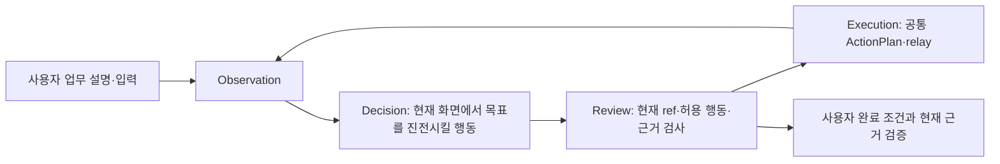

# 일반 ERP 업무 런타임 계약

2026-10-03 사용자 지시에 따라 기본 화면 작업에서 선적 등록 순서와 화면별 단계 목록을
제거했다. 업무가 바뀌면 코드를 고치는 구조가 아니라, 사용자가 제공한 업무 설명과 입력을
같은 작업자 그래프가 해석하는 구조가 목표다.

## 런타임 입력

- `TaskInstruction`: 업무 이름, 목표, 요구사항, 완료 조건, 제약을 담는다.
- `TaskInputRecord`: 이번 건에서 사용할 임의의 이름 있는 입력 값을 담는다.
- 현재 관찰: 허용된 창의 캡처에서 얻은 OCR, 시각 컨트롤, 역할, 값, 좌표를 담는다.
- 중앙 상태: 검증된 입력, 남은 입력, 직전 행동과 결과, 실패·비용 한도를 담는다.

업무 설명에는 ERP 화면 이름, 탭 이름, 좌표, 클릭 순서가 필요하지 않다. 예제
`examples/shipment-task.json`은 한 업무의 사용자 설명이며 실행기 분기를 정의하지 않는다.

## 공통 실행 흐름

모델은 로그인, 직접 입력, 조회·선택, 화면 이동, 저장, 취소, 대기 같은 공통 기능 중
현재 화면에서 가능한 행동을 고른다. 코드는 특정 업무의 순서를 결정하지 않는다. 코드는
현재 관찰에 있는 대상인지, 입력 출처가 이번 업무 데이터인지, 실행 뒤 값이나 화면 변화가
실제로 관찰됐는지, 완료 근거가 사용자의 완료 조건을 가리키는지만 검사한다.

로그인 자격 증명은 업무 입력과 분리한다. 비밀번호 값은 모델과 관찰 기록에 노출하지 않는다.
비용, 허용 창, 만료 캡처, 반복 실패 제한도 업무와 무관한 공통 경계로 유지한다.

## 재사용

의미 캐시는 성공한 실행이 끝난 뒤에만 승격된다. 일반 업무에서도 동적 입력 키, 입력 컨트롤의
역할·라벨 문맥, 전후 값 검증을 사용한다. 캐시는 새 건의 값을 저장하지 않고 입력 위치의 의미만
저장한다. 화면 의미가 맞지 않거나 대상이 모호하면 캐시를 사용하지 않고 현재 화면을 다시 판단한다.

기존 `ProcedureStep` 경로는 과거 결과 재현과 비교를 위해 남겨 두었다. 기본 시각 설정과 하네스
프로필은 `task_path`를 사용한다.

## 현재 검증 범위

동적 업무 키, 사용자 완료 조건 근거, 일반 업무 정책 선택, 일반 업무 의미 캐시를 무료 테스트로
검증했다. 이 변경 뒤 실제 ERP 전체 업무, 서로 다른 ERP 제품, 서로 다른 업무 유형을 연속 수행한
실측은 아직 남아 있다. 따라서 범용 호환 완료나 M1/M2 종료를 선언하지 않는다.
