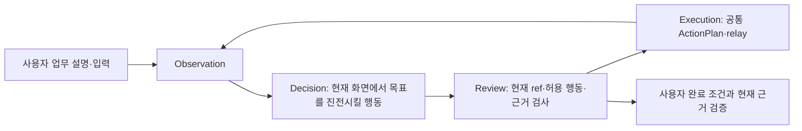

# 일반 ERP 업무 런타임 계약

2026-10-03 사용자 지시에 따라 기본 화면 작업에서 선적 등록 순서와 화면별 단계 목록을
제거했다. 업무가 바뀌면 코드를 고치는 구조가 아니라, 사용자가 제공한 업무 설명과 입력을
같은 작업자 그래프가 해석하는 구조가 목표다.

## 런타임 입력

- `TaskInstruction`: 업무 이름, 목표, 요구사항, 완료 조건, 제약을 담는다.
- `TaskInputRecord`: 이번 건에서 사용할 임의의 이름 있는 입력 값을 담는다.
- 현재 관찰: 허용된 창의 캡처에서 얻은 OCR, 시각 컨트롤, 역할, 값, 좌표를 담는다.
- 중앙 상태: 검증된 입력, 남은 입력, 직전 행동과 결과, 실패·비용 한도를 담는다.

업무 설명의 최소 계약은 목표·입력·완료 조건이다. 사용자가 실제 프로그램 절차를 가르친 경우에는
화면 이름, 버튼 이름, 클릭 순서를 `TaskInstruction.procedure`의 참고가 아니라 **업무 경로**로
보존한다. 첫 실행은 모델이 현재 화면에서 이 경로를 해석하고, 전체 성공 뒤에만 화면 상대적인
레시피로 컴파일한다. 예제 `examples/shipment-task.json`은 한 업무의 사용자 설명이며 실행기
분기를 정의하지 않는다. 화면 절차가 포함된 과거 비교 입력은
`examples/shipment-taught-task.json`으로 분리해 보존한다.

## 표준 용어와 매핑

일반 업무 경로는 다음 용어만 모델과 중앙 메모에 사용한다.

- `inputs`: 사용자가 제공한 업무 데이터의 키-값 맵이다.
- `input key`: `inputs`에 실제로 존재하는 정확한 키다.
- `source`: 입력 행동이 참조하는 input key다. 로그인만 `credential.*`를 사용한다.
- `field`: 현재 화면에서 읽은 값 증거를 input key에 연결할 때만 사용한다.
- `fill`: 조회칸, 필터, 일반 입력칸을 포함한 모든 업무 텍스트 입력이다.
- `capabilities`: 현재 화면에서 코드가 허용한 공통 행동 집합이다. 각 항목은
  `capability_id`, `input_scope`, `requires_verified_inputs`를 사용한다.
- `available_inputs`: 화면이 바뀌어도 다시 사용할 수 있는 전체 입력 키다.
- `remaining_inputs`, `verified_inputs`: 모델이 아직 어떤 화면에서도 확인하지 못한 입력과 모델이 현재까지 직접 확인한 입력이다. 현재 화면에 이미 같은 값이 보이면 재입력하지 않고 증거로 누적한다.

모델은 `source`와 `evidence.field`에 `inputs`의 정확한 키를 반환한다. `record.hbl_no`,
`inputs.hbl_no`, 값 자체처럼 이전 프롬프트에서 생긴 표기는 화면 매칭 입구의 단일
`resolve_input_key` 함수에서만 호환 변환한다. 이후 정책, 실행, 검토, 캐시는 정확한 키만 받는다.
클릭 행동에 붙은 설명성 `source`는 데이터 바인딩이 아니므로 같은 경계에서 제거한다.

`record`, `remaining_fields`, `query_input`, `procedure`는 과거 선적 비교 경로에만 남긴다.
일반 업무의 모델 state와 `task-notebook.json`에는 이 레거시 조회 상태를 싣지 않는다.

## 공통 실행 흐름

모델은 로그인, 직접 입력, 조회·선택, 화면 이동, 저장, 취소, 대기 같은 공통 기능 중
현재 화면에서 가능한 행동을 고른다. 코드는 특정 업무의 순서를 결정하지 않는다. 코드는
현재 관찰에 있는 대상인지, 입력 출처가 이번 업무 데이터인지, 실행 뒤 값이나 화면 변화가
실제로 관찰됐는지, 완료 근거가 사용자의 완료 조건을 가리키는지만 검사한다.

로그인 자격 증명은 업무 입력과 분리한다. 비밀번호 값은 모델과 관찰 기록에 노출하지 않는다.
비용, 허용 창, 만료 캡처, 반복 실패 제한도 업무와 무관한 공통 경계로 유지한다.

## 재사용

의미 캐시는 성공한 실행이 끝난 뒤에만 승격된다. 일반 업무에서도 동적 입력 키, 입력 컨트롤의
역할·라벨 문맥, 전후 값 검증을 사용한다. 캐시는 새 건의 값을 저장하지 않고 입력 위치의 의미만
저장한다. 화면 의미가 맞지 않거나 대상이 모호하면 캐시를 사용하지 않고 현재 화면을 다시 판단한다.

절차가 없는 일반 업무의 첫 성공 실행은 같은 업무 목표 아래 전달된 행동 그룹을 하나의 방법으로
모은다. 각 그룹에는 성공 trace의 `trace_index`와 `predecessor_group_ids`를 저장한다. 다음 실행은
루트 그룹부터 시작해 선행 그룹이 실제 전달된 다음 그룹만 현재 OCR·컨트롤에 결합한다. 현재 화면에
결합되는 후보가 하나일 때만 로컬 실행하며, 없거나 여러 개면 모델 판단으로 돌아간다. 전체 성공
trace에서 실행되지 않은 과거 화면 변형은 뒤따르는 절차 단계로 만들지 않는다. 마지막 그룹 뒤에는
같은 성공 실행에서 학습한 현재 화면 completion 근거를 먼저 검사한다.

기존 `ProcedureStep` 경로는 과거 결과 재현과 비교를 위해 남겨 두었다. 기본 시각 설정과 하네스
프로필은 `task_path`를 사용한다.

## 현재 검증 범위

동적 업무 키, 사용자 완료 조건 근거, 일반 업무 정책 선택, 일반 업무 의미 캐시를 무료 테스트로
검증했다. 실제 ERP seed17의 제한 파일럿081/082에서는 사용자 교육 절차를 모델이 콜드 실행하고,
성공 레시피9개 그룹을 새 값에 재결합한 뒤 부족한 최종 조회를 모델이 보완해 두 실행 모두 저장 후
재조회·10/10 대조까지 완료했다. 상세 구조와 측정은
[사용자 교육 절차의 모델 선례·재사용 레시피](taught-procedure-runtime-20261003.md)에 있다.
서로 다른 ERP 제품과 업무 유형의 연속 실측은 아직 남아 있으므로 범용 호환 완료나 M1/M2 종료를
선언하지 않는다.

2026-10-04에는 기본 `shipment-task.json`에서 고정 화면 절차를 분리하고, 절차 없는 두 행동의 성공
trace가 하나의 선행 관계 그래프로 승격된 뒤 새 값에서 모델 호출 없이 순서대로 결합되는 무료 회귀를
추가했다. 잘못된 선행 그룹, 중복 trace index와 부분 실행 변형의 순서 오인을 검사하며 core 전체
891개 테스트가 통과했다. 실제 일반 업무 콜드·웜 화면 실행은 다음 단계다.

## 후속 수정 계획 · 제안

056–069 결과와 독립 소스 검토를 반영한 후속 계획은
[업무 메모·경험 재사용 수정 계획](experience-runtime-repair-plan-20261003.md)에 있다.
사용자 지적을 반영해 실제 trace에서 방법 생성 → 전체 성공 뒤 컴파일 → 새 입력·현재 화면에 적용 →
모델 보완 그룹 병합까지 구현했다. 다른 화면 구조와 다른 업무의 방법 조합은 후속 범위다. 실제 실행
결과는 bench 진행 기록을 따른다.
