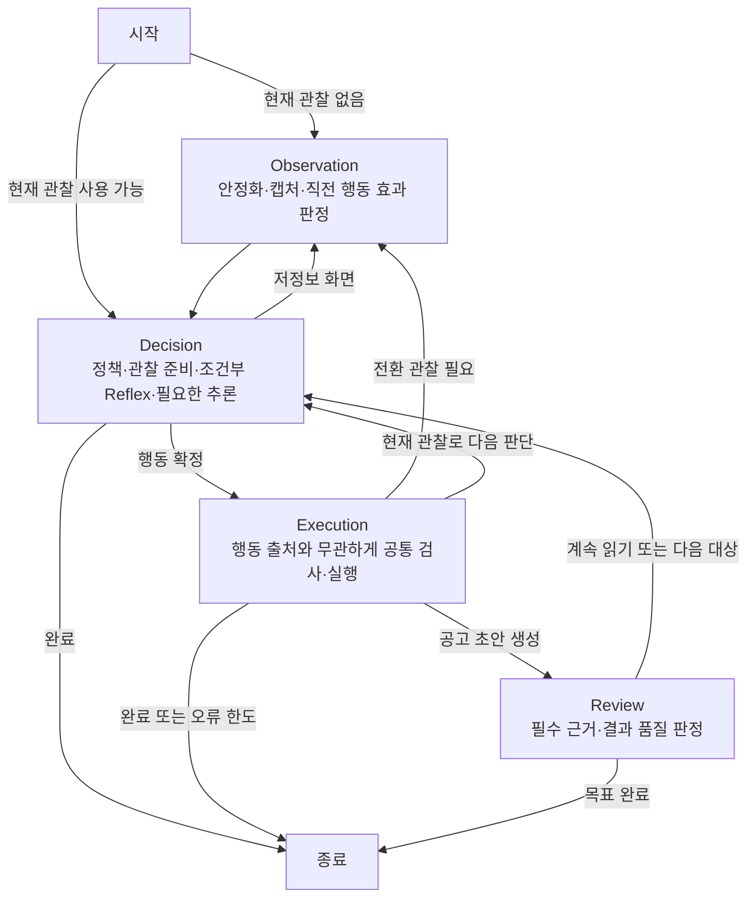
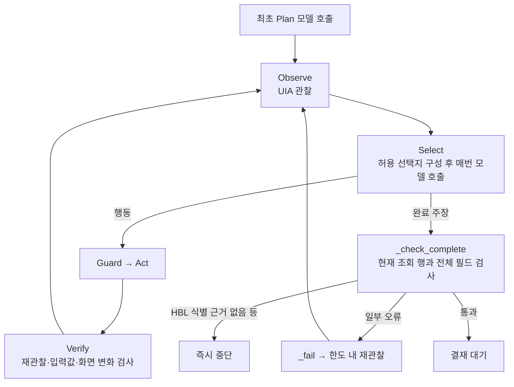
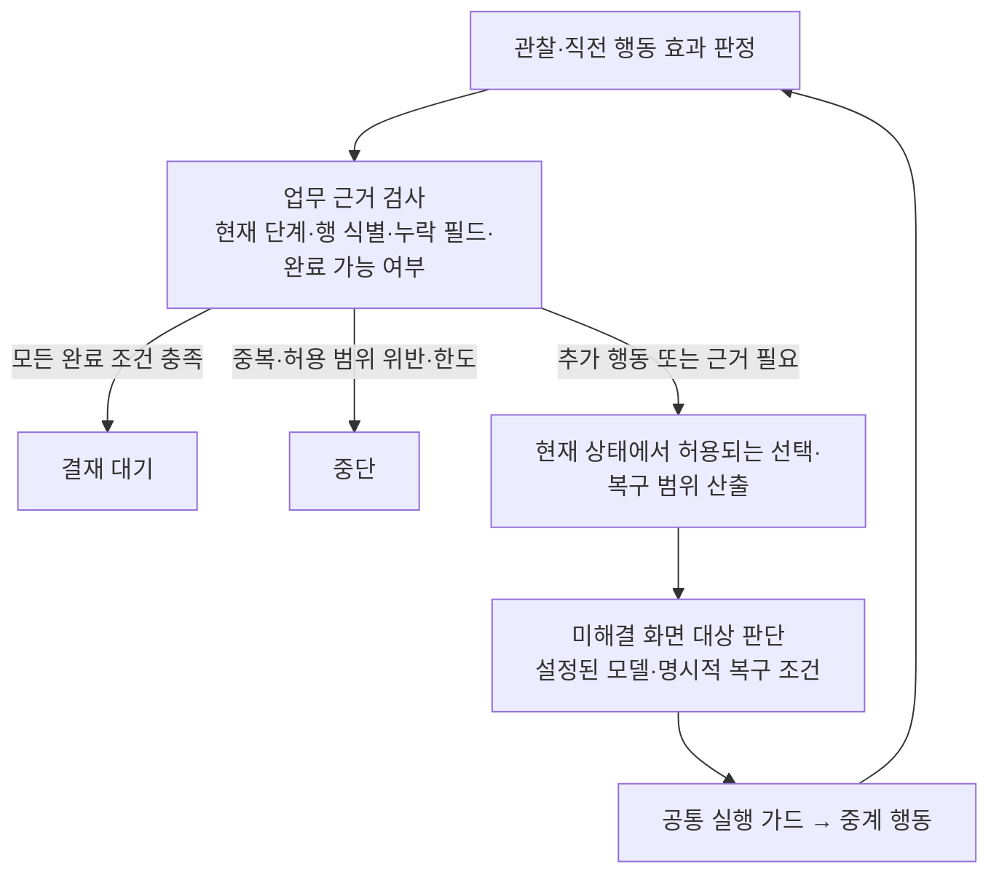

# L2C와 Sawon 그래프 비교

> 이 문서는 M2 적용 전 분석 기록이다. 이후 구현한 구조는 [M2 실행 흐름](code-flow.md)을 참조한다.

2026-09-29, 로컬 L2C HEAD `db144a6`의 실제 활성 코드와 Sawon 현재 코드를 읽기 전용으로
비교했다. L2C 실행·API 호출·GUI 조작·운영 코드 변경은 없다.

**두 구조는 다르다. 앞선 L2C 적용은 선택지 제한, 전이 기록, 반복 탐지의 일부 원칙을
옮긴 것이며 L2C의 전체 그래프나 복구 구조를 이식한 작업은 아니었다.**
당시 계획은 기존 M1 루프를 유지하는 것이었지만, 현재 결과 근거 부족을 다루는 정책과
복구까지 충분히 반영하지 못했다.

## 비교 수준

L2C의 활성 시스템에는 두 LangGraph가 있다.

- 상위 Investigation: 요청 이해·확인 질문 → 필요한 근거 정의·검사 → 계획·수집 →
  저장·근거 재검사 → 답변. 조건부 재계획과 체크포인트 재개가 포함된다.
- 하위 Vision Worker: 화면을 보고 실제 조작과 수집 결과 검토를 수행한다.

Sawon은 고정된 선적 레코드 한 건을 처리하는 M1 작업자다. 이전에 제시한 그래프는
L2C 상위 조사·답변 전체보다 하위 Worker와 비교하는 것이 맞다. 상위 그래프가 없다는
사실 자체가 최근 GUI 오류의 원인이라는 증거는 없다.

조립 근거는 L2C `agent/bootstrap.py:135`, 상위 노드와 분기는
`agent/graph/investigation_workflow.py:49`에 있다. 옛 `classic` 구현을 기준으로 삼지 않았다.

## 실제 Worker 그래프

L2C의 그래프 노드는 정확히 observation / decision / execution / review 네 개다.
Selection, Reflex, OCR, Reasoning은 decision 내부 단계이며 각각 독립 그래프 노드는 아니다.

현재 Sawon의 주요 경로는 다음과 같다. 중복 검사와 오류 분기의 상세는
[전체 흐름](code-flow.md)에 있다.

## 동작에 영향을 주는 차이

| 항목 | L2C 현재 코드 | Sawon 현재 코드 |
| --- | --- | --- |
| 모델의 역할 | 정책·기존 카드 큐·조건부 경험 규칙으로 정하지 못한 판단을 처리 | 선택지를 좁힌 뒤에도 매 선택마다 모델 호출 |
| 관찰과 효과 확인 | 다음 observation에서 직전 효과 판정. 준비된 관찰 재사용 분기 | verify 내부 재관찰 후 observe 노드에서 다시 관찰 |
| 결과 검토 | review가 COMPLETE / NEEDS_MORE / 제외할 대상을 구분하고 다음 결정으로 연결 | 최종 검사가 select 내부 함수. 복구 가능한 누락과 즉시 중단 오류가 나뉨 |
| 모델 복구 | 전이 unknown·반복 경고는 primary부터 사용. 경량 도구 호출 실패는 primary 한 번 시도 | 실행 설정의 단일 모델. 저장 관찰 비교는 별도 실험이며 자동 전환 아님 |
| 상태 소유 | WorkerState의 observation / decision / transition / collection / progress 등 책임별 구역 | 그래프 상태에는 next만 있고 실제 사실·근거·피드백은 Brain 인스턴스에 저장 |
| 경험 재사용 | 설정에 따라 Reflex 활성 레시피 시도, 실행 뒤 별도 승격 경로 | 영속 의미 캐시는 아직 미구현; 브리프 M2 항목 |

L2C의 내부 판단 순서는 고정된 한 줄 파이프라인이 아니다. 현재 관찰 준비 여부, 미해결 큐,
전이 상태, review 후속 필요 여부에 따라 OCR·Reflex를 건너뛰거나 Reasoning으로 바로 간다.
또한 상위 모델 복구는 임의의 업무 오판을 모두 찾아내는 기능이 아니다. 경량 모델 호출과
도구 응답 변환 중 실패를 복구하며, 유효하지만 의미적으로 잘못된 행동은 별도 검증이 필요하다.

L2C의 JobReview와 Critic도 다르다. JobReview는 현재 수집 결과를 검토하고,
Critic은 저장된 실행 경험에서 재사용 경로를 구성·가지치기하는 별도 승격 경로에 있다.
Critic이 모든 클릭을 실시간 승인하는 구조로 설명하면 부정확하다.

## 현재 문제에 필요한 적용

앞서 반영한 `DecisionPolicy`, `ActionTransition`, `NavigationHistory`는 위 구조 중 일부다.
완료 정책에는 workflow 진행 플래그만 있고 최신 결과 행의 근거 범위가 빠져 있다.
따라서 아직 전체 근거가 없는 상태에서 complete를 제시하고, HBL이 화면 밖이면
복구 대신 즉시 끝난다. 이 지점은 영속 캐시 없이도 M1에서 보완할 수 있다.

아래는 **아직 구현하지 않은 적용 방향**이다.

핵심은 함수 이름을 L2C와 같게 바꾸는 것이 아니라, 근거 부족을 완료 후보 생성과
복구 분기까지 연결하고 결과 검사와 행동 선택의 책임을 나누는 것이다.
ERP는 입력할 정답 레코드가 주어지므로 결과 검토를 별도 LLM에 맡길 필요는 없다.
현재 관찰과 레코드를 코드로 엄격히 대조하는 검사는 유지한다.

Reflex·영속 경험 학습은 브리프 M2이고, 사이트별 고정 경로·ROI 좌표 재생·L2C의
업무 DB 조회를 Sawon 두뇌에 옮기지 않는다. 근거 부족 복구와 상태 책임 분리를
M2로 미룰 이유도 없다. 자동 모델 복구를 추가한다면 조건·비용 상한·사용 모델을
명시하고 경량 단독 결과와 섞지 않아야 한다.

## 소스 위치

- L2C `agent/graph/workflow.py:90`: 실제 Worker 노드와 연결.
- L2C `agent/graph/worker_cycle.py:173`, `:188`: 관찰·판단 내부 순서와 조건부 경로.
- L2C `agent/graph/worker_reasoning.py:252`, `:365`: 모델 복구와 최초 tier 선택.
- L2C `agent/graph/worker_review.py:171`: 완료·추가 근거·대상 제외 처리.
- L2C `agent/runtime/worker_contracts.py:668`: 책임 구역별 그래프 상태.
- Sawon `brain/graph/engine.py:546`, `:659`, `:1064`, `:1127`: 정책, 선택, 최종 검사, 그래프.
- Sawon `CODEX_BRIEF.md:418`, `:456`: M1 기본 루프와 M2 의미 캐시 구분.

이 비교는 코드 구조 분석이며 L2C와 Sawon의 실제 성공률·성능 우열을 측정한 결과는 아니다.
