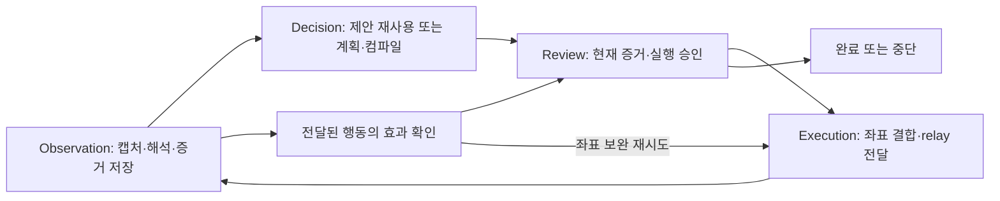

# 성공 파일럿 경로의 잔여 코드 조사

기준: `194000c`의 소스(직전 실제 실행 코드는 `564e27c`로 동일).
대상 실행: `core-pilot-20261008-141420-refactor`, seed19, 회사별 TaskInstruction,
Luna, visual_only, combined matching, OmniParser icon_detect(캡션 비활성), model-only review.
추가 해시 검증에서 기존 가중치가 공식 v2 icon_detect와 동일함을 확인했다. 이전 v1 표기는 정정한다.

요청 범위는 재추적과 삭제 후보 탐색이다. 이번에는 생산 코드·테스트를 수정하거나 삭제하지 않았다.
이전 보고서에서 완료한 설정4개·Procedure 로더 삭제는 신규 후보로 다시 세지 않는다.

## 결론

남은 문제는 호출자가 전혀 없는 큰 모듈보다 **삭제된 기능의 분기와 중복 부작용이 현재 경로에 남은 것**이다.

1. 제거된 pixel rectangle 탐지기를 전제로 한 입력 영역 판별이 남아 있다. 현재 탐지기에서는 표 셀 판별이 작동하지 않는다.
2. 관찰에서 저장한 동일 모델 증거를 배치 검증에서 다시 저장한다. 실제 실행의3개 배치에서 같은 증거12건을 중복 기록했다.
3. Task 전용 화면 매칭 안에 이제 도달하지 않는 구형 업무 단계 분기가 남아 있다.
4. 구형 노드 호출 규약과 단일 capability를 여러 Procedure 후보처럼 다루는 구조는 통합 후보다. 현재 호출되고 있으므로 사장 함수로 분류하지 않는다.

전체 파일 일괄 삭제를 뒷받침하는 근거는 이번 조사에서 확인하지 못했다. 특히 저장 증거, 좌표 재연결,
OCR/GPU 워커, 방법 학습, 현재 기본 설정의 분리 판단·v2 경로는 유지해야 한다.

## 조사 방법과 한계

- 추적 중인 생산 Python83개 파일의 AST에서 함수·필드 참조를 추출했다. core 테스트와 bench의 추적 중인 Python을 합한213개 파일에서 호출·문자열 참조를 교차 확인했다.
- 직접 참조가 없는 함수는 `getattr`, Pydantic validator, HTTP handler/표준 라이브러리 override를 확인했다. 이 예외를 확인하기 전에는 미사용으로 확정하지 않았다.
- 실제 로그414개 이벤트, 설정, 현재 마커 산출물을 대조했다. 함수/라인 실행 커버리지를 새로 수집한 것은 아니므로 이벤트 개수를 함수 호출 횟수로 해석하지 않는다.
- 합성 데이터로 증거 원장 중복 저장과 탐지 출처별 영역 판별을 로컬 재현했다. ERP 실행·유료 호출·네트워크 의존 측정은 하지 않았다.
- 기본 프로필은 `separate_observation_decision=true`, v2 캡션 활성 설정이다. 이번 성공 파일럿의 false/캡션 비활성과 다르므로 미실행 경로 전체를 삭제하지 않는다. 당시 기본 프로필의 가중치 폴더는 존재하지 않아 실제 준비도 별도로 필요했다.

## 실제 실행 순서와 소스 연결

| 순서 | 현재 함수/모듈 | 실행에서 확인한 근거 |
|---|---|---|
| 초기화 | `brain.run.main → Brain.__init__ → _plan_node` | `user_education_loaded`1회. task를 읽고 초기 phase를 task로 설정 |
| 관찰 | `observation_node → _observe/_verify_node → VisualPerception.observe` | 새 OCR/탐지15회, 동일 화면 카탈로그 재사용6회 |
| 화면 해석·행동 제안 | `_detect_visual → match_screen`; 필요하면 `_selection_call → match_screen` | 화면 매핑22회, 기존 해석을 이용한 새 계획6회. 이 숫자는 모델 호출 수와 다름 |
| 현재 증거 저장 | `_observe → _bind_saved_evidence → _remember_model_task_evidence` | 모델 증거 기록10개 이벤트. 후기 상세 기본5개 seq339, 추가6개 seq359 |
| 계획 컴파일 | `_select_node → _selection_call → compile_match/compile_*_plan` | `screen_match_compiled`18회, 로그인 묶음1회, 필드 계획3회 |
| 실행 전 검토 | `review_node → _review_node` | `proposed_execution_review`17회. 허용된 계획에 실행 권한 부여 |
| 실행 | `execution_node → _act_node → _execute_plan → execute_plan` | 요청29회/반환29회. 입력5개·6개는 batch 전달 |
| 현재 좌표 재연결 | `_prepare_actions → _wire_action → VisualPerception.rebind_action` | pHash 같은 배치 재연결3회. 정적 참조 검색만으로는 놓치는 `getattr` 호출 |
| 효과 확인 | `_verify_node → verify_screen_fields` 또는 단일 행동 분기 | 필드 검증3회, 행동 전이29회, 상세 좌표 보완2회 |
| 저장 결과 처리 | `_select_node → _apply_save_review` | seq242 `ready_for_query`. task → save_result → task |
| 완료 및 승격 | `_check_complete → _finish`; `_run` 종료 처리 | seq410 완료 증거 승인, seq411 success. 방법/visual cache 승격 이벤트 각1회 |

네 책임 그래프의 기본 반복은 다음과 같다. 결합 모드에서는 관찰 안에서 모델의 행동 제안도 생성되지만,
실제 실행은 Decision의 컴파일과 Review를 거친다. 효과 확인의 좌표 보완 재시도는 별도 경로다.

## A. 정리 근거가 확인된 후보

### A1. 폐기된 `pixel_rectangle` 전용 알고리즘과 프롬프트

- `brain/visual/markers.py:158`: `nested_rectangle_count`, 함수 본문11줄.
- `brain/visual/markers.py:171`: `grid_cell_marker_ids`, 함수 본문27줄.
- `markers.py:22,95,248`, `action_rebind.py:151`, `refinement.py:18`의 출처 분기.
- `perception.py:59`부터 이어지는 pixel rectangle 전용 모델 지시.
- `matching.py:1036`의 구형 표 셀 탐지 결과 소비.

현재 생산 탐지기의 생성 지점 `detector_worker.py:171`은 `source="omniparser"`만 반환한다.
OCR 병합이 추가하는 출처는 ocr/ocr_group이다. 삭제된 rectangles.py를 대체해
pixel_rectangle을 생성하는 생산 경로는 확인되지 않았고 bench Python 참조도 없다.
이번 실행의 markers.json15개에는 OmniParser205개, OCR295개, pixel_rectangle0개였다.

여기에는 단순 잔재와 동작 결함이 섞여 있다. `nested_rectangle_count`는 현재 마커에 항상0,
`grid_cell_marker_ids`는 항상 빈 집합을 반환한다. 따라서 `enforce_taught_input_surfaces`는
현재 표 셀도 direct_input으로 판정한다. 상자 위치·크기를 동일하게 유지한2×2 합성 재현 결과:

| 사용자 교육 surface | 옛 pixel_rectangle 마커 | 현재 omniparser 마커 |
|---|---|---|
| direct_input | 표 셀이라 거절 | 일반 입력으로 분류하여 허용 |
| table_cell | 허용 | 일반 입력으로 분류하여 거절 |

**조치:** 폐기된 출처별 기하학 알고리즘·프롬프트는 삭제 후보다. 다만 교육의 surface 의미와
그 소비 함수65줄 전체를 함께 삭제하면 사용자 제약도 사라진다. surface 검증은 현재 모델이
연결한 역할·부모 관계에 맞춰 교체하거나 불확실성을 명시하는 별도 결함 수정으로 다룬다.
구형 사각형 탐지기를 되살리는 해결은 피한다.

테스트에도 구형 출처가 남아 있다. `test_methods.py`, `test_screen_matching.py`,
`test_visual_markers.py`의10개 test 함수와 공통 fixture에서 이를 만든다.
특히 grid 입력 허용/거절 테스트는 생산자가 더 이상 만들지 않는 입력으로 통과한다.
공통 OCR·증거·캐시 동작 테스트는 실제 출처로 이관하고, 구형 알고리즘만 검증하는 경우를
따로 폐기해야 한다. 테스트 파일 전체 삭제 근거는 아니다. 과거 실행 산출물은 그대로 보존한다.

### A2. 배치 검증의 동일 증거 재저장

생산 호출 순서는 `engine.py:2153 _observe()` → `engine.py:845` 증거 저장 →
`engine.py:2156 verify_screen_fields()` → `screen_batch.py:199` 같은 proposal 재저장이다.
이 사이에는 새로운 관찰이나 모델 응답이 없다.

| 같은 proposal의 로그 쌍 | 중복 필드 수 |
|---|---:|
| seq77 →79 | 1 |
| seq150 →152 | 5 |
| seq207 →209 | 6 |
| 합계 | **12** |

`EvidenceLedger.record`는 동일 observation/field/descriptor도 새 revision으로 추가하고
기존 claim을 superseded로 바꾼다. 합성 입력을 두 번 기록한 결과도 history2건,
상태 superseded/active, revision1/2였다. 그러므로 로그만 중복된 것이 아니다.

seq223도 같은 관찰의 추가정보6개를 다시 기록했지만, 이때는 seq218의 새 계획 응답이 있다.
같은 관찰·필드 집계상 반복은18건이나, **그중12건만 위 배치 이중 호출로 확정**한다.
seq223까지 무조건 삭제하자는 근거로 사용하지 않는다.

**조치:** 관찰/새 판단 경계에 증거 쓰기 책임을 남기고 배치 검증의 중복 호출3줄을 제거하는 후보.
`verify_screen_fields` 자체와 matched/mismatched 판단은 유지한다. 직접 이 함수를 호출하는
테스트는 생산 순서대로 이미 기록된 상태를 준비해야 한다. 새 화면 또는 수정된 binding의
증거 갱신까지 막는 전역 중복 방지 규칙은 추가하지 않는다.
모델 호출 감소나 초 단위 절감은 측정하지 않았으며 주장하지 않는다.

### A3. Task 전용 매칭에 남은 도달 불가능한 단계 분기

초기화 `engine.py:241–258`은 screen_matching이면 task를 필수로 로딩하고 phase=task로 설정한다.
저장 전달 `engine.py:1970–1973`은 save_result, 저장 결과 처리 `engine.py:2473,2483`은
task_instruction이 있으므로 다시 task가 된다. 유효한 task 정책은 duplicate_clear/found를
허용하지 않는다. 따라서 정상 진입·정책을 통한 screen_matching의 상태 집합은
`{task, save_result}`다. 실제 로그에 기록된 phase도 task36개, save_result1개였다.

| 위치 | 남은 잔재 | 조치 범위 |
|---|---|---|
| `matching.py:1087–1090` | duplicate/final-query capability 추가 | Task 전용 함수의4줄 분기 삭제 후보 |
| `matching.py:1165–1174` | enter 조건에서 verified/record 범위를 다시 계산 | 두 enter 전용 분기 삭제 후보. 전체 notebook의 else는 save_result가 쓰므로 유지 |
| `matching.py:1150` | remaining_inputs를 읽은 직후1157에서 무조건 덮어씀 | 첫 대입1줄 삭제 후보 |
| `matching.py:509–525` | 과거 query_value_verified/anchor 유지 | Task 경로에서 상태가 세워지지 않는 부분 삭제 후보. pending fill 증거 수집은 유지 |
| `engine.py:961–966` | screen_matching이면서 legacy final-query가 준비됐다는 조건 | 동시에 성립하지 않는 legacy_saved_review 조건만 정리 |
| `engine.py:1967–1969` | final_query에서 screen_matching saved session 시작 | 같은 이유로 해당 중첩 분기만 삭제 후보 |
| `engine.py:2177–2180` | save 전달 후 phase가 task인 경우 처리 | 전달 승인 시 이미 save_result로 변경됨. 이 분기만 정리 후보; 저장 효과 사실 기록은 유지 |
| `notebook.py:51` 이후 else | task 없는 구형 notebook 형식 | 모든 생산 remember 호출은 screen_matching 조건 안. 구형 else만 정리 후보 |

이는 non-screen_matching 자체를 폐기하자는 뜻이 아니다. `BrainSettings`는 그 경로를 여전히
공개하고 기본 클래스 값도 screen_matching=false다. engine/context/policy 전체의 duplicate/enter/
final_query 분기는 해당 설정에서 살아 있다. 그 기능을 종료하려면 별도 범위 결정과 회귀 이관이 필요하다.

## B. 사장 코드는 아니지만 통합할 후보

| 후보 | 확인한 사실 | 권장 조치 |
|---|---|---|
| 구형 노드 호출 규약 | `_plan/_observe/_review/_select/_act/_verify_node`의 state 인자6개가 사용되지 않음. 내부에 `{next: select/act/verify}`를 만들고 `_responsibility_route`12줄이 새 노드명으로 변환 | 내부 함수의 빈 인자와 이중 route 규약 통합. 공개 네 책임 노드의 WorkerState 인계·격리 복사는 유지 |
| ProcedureStep 다중 후보 선택 | 생산 생성자는 task_action_contract 하나, 후보 목록도 항상 한 개. screen/checkpoint는 any, requires_verified는 빈 목록 | capability 계약으로 좁히고 상수 검사를 제거할 후보. 사용자 교육 procedure와 기록된 procedure_step 형식은 별개이며 일괄 삭제 금지 |
| 프롬프트의 구형 검토 설명 | `context.py:237` 이후 saved_record_review 지시는 코드가 완료를 결정한다고 설명. 현재 model-only 경로는 최종 모델 completion을 수용 | 모드에 맞는 설명으로 통일할 후보. 이 문구가 이번 추가 탭 왕복의 원인이라는 인과는 아직 미입증 |

파일 분리만으로는 이 중복 계약이 줄지 않는다. 현재 계약을 한 가지로 줄이되 실제 근거 기록,
작업자 상태 인계, relay 전달 후 확인을 없애지 않는 방식이 필요하다.

## C. 삭제 대상에서 제외한 코드

- `VisualPerception.rebind_action`: AST의 직접 속성 호출 목록에는 없지만 engine.py:1790이
  getattr로 조회하여 호출한다. 이번 실행에서도 pHash 경로3회가 기록됐다.
- Pydantic validator, HTTP do_GET/do_POST/log_message, redirect_request: 프레임워크가 호출한다.
- 기본 v2/분리 판단, visual refinement, saved_evidence, action rebind: 현재 설정 또는 복구에 연결되어 있다.
- 방법/visual cache: 이번 콜드 실행의 cache hit 부재는 미사용 코드 증거가 아니다.
- models/gemini 및 replay: factory의 명시적 경로와 테스트 소비자가 있다. 공급자 비교 preset 삭제와 구별한다.
- 문서 추출 pipeline/handoff와 OCR worker: 이번에는 준비된 record를 사용했지만 M2 진입점과 화면 OCR에서 필요하다.
- 데이터 모델의 직접 읽기 없는 필드: expected_effect, updated_at, evidence_source, 가격 확인일,
  OCR 원본 좌표/근거 등은 직렬화·감사 계약이다. 속성 읽기가 없다는 이유로 삭제하지 않는다.
- `prepare_match_plan`의 첫 검증과 마지막 검증: 중간 모델 보완이 새 행동을 만들 수 있으므로
  동일 함수를 두 번 호출한다는 이유만으로 한쪽을 지우지 않는다.

## 다음 적용 순서

1. A2 동일 proposal 증거 이중 쓰기를 제거하고, 기존 회귀 검증에서 생산 순서·revision 수를 확인한다.
2. A3 도달 불가능 분기·덮어쓰는 대입을 정리한다. task/save_result, 저장 거절 후 task 복귀,
   기존 non-screen_matching 지원이 유지되는지 확인한다.
3. A1 구형 픽셀 출처를 제거하면서 교육 surface 검증과 테스트를 실제 탐지 출처로 이관한다.
   원래 제약을 조용히 삭제하지 않고 현재 모델 의미 계약으로 검증 가능하게 만든다.
4. B의 빈 state 인자·옛 route/capability 규약을 좁힌다. 의미 없는 파일 이동은 하지 않는다.

실제 성공 파일럿의 추가 행 클릭·탭 왕복4회는 현재 사용 중인 해석/탐색 경로의 문제다.
위 잔재 정리만으로 그 행동이 사라진다고 단정하지 않는다. 시간의 큰 부분인 Luna25회/134.58초를
줄이려면 해당 판단 순서와 증거 사용을 별도로 비교해야 한다.

검증 범위: 합성 재현과 정적 참조 조사. Ruff check/format(155files)는 통과했다.
전체 pytest·coverage·유료 화면 재실행은 수행하지 않았다.
이번 보고서는 소스 변경의 검증 결과나 마일스톤 완료 선언이 아니다.
