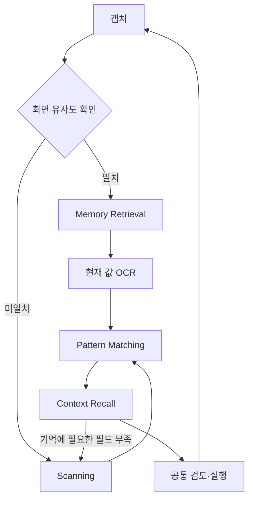

# 화면 처리 단계와 코드 대응

기준일: 2026-10-21

화면 유사도 확인 → Scanning 또는 Memory Retrieval → 공통 Pattern Matching과 Context Recall
순서로 처리한다. 각 화면에서 새로 경로를 고르며, 실행 전체가 콜드에서 웜으로 바뀌는 스위치는 아니다.

## 책임과 진입점

| 책임 | 의미 | 현재 코드 |
|---|---|---|
| 화면 유사도 | 같은 업무의 기억과 viewport·pHash 비교 | `ScreenScanner.scan`, `screen_similarity_distance` |
| Scanning | 현재 캡처에서 OCR·OmniParser로 필드 발견 | `brain/visual/scanning.py`: `_build_catalog` |
| Memory Retrieval | 가까운 화면의 필드 이름·기하 인출, 현재 값은 OCR로 확보 | `brain/graph/memory_retrieval.py`: `recall_screen` |
| Pattern Matching | 현재 업무 진행과 행동 패턴 결합, 화면 캐시 조회 | `MemoryRetrieval.match_pattern`, `ScreenPatternCache.lookup` |
| Context Recall | 현재 관찰·교육·입력·메모와 인출된 계획을 결합, 필요하면 모델 판단 | `brain/graph/context_recall.py`: `recall_context`, `select_context_response` |
| Memory Compilation | 성공 기록에서 재사용할 행동과 관찰 필드 정제 | `read_memory_candidates`, `assemble_memory`, `compile_memory` |

## 실행 계약

1. 캡처 직후 유사도를 확인한다. 기존 `methods.max_phash_distance`와 viewport 조건을
   행동 결합과 공통으로 사용하며, 새 임계값은 만들지 않는다.
2. 같은 교육 digest·목표에서 가까운 기억을 찾으면 필드 기하를 인출한다. 이때 행동을
   선택하거나 pending·used·verified를 갱신하지 않는다. 같은 거리의 그룹은 bbox·role로 합친다.
3. 기억 경로는 OmniParser를 생략하고 현재 OCR 값을 읽는다. 탐색 경로는 OCR과 OmniParser를
   수행한다. byte-identical catalog의 기존 재사용은 두 연산을 모두 생략할 수 있다.
4. 두 경로는 같은 `_resolve` → `recall_context`로 들어간다. 그 안에서 행동 패턴, 화면 캐시,
   현재 해석과 모델 계획을 기존 우선순위로 선택한다. Context Recall은 모델 호출과 동의어가 아니다.
5. 기억에 필요한 필드가 없어 `needs_refinement`가 나오면 같은 캡처와 OCR을 재사용해 전체
   탐지로 전환한다. 이후 기존 보완 탐지·모델 판단·검토·실행을 공유한다.

LangGraph의 Observation·Decision·Review·Execution 노드는 유지한다. 관찰 내부의 분기와
공통 문맥 조립을 바꾼 것이며 네 이름의 새로운 상태 기계나 독립 그래프를 추가한 것은 아니다.

## 기억과 현재 값

`MethodActionGroup.observed_fields`와 `field_sources`는 행동 대상 외의 읽기 전용 필드를
포함해 의미·좌표·업무 key를 보존한다. 원래 값은 저장하지 않는다. 인출된 필드는 현재 프레임에서
새 임시 ID를 받으며, 모델에는 이름·bbox·현재 OCR 값을 담은 `remembered_fields`로 전달한다.
현재 OCR에서 업무 값과 일치한 필드만 기존 메모 갱신 경로로 들어간다.

옛 기억은 빈 필드 기본값으로 읽으며 기존 행동 좌표를 사용할 수 있다. 추가 관찰 필드가 필요하면
성공 기록을 재편찬해야 한다. 편찬은 여전히 행동이 전달된 후보를 선택하므로, 행동 없는 모든
프레임까지 새 기억 그룹으로 보존하는 변경은 포함하지 않는다.

## 로그와 저장 형식

- `screen_similarity`: 거리, 후보 그룹, 선택 경로를 기록한다.
- `local_visual_detection`: `route`, `detector_skipped`와 기존 시간을 기록한다.
- `screen_pattern_selection`: 메서드·화면 캐시·grounded plan·모델 중 선택한 원천을 기록한다.
- `screen_memory_fallback`: 기억에서 탐지로 돌아간 원인을 기록한다.
- `methods`, `visual_match_cache`, `method_id`, `warm_compiled`, 모델 purpose와 기존 계측 식별자는
  유지한다. bench의 cold/warm은 실험 조건이며 Scanning/Memory Retrieval과 같은 값이 아니다.
- 공용 모델 응답 필드와 어휘 fixture는 유지한다. 추가 기억 필드는 내부 저장 계약이다.
- CLI: `python -m brain.demo_learning.memory_compilation`.

## 검증

합성 테스트로 유사도→관찰→공통 판단 순서, 탐지 생략, 탐색 폴백에서 캡처/OCR 재사용,
읽기 전용 필드의 편찬·현재 값 증거 연결, 재관찰 후 모델 없는 행동 전달을 확인한다.
이 결과는 실제 ERP 성공이나 유료 모델 성능 측정이 아니다.
