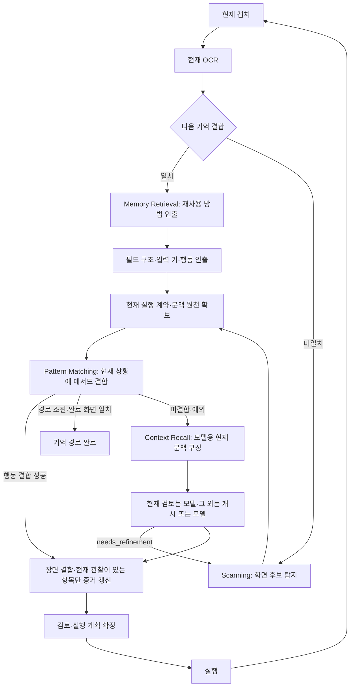

# 화면 처리 개념과 실행 순서

기준일: 2026-11-08

이 문서는 현재 구현의 용어와 코드 대응을 정의한다. [업무 완수와 경험 재사용 계획](development-plan.md)은
현재 기반을 여섯 책임으로 구분해 첫 실제 앱 업무 완수·새 자료 재사용·정제 비교를 진행한다.
책임 구분은 새 모듈·상태·실행 루프를 추가하라는 뜻이 아니며, 미완성 연결을 완료된 것으로 보지 않는다.

Memory Retrieval은 **과거에 배운 업무 방법**을 가져온다. Context Recall은 **이번 실행의
메모와 이력을 모델 문맥으로 구성**한다. 파일에서 중단 상태를 복원하는 기능을 뜻하지 않는다.
기억을 찾은 경우와 새로 탐지한 경우 모두 현재 실행 상태와 화면에 맞춰 다음 행동을 정한다.

## 업무와 기억의 용어

| 용어 | 의미와 경계 | 현재 코드와의 관계 |
|---|---|---|
| 업무 매뉴얼·교육 | 사용자가 알려준 목적·절차·완료 조건. 모델 가중치 학습을 뜻하지 않음 | `TaskInstruction` |
| 업무 탐색 | 교육·현재 관찰·누적 메모로 자료를 찾고 해석하며 다음 행동을 선택해 목적을 달성하는 과정 | 현재 화면 판단·공통 실행을 재사용. 새 정보의 후속 입력과 실제 GUI 업무 완수는 계획 대상 |
| 화면 관찰 | 현재 캡처·OCR·조작 후보와 읽은 내용. `Observation` 책임 노드 전체와 구분 | relay, `ScreenScanner`, 화면 판단 |
| 화면 탐지(Scanning) | OCR와 OmniParser로 텍스트·후보 영역을 찾는 처리. 자료 찾기나 업무 전체의 탐색과 구분 | `ScreenScanner._build_catalog` |
| 업무 정보 | 이번 건에서 주어지거나 화면에서 읽은 값과 출처. 모든 정보가 필수 입력이거나 확인된 정답인 것은 아님 | 사전 입력은 `TaskInputRecord`/`values`; 새 정보의 후속 입력 연결은 개발 계획 대상 |
| 화면 기억 | 특정 화면 경로의 필드·컨트롤·관찰·전달 이력 | `ProgressState.screen_nodes`; 앱·문서 식별 확장은 계획 대상 |
| 업무 메모 | 이번 실행의 정보·행동 이력·진행 상황을 함께 부르는 표현. 별도 새 클래스나 저장소 이름이 아님 | 화면 기억, 진행 상태, `task-notebook.json` |
| 재사용 방법 | 성공 기록에서 남긴 처리 순서·필드 연결·정보를 얻는 방법. 사용자 교육과 이번 값은 별개 | `LearnedMethod`는 현재 화면·행동·입력 키 연결을 저장; 새 정보의 후속 활용은 계획 대상 |
| 편찬(Memory Compilation) | 성공 기록에서 재사용 방법을 만드는 전체 작업. 코드 생성·모델 학습을 뜻하지 않음 | `assemble_memory`, `compile_memory` |
| 경험 정제 | 모델이 행동의 기여·의존관계를 보고 유지·제거와 의미 교정을 선택 | `memory_assembly_prompt`, `MemoryAssembly` 응답 |
| 재사용 형식 변환 | 선택된 실제 기록을 인출 가능한 방법 구조로 구성·검증 | `compile_memory`; 정제 없는 기준선은 구현 예정 |
| 기억 인출(Memory Retrieval) | 배운 방법을 현재 업무·부분업무에 적용해 수행. 이번 건의 값을 과거 기록에서 복원하지 않음 | `MemoryRetrieval`; 실제 앱의 새 자료 재사용은 계획의 검증 대상 |
| 문맥 구성(Context Recall) | 현재 상태에서 모델에게 줄 업무 메모·이력을 조립. 검색·행동 선택·프로세스 재개와 구분 | `context_recall.recall_context` |

수집 정보, 실행 입력, 완료 조건은 서로 연결되지만 같은 목록이 아니다. 이 용어 구분은
현재 저장소를 복제하거나 새 상태 클래스를 추가하라는 뜻이 아니다.

계획·시연에서는 **첫 수행**, **원본 방법 재사용**, **정제 방법 재사용**을 구분한다.
콜드/웜은 기억·캐시 등 실험 초기 조건이며, 매 화면의 탐지·인출 경로와 같은 말이 아니다.
방법 재사용 중에도 새 문서나 조회 결과를 읽는 판단이 필요할 수 있다. 이 계획에서 그런 호출은
정상 정보 획득이며 예외 복구와 구분한다. 현재 인출 경로가 이를 이미 지원한다는 뜻은 아니다.
재사용 방법과 `visual_match_cache`의 화면 행동 응답 캐시도 효과를 따로 기록한다.

검증 범위는 **Mock ERP 검증**(자체 합성 앱), **실제 앱 검증**(독립적으로 만들어진 기존 앱),
**현장 검증**(실제 회사의 업무·환경)으로 표시한다. ‘실제 ERP’라는 표현만으로 범위를 대신하지 않는다.
시연 영상은 검증 과정을 보여주는 자료이며 결과 대조·실행 기록을 대신하지 않는다.

## 책임과 데이터

| 단계 | 질문 | 입력 → 출력 | 코드 |
|---|---|---|---|
| 화면 유사도·기억 결합 | 배운 다음 행동을 현재 화면에 연결할 수 있는가? | 캡처·현재 OCR·업무 식별 → 다음 기억 또는 미일치 | `ScreenScanner.scan`, `MemoryRetrieval._matching_route`, `MethodLibrary.bind_with_context` |
| Memory Retrieval | 이 업무를 어떻게 처리했는가? | 일치한 기억 → 필드 이름·bbox·입력 key·행동 좌표·저장한 절차 | `MemoryRetrieval.retrieve_screen_memory`, `_restore_structure` |
| 화면 탐지(Scanning) | 현재 어떤 텍스트·조작 후보가 있는가? | 캡처 → OCR 텍스트·OmniParser 후보 영역 | `ScreenScanner._build_catalog` |
| 문맥 구성(Context Recall) | 이번 실행은 어디까지 왔는가? | 현재 상태 → 메모·이력·완료/미완료 입력·진행 중 행동·교육 위치 | `context_recall.recall_context` |
| Pattern Matching | 배운 방법을 지금 적용할 수 있는가? | 현재 화면·진행 상태 → 결합된 메서드 또는 화면 캐시 | `screen_decision.match_screen_pattern` |
| 화면 판단 | 다음에 무엇을 할 것인가? | 위 결과 → 실행 계획 또는 탐색 요청 | `screen_decision.decide_screen`, `select_screen_response` |
| 경험 정제 | 성공 경험에서 무엇을 재사용할 것인가? | 성공 실행 기록·후속 관찰 → 모델의 유지·제거·의미 교정 선택 | `memory_assembly_prompt`, `assemble_memory`의 모델 호출 |
| 재사용 형식 변환 | 선택한 기록을 어떻게 저장할 것인가? | 선택안·실제 기록 → 절차·필드 대응·좌표·검토 대상을 담은 방법 | `compile_memory` |

Context Recall에는 모델 호출·행동 선택·상태 변경이 없다. 모델 호출과 응답 검증·복구는
`screen_decision.py`가 소유한다. 편찬물은 입력 키와 실행 방법을 보관하고, 실제 입력 문자열은
이번 실행의 `request.values`에서 가져온다. 과거에 확인한 값은 현재 화면의 관찰값이 아니다.

## 화면 처리 그래프

`ScreenScanner.scan` → `_resolve` → `Brain._detect_visual` → `decide_screen` 순서다.
`decide_screen`은 `build_decision_prompt`에서 실행 계약과 문맥 원천을 확보한 다음
`select_screen_response`는 먼저 `match_screen_pattern`으로 기존 경로를 찾는다.
정상 기억 경로에는 탐색의 미확인 입력·상세 진입·모델 완료 검토 조건을 적용하지 않는다.
미결합이나 실행 실패 때 `DecisionPromptContext.state`가 `recall_context`를 한 번 호출하고
기존 `ScreenMatch`로 현재 관찰과 다음 행동을 얻는다. 실행 실패 메서드는 모델 복구를 수용하기
전까지 화면 캐시로 우회하지 않는다. 화면 투영·메서드 문맥은 결합 전 시점으로 유지한다.
두 경로 모두 `ground_meanings` → `bind_scene` →
`_remember_model_task_evidence`로 이어진다.

새 `ScreenScanner.scan()`은 캡처가 같아도 OCR을 수행한다. 유사한 화면의 기억이나 catalog가
있으면 탐지 영역을 재사용하지만 현재 문자열은 다시 읽는다. 같은 관찰을 다시 판단하는
`rematch()`와 보완 탐지는 이미 읽은 OCR을 사용한다. 어느 경우에도 현재 문맥 구성과
패턴 매칭을 거쳐 다음 행동을 정한다. 판단을 Decision 노드까지 미루던 이전의 별도 경로는 제거했다.

## 기억과 탐색의 연결 계약

- 일반 그룹 유사도는 기존 viewport·`methods.max_phash_distance` 조건을 사용한다. 같은 교육 digest·
  목표의 메서드에서 다음 진입 화면을 비교하고, 선택한 메서드는 실행 중 유지한다.
  기억 인출과 행동 결합은 같은 함수로 남은 첫 그룹만 선택한다. 편찬 trace 순서를 교육 순서로
  재정렬하지 않으며, 경로가 소진되면 완료 기억을 선택한다. 다른 그룹의 관찰을 합치지 않는다.
  선택한 그룹 내부의 기하 중복은 같은 role·공용 영역 판정으로 합치며 bbox 완전일치를 요구하지 않는다.
- 활성 메서드의 다음 저장 결과 그룹은 현재 OCR 메시지와 행동 대상의 실제 앵커·상대 기하로
  결합한다. 인출과 Pattern Matching은 같은 현재 결합 결과를 사용한다. 전체 이미지의 업무 값
  글자 차이로 재판단하지 않으며, 대상 결합 실패는 기존 모델 경로로 보낸다.
- `retrieve_screen_memory`는 이름·bbox·role뿐 아니라 현재 슬롯에 연결한 `source`와
  `procedure`를 반환한다. 행동 후보가 선택되지 않아도 이 정보는 모델에 전달된다.
  인출만으로 `pending`, `used`나 현재 관찰을 갱신하지 않는다.
- `group_input_sources`를 기억 인출과 입력 키 연결이 함께 사용한다. `_restore_structure`가
  만든 필드에는 `value`가 없으며 과거 `observed_step_results`도 현재 응답으로 복원하지 않는다.
  화면 캐시도 같은 방식으로 과거 값을 제거하고 `act` 행동 계획만 재사용한다. 현재 실행에서 확인한 메모는
  `screen_tree`의 이력으로 보존하고, 새 관찰 ID·순번의 확인값을 만들어내는 데 쓰지 않는다.
- 다음 메서드의 `act`가 결합되면 입력 후에도 저장된 행동을 모델 없이 이어간다. 입력 문자열은
  현재 업무 값에서 가져온다. 미관찰 입력의 확인은 유예하고 relay 전달 진도만 반영한다.
  조회 입력 확인 대기와 상세 진입 대기도 정상 메서드 행동을 막지 않는다. 메서드 미결합은
  기존 화면 모델이 현재 관찰과 다음 행동을 함께 판단한다.
  미결합·실행 검증 실패도 모델 복구 사유다. 입력 후 화면 캐시로 현재 검토를 대체하지 않는다.
- `completion_receipt`는 이번 실행의 활성 경로가 소진되고 현재 완료 화면이 일치하는지
  기존 경로 선택 함수로 확인한다. 이를 `method_route_complete`로 기록하고 정상 종료한다.
  필드별 값을 모델이 확인했다는 뜻은 아니며 과거 관찰값·교육 완료를 복원하지 않는다.
  탐색·복구 모델은 누적 관찰과 사용자 완료조건으로 완료를 선택한다. 완료 응답은 현재 근거를
  연결해 검토하며 별도 저장 상세 플래그나 필드 개수 게이트는 없다.
- 경로 진행은 원본 전달·검토된 같은 행동의 대체·현재 모델 복구 응답으로 확인한 연속 선두
  그룹의 재개 이력으로 결정한다. 과거 기억의 완료 결과나 전역 교육 완료 집합은 실행 자격이 아니다.
  `resumed_group_ids`는 `method_route_resumed`에 기록하고 `used`에 가짜 전달을 추가하지 않는다.
- 모델의 `ScreenMapping.needs_refinement`가 `ScreenPlan`/`ScreenMatch`를 지나
  `SemanticDetection`까지 전달된다. 기억에 필요한 보이는 컨트롤이 없으면 같은 캡처·OCR로
  OmniParser를 실행하고 다시 공통 문맥·패턴·판단 경로로 들어간다. 빈 행동 보완 호출로 바꾸지 않는다.
- 화면 밖 컨트롤은 탐색 요청 신호로 대신 처리하지 않고 기존 이동·스크롤 행동으로 찾는다.
  재탐지 이후에는 기존 보완 탐지의 종료 조건을 사용한다.
- 화면 변화는 ORB 관찰 사실로 전달한다. 반복·순환 분류나 별도 좌표 보완 모델이 현재 계획을
  다시 선택하지 않는다. 확인된 입력과 확인 대기는 노드별 관찰·전달 순번에서 조회한다.
- 새 편찬물은 `field_values`를 저장하지 않는다. 구형 산출물의 해당 키는 로더에서 버리며 파일
  자체를 수정하지 않는다. 구조 매핑의 누락된 값을 OCR이나 입력 요구값으로 채우지 않는다.
  누락된 필드 구조·입력 대응은 재편찬 또는 현재 모델 판단으로 확보한다. 콜드/웜은 bench의
  실험 조건이며 화면마다 선택하는 경로와 다르다.

## LangGraph와의 관계

위 단계는 화면 처리 내부의 실제 함수 순서다. 외부 LangGraph는 네 책임 노드를 유지하며 보통
`Observation → Review → Decision → Review → Execution → Observation`으로 진행한다.
현재 `screen_matching=true`에서는 화면 해석과 다음 계획을 한 번에 얻으므로 화면 판단까지
Observation 내부에서 실행한다. Decision 노드는 그 계획을 실행 계약으로 확정하고, 필요할 때
공통 화면 판단 경로로 재진입한다. 따라서 두 그래프를 같은 단계 이름으로 혼동하지 않는다.
실행 후 Observation은 전달 효과 검증도 수행하며 완료·중단은 `lifecycle.route`에 따른다.

## 검증과 저장 형식

합성 테스트는 실제 파서·문맥·패턴·판단 함수를 연결해 순서를 확인한다. 기억이 있어도 행동
후보가 없는 경우의 입력 대응 전달, 모델 응답에 의한 탐색 복귀, 동일 캡처의 문맥 재평가를
검증한다. 이 검증은 실제 ERP·유료 모델 성공률 측정이 아니다.

기존 `screen_similarity`, `screen_pattern_selection`, `screen_memory_fallback`,
`methods`, `visual_match_cache`, `warm_compiled`, 모델 purpose는 유지한다.
모델 응답 스키마에 추가된 `needs_refinement`는 두 스키마 fixture에 반영한다.
기억 편찬 CLI는 `python -m brain.demo_learning.memory_compilation`이다.
