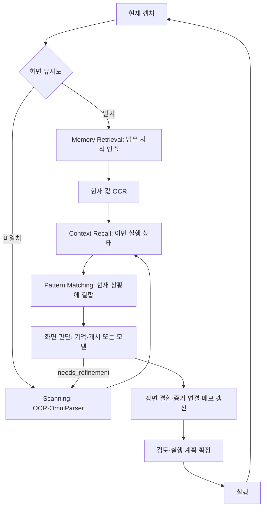

# 화면 처리 개념과 실행 순서

기준일: 2026-10-21

Memory Retrieval은 **과거에 배운 업무 방법**을 가져온다. Context Recall은 **이번 실행의
현재 상황**을 복원한다. 두 역할은 서로를 대체하지 않는다. 기억을 찾은 경우와 새로 탐색한
경우 모두 현재 상황을 확인하고, 현재 화면에 맞는 패턴을 연결한 뒤 다음 행동을 정한다.

## 책임과 데이터

| 단계 | 질문 | 입력 → 출력 | 코드 |
|---|---|---|---|
| 화면 유사도 | 이 화면을 경험했는가? | 현재 캡처·업무 식별 → 가까운 기억 또는 미일치 | `ScreenScanner.scan`, `screen_similarity_distance` |
| Memory Retrieval | 이 업무를 어떻게 처리했는가? | 일치한 기억 → 필드 이름·bbox·입력 key·학습한 절차 | `MemoryRetrieval.retrieve_screen_memory` |
| Scanning | 현재 무엇이 보이는가? | 캡처 → OCR 텍스트·OmniParser 후보 영역 | `ScreenScanner._build_catalog` |
| Context Recall | 이번 실행은 어디까지 왔는가? | 현재 상태 → 메모·이력·완료/미완료 입력·진행 중 행동·교육 위치 | `context_recall.recall_context` |
| Pattern Matching | 배운 방법을 지금 적용할 수 있는가? | 현재 화면·진행 상태 → 결합된 메서드 또는 화면 캐시 | `screen_decision.match_screen_pattern` |
| 화면 판단 | 다음에 무엇을 할 것인가? | 위 결과 → 실행 계획 또는 탐색 요청 | `screen_decision.decide_screen`, `select_screen_response` |
| Memory Compilation | 성공 경험에서 무엇을 재사용할 것인가? | 성공 실행 기록 → 절차·필드 대응·좌표를 담은 기억 | `compile_memory` |

Context Recall에는 모델 호출·행동 선택·상태 변경이 없다. 모델 호출과 응답 검증·복구는
`screen_decision.py`가 소유한다. 기억의 이전 업무 값은 현재 입력 완료의 증거로 사용하지 않는다.

## 화면 처리 그래프

`ScreenScanner.scan` → `_resolve` → `Brain._detect_visual` → `decide_screen` 순서다.
`decide_screen`은 `build_decision_prompt`에서 `recall_context`를 호출한 다음
`select_screen_response` → `match_screen_pattern`으로 기존 계획을 찾는다. 사용할 계획이
없으면 모델 판단을 요청한다. 두 경로 모두 `ground_meanings` → `bind_scene` →
`_remember_model_task_evidence`로 이어진다.

바이트 단위로 동일한 캡처는 OCR·탐지를 생략하지만 `_resolve` 이후 공통 순서는 생략하지
않는다. 저장된 화면 해석만 재사용하고 현재 진행 상태로 다음 행동을 다시 정한다. 판단을
Decision 노드까지 미루던 이전의 별도 경로는 제거했다.

## 기억과 탐색의 연결 계약

- 유사도는 기존 viewport·`methods.max_phash_distance` 조건을 사용한다. 같은 교육 digest·
  목표의 기억만 검색한다. 같은 거리의 그룹은 같은 role·겹치는 영역으로 합치며 그룹 출처를 남긴다.
  bbox 완전일치를 요구하지 않고, 기억 인출·좌표 결합·장면 보충이 기존 장면 중복 기준을 공유한다.
- `retrieve_screen_memory`는 이름·bbox·role뿐 아니라 현재 슬롯에 연결한 `source`와
  `procedure`를 반환한다. 행동 후보가 선택되지 않아도 이 정보는 모델에 전달된다.
  인출만으로 `pending`, `used`, `verified`를 갱신하지 않는다.
- `group_input_sources`를 기억 인출과 현재 값 증거 연결이 함께 사용한다. 현재 OCR 값과 입력값의
  비교는 기존 `bind_visible_value_evidence` 경로를 사용한다. 기억에 있는 절차는 실행 완료 이력이 아니다.
- 모델의 `ScreenMapping.needs_refinement`가 `ScreenPlan`/`ScreenMatch`를 지나
  `SemanticDetection`까지 전달된다. 기억에 필요한 보이는 컨트롤이 없으면 같은 캡처·OCR로
  OmniParser를 실행하고 다시 공통 문맥·패턴·판단 경로로 들어간다. 빈 행동 보완 호출로 바꾸지 않는다.
- 화면 밖 컨트롤은 탐색 요청 신호로 대신 처리하지 않고 기존 이동·스크롤 행동으로 찾는다.
  재탐지 이후에는 기존 보완 탐지의 종료 조건을 사용한다.
- 예전 기억은 빈 관찰 필드 기본값으로 읽는다. 저장되지 않은 추가 필드·입력 대응은 성공 기록을
  재편찬해야 확보할 수 있다. 콜드/웜은 bench의 실험 조건이며 화면마다 선택하는 경로와 다르다.

## LangGraph와의 관계

위 단계는 화면 처리 내부의 실제 함수 순서다. 외부 LangGraph는 네 책임 노드를 유지하며 보통
`Observation → Review → Decision → Review → Execution → Observation`으로 진행한다.
현재 `screen_matching=true`에서는 화면 해석과 다음 계획을 한 번에 얻으므로 화면 판단까지
Observation 내부에서 실행한다. Decision 노드는 그 계획을 실행 계약으로 확정하고, 필요할 때
공통 화면 판단 경로로 재진입한다. 따라서 두 그래프를 같은 단계 이름으로 혼동하지 않는다.
실행 후 Observation은 전달 효과 검증도 수행하며 완료·중단은 `lifecycle.route`에 따른다.

## 검증과 저장 형식

합성 테스트는 실제 파서·문맥·패턴·판단 함수를 연결해 순서를 확인한다. 기억이 있어도 행동
후보가 없는 경우의 입력 대응 전달, 모델 응답에 의한 탐색 복귀, 동일 캡처의 문맥 재평가를
검증한다. 이 검증은 실제 ERP·유료 모델 성공률 측정이 아니다.

기존 `screen_similarity`, `screen_pattern_selection`, `screen_memory_fallback`,
`methods`, `visual_match_cache`, `warm_compiled`, 모델 purpose는 유지한다.
모델 응답 스키마에 추가된 `needs_refinement`는 두 스키마 fixture에 반영한다.
기억 편찬 CLI는 `python -m brain.demo_learning.memory_compilation`이다.
